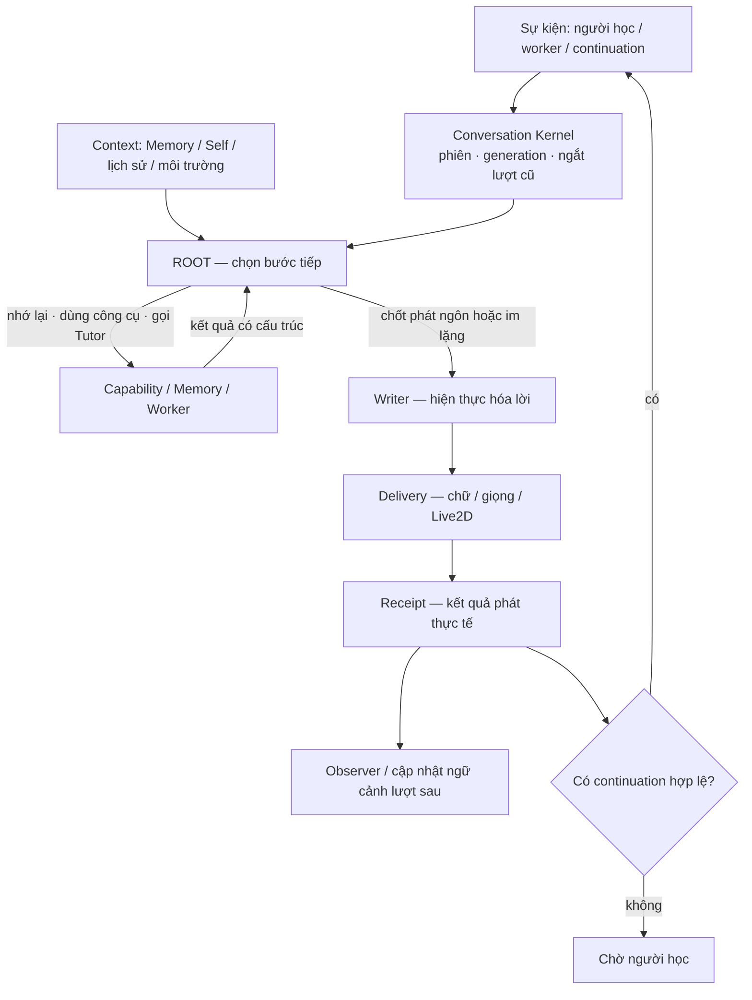
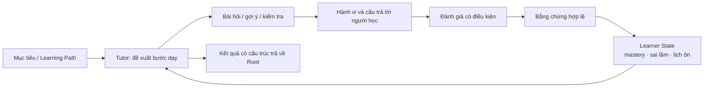

# ERIS — KỊCH BẢN THUYẾT TRÌNH Ý TƯỞNG (bản hợp nhất)

> **Bản biên tập nội dung để dựng PowerPoint — mục tiêu ~5 phút.**
> Tập trung vào **AI gia sư đồng hành**, cho thấy Agent Loop có chiều sâu thật. **Không phải tài liệu nghiệm thu**: phân biệt rõ cái đã có trong source với cái còn là mục tiêu.
>
> **Quy ước:** `HIỆN TRÊN SLIDE` = ít chữ để chiếu · `LỜI NÓI` = kịch bản người nói · `DỰNG HÌNH` = bố cục PowerPoint · `LƯU Ý` = không đọc trên sân khấu.
>
> **Nguyên tắc nền:** gáy được mà vẫn không nói dối. Dám tuyên ngôn ở hook/chốt, nhưng mọi khẳng định kỹ thuật giữ đúng ranh giới ở Phụ lục A. Khẳng định tuyệt đối không dùng: xem cuối Phụ lục A.
>
> Khẳng định kỹ thuật đối chiếu `DIEU-TRA-LOOP-EVIDENCE.md`. Số thị trường từ `TAC-DONG-BANG-CHUNG.md`. Sơ đồ có sẵn trong `hinh/`.

## Mạch kể

**Đặt cược vào gì khi model luôn đổi → vấn đề người học → triết lý bằng chứng → kiến trúc Agent hai vòng → phóng to Tutor → tính đáng tin → một cảnh đồng hành → khả thi (có vết sẹo thật) → đo tác động → tuyên ngôn.**

| Slide | Vai trò | Mục tiêu giây | Tiêu chí chính |
|---|---|---:|---|
| 1 | Đặt cược vào gì khi model đổi liên tục | 25 | Trình bày · Sáng tạo |
| 2 | Có AI để hỏi ≠ có người đồng hành để học | 30 | Giải quyết vấn đề |
| 3 | Triết lý: tin bằng chứng, không tin lời khẳng định | 27 | Sáng tạo |
| 4 | Toàn cảnh: Agent Loop + vòng hội thoại tiếp diễn | 40 | Khả thi · Công nghệ |
| 5 | Phóng to Learning Loop bên trong Tutor | 38 | Sáng tạo · Công nghệ |
| 6 | Ai quan sát, ai đề xuất, ai được ghi nhận? | 34 | Khả thi · Công nghệ |
| 7 | Một cảnh đồng hành, không chỉ trả lời | 35 | Sáng tạo · Tác động |
| 8 | Khả thi: đã có gì, còn nối gì (có một vết sẹo thật) | 34 | Khả thi |
| 9 | Tác động: đo đúng điều quan trọng + vì sao đáng cược | 26 | Tác động |
| 10 | Tuyên ngôn | 15 | Trình bày |
| **Tổng** | | **~300** | |

*Mốc là phân bổ dự kiến, chưa bấm giờ đọc thật. Có demo 10 giây thì cắt tương đương từ lời nói.*

---

## SLIDE 1 — MỞ MÀN: KHI MODEL NGÀY MAI MẠNH HƠN

### HIỆN TRÊN SLIDE
**ERIS — GIA SƯ AI ĐỒNG HÀNH**
> **Một AI trả lời được hàng nghìn câu hỏi. Nhưng nó có đồng hành được qua hàng nghìn buổi học không?**

### LỜI NÓI
> Kính chào ban giám khảo. Chúng ta đang trong một cuộc đua công nghệ, nơi lợi thế hôm nay là tính năng mặc định của ngày mai.
> [...]
> Một mô hình mạnh hơn sẽ xuất hiện. Một API rẻ hơn sẽ ra đời. Thứ hôm nay ta tự hào, ngày mai chỉ còn là một lời gọi hàm.
> [...]
> Nên chúng em không đặt cược vào việc sở hữu model thông minh nhất. Chúng em chọn một bài toán khó hơn: một AI có thể đồng hành cùng một con người qua hàng nghìn buổi học — nhận ra chỗ họ đang vướng, và biết khi nào cần kiểm tra lại. Đó là Eris.

### DỰNG HÌNH
- Nền sáng, chân dung Eris một bên, câu hỏi lớn bên kia. Một hiệu ứng nhấn vào **"hàng nghìn buổi học"**.
- Có demo giọng/Live2D: mở bằng nhân vật chào ngắn, trước mọi thứ. Không khoe hệ thống nội bộ ở slide đầu.

### LƯU Ý
Hook này gáy vào BÀI TOÁN mình dám giải, không hạ thấp sản phẩm người khác. Tham vọng nằm ở độ khó của bài toán, không nằm ở việc gọi đồ của người khác là "rác".

---

## SLIDE 2 — VẤN ĐỀ: ĐƯỢC TRẢ LỜI CHƯA CHẮC ĐÃ HỌC ĐƯỢC

### HIỆN TRÊN SLIDE
**Có AI để hỏi ≠ có người đồng hành để học**
Câu dẫn (một dòng, dưới tiêu đề): *Gần như ai cũng thử. Rất ít người ở lại đủ để học sâu.*

Hai thẻ số, cặp nhãn có nghĩa:
- Thẻ trái — nhãn **NGHIÊN CỨU NBER 2026** · số lớn **96%** · chú thích *học sinh từng thử gia sư AI* · dòng nhỏ *18 trường cấp hai, Tennessee*
- Thẻ phải — nhãn **THỰC TẾ SỬ DỤNG** · số lớn **~1/3** · chú thích *số ngày luyện tập có tương tác với AI, ở mức học sinh trung vị* · dòng nhỏ *dù gần như ai cũng từng thử*

Dải dưới cùng: **Hai bài toán: Duy trì tiến trình học + Kiểm chứng sự tiến bộ**

Footer: **02 / 10** (deck 10 slide — KHÔNG để "02 / 14").

### LỜI NÓI
> Nghiên cứu NBER năm 2026 tại mười tám trường ở Tennessee: 96% học sinh từng thử gia sư AI. Nhưng học sinh trung vị chỉ nhắn nó khoảng một phần ba số ngày luyện tập. Kết quả toán có cải thiện nhỏ, gần tương tự luyện Khan Academy không có AI.
> [...]
> Điều đó đặt ra hai câu hỏi: làm sao để người học muốn quay lại, và làm sao biết việc quay lại ấy thật sự giúp họ tiến bộ?

### DỰNG HÌNH
- Hai thẻ số tương phản (96% tím · ~1/3 xanh teal) để mắt đọc được khoảng cách "công bố" vs "thực tế dùng" ngay lập tức. Bố cục hiện tại tốt, giữ.
- Hai nhãn thẻ là một CẶP có nghĩa (NGHIÊN CỨU ↔ THỰC TẾ SỬ DỤNG), không dùng "NHƯNG..." — từ nối không mang thông tin.
- KHÔNG dùng hình "học sinh bỏ sau vài ngày" — nghiên cứu được trích không nói vậy.
- Vế "nghiên cứu không kết luận mọi AI thất bại" để NÓI miệng, không in lên slide (câu phủ định phòng thủ làm loãng slide).

### NGUỒN & LƯU Ý
- NBER Working Paper 35620 (08/2026): https://www.nber.org/papers/w35620
- Không nói "AI không tác dụng" hay "không hơn nhóm không AI": có cải thiện nhỏ, tương tự luyện Khan Academy không AI.
- Không suy rộng 18 trường Tennessee thành kết luận cho mọi học sinh Việt Nam.
- Chân slide gọn: *Nguồn: NBER Working Paper 35620 (2026)* — bỏ "Hoa Kỳ" (thừa) và cụm "bối cảnh học sinh và môi trường nghiên cứu cụ thể" (dài, đẩy xuống phần nói).

---

## SLIDE 3 — TRIẾT LÝ: KHÔNG PHÁN "ĐÃ HIỂU" BẰNG CẢM GIÁC

### HIỆN TRÊN SLIDE
> **Đừng bắt AI phán người học đã hiểu. Hãy bắt nó chỉ ra bằng chứng nào khiến nó tin như vậy.**

**Nguồn quan sát → Bằng chứng → Độ chắc chắn → Quyết định dạy tiếp**

### LỜI NÓI
> Người học có thể nói "em hiểu rồi". Nhưng làm đúng một câu chưa chắc đã hiểu bản chất.
> [...]
> Nên chúng em chọn một triết lý: AI không được phán "đã hiểu" từ cảm giác. Nó phải dựa vào bằng chứng quan sát được — bài làm, cách giải thích, khả năng vận dụng, và cả những lỗi trước đó. Khi chưa chắc, Eris phải hỏi để kiểm, thay vì giả vờ biết.

### DỰNG HÌNH
- Hai nhánh: `"Em hiểu rồi"` KHÔNG đi thẳng tới `ĐÃ NẮM`; nhánh đúng đi qua bài kiểm biến thể và hồ sơ bằng chứng.
- Đây là triết lý thiết kế, không khẳng định con số tự chấm của model là sự thật khách quan.

---

## SLIDE 4 — KIẾN TRÚC: MỘT BỘ NÃO, HAI VÒNG TUẦN HOÀN

### HIỆN TRÊN SLIDE
**ERIS KHÔNG CHỈ "NHẬN CÂU HỎI → TRẢ LỜI".**
**Vòng trong:** Quyết định → Hành động → Quan sát → Quyết định tiếp
**Vòng ngoài:** Phát ngôn → Xác nhận → Có cần quay lại? → Sự kiện mới

### LỜI NÓI
> Trái tim của Eris không phải một prompt dài, mà là một vòng điều hành. Sự kiện từ người học — hoặc một lần Eris chủ động quay lại — đi vào Kernel quản lý phiên. Một bộ não tên Root nhận ngữ cảnh: lịch sử, ký ức, trạng thái, kết quả từ các bộ phận hỗ trợ.
> [...]
> Mỗi bước, Root chỉ chọn MỘT việc: nhớ thêm, gọi Tutor, dùng công cụ, hoặc chốt lời. Kết quả quay về Root TRƯỚC khi nó quyết bước tiếp. Khi phát ngôn, Writer và Delivery lo phần trình bày, rồi một biên nhận trả về — từ đó hệ thống mới xét có nên mở lượt tiếp hay chờ người học.

### DỰNG HÌNH — SLIDE KIẾN TRÚC QUAN TRỌNG NHẤT
Dựng khối + mũi tên **editable**, KHÔNG chụp ảnh code. Nhấn **hai vòng tuần hoàn**, đừng vẽ thành chuỗi tuyến tính. (Tham khảo `hinh/s04-luong-tong.svg`, `hinh/s05-root-loop.svg`.)

### LƯU Ý KỸ THUẬT (ranh giới phải giữ)
- Đường chạy có trong source: `kernel.py`, `agent.py`, `continuation.py`, `context_assembler.py`, `runtime_writer.py`, `delivery_adapter.py`.
- Root giới hạn bước: **mặc định 8, clamp 2–12** — đừng nói mọi phiên chạy đúng 12 bước. Có nhánh batch fallback.
- Có continuation KHÔNG đồng nghĩa Eris luôn tự nói tiếp: Root có thể im lặng, scheduler có circuit breaker.
- Biên nhận chứng minh trạng thái PHÁT, không chứng minh nội dung đúng hay học sinh đã hiểu.

---

## SLIDE 5 — PHÓNG TO TUTOR: NÓ THAY CÁCH DẠY, KHÔNG CHỈ ĐỔI LỜI

### HIỆN TRÊN SLIDE
**Một capability đặc biệt: TUTOR**
**Mục tiêu → Quan sát → Giả thuyết → Chiến thuật → Kiểm tra → Bằng chứng → Điều chỉnh**
*Không tin một đáp án đúng duy nhất. Không nâng độ khó chỉ vì học sinh nói "hiểu rồi".*

### LỜI NÓI
> Giờ phóng to một nhánh bên trong Root: Tutor. Nó giữ mục tiêu học, các điểm kiến thức, lịch sử bài làm, và những giả thuyết về chỗ người học đang vướng.
> [...]
> Tutor đề xuất bước sư phạm: giải thích lại, gợi ý, yêu cầu tự giải thích, hay kiểm tra bằng bài biến thể. Câu trả lời của học sinh tạo thêm bằng chứng; mức nắm vững được tính lại để chọn bước sau. Điểm quan trọng: kết quả đánh giá quay lại THAY ĐỔI cách Eris dạy, chứ không nằm chết trong một file log.

### DỰNG HÌNH
- Animation **zoom từ ô Tutor ở slide 4** sang vòng học tập lớn. (Tham khảo `hinh/s09-learning-kernel.svg`.)
- **Learner Model** ở trung tâm: `điểm kiến thức · giả thuyết sai lầm · bằng chứng đã quan sát · mastery/độ bất định · mốc cần ôn`.

### LƯU Ý KỸ THUẬT
- Source: `learning_core/service.py` (path, pending interaction, evidence, mastery, review), `tutor/executive.py` (tạo/đánh giá move), `capabilities/tutor.py` (boundary trả dữ liệu cho Root).
- Learning kernel ghi nguồn: **port từ DeepTutor (Apache 2.0)** — được phép nói nguồn này. Loop hội thoại (Root) thì nhóm tự thiết kế, KHÔNG viện dẫn ReAct.
- Có lõi ≠ đã chứng minh buổi dạy thực tế chạy trọn E2E. "Mastery" là ước lượng thuật toán, không phải đọc được suy nghĩ người học.

---

## SLIDE 6 — NIỀM TIN KHÔNG ĐẾN TỪ LỜI HỨA CỦA MODEL

### HIỆN TRÊN SLIDE
**AI có thể đề xuất. AI không được tự biến đề xuất thành sự thật học tập.**
**Quan sát có nguồn → Đánh giá → Kiểm tra luật → Ghi bằng chứng → Tính lại mastery**
> *"Định nói" ≠ "Đã nói" ≠ "Người học đã hiểu"*

### LỜI NÓI
> Nếu model tự đánh giá rồi tự ghi rằng học sinh đã hiểu — ai kiểm nó? Đây là câu hỏi khó nhất, và là lý do Eris tách ba thứ: quan sát gốc, đánh giá được ĐỀ XUẤT, và luật GHI NHẬN.
> [...]
> Model chỉ đề xuất. Một đánh giá chưa đủ tin cậy không được chuyển thẳng thành sự thật học tập. Con số nắm vững không do model gán — nó được một hàm tính lại từ toàn bộ bằng chứng hợp lệ. Và biên nhận phát lời chỉ chứng minh Eris đã NÓI, không chứng minh học sinh đã HIỂU.

### DỰNG HÌNH
Hai đường bằng chứng song song, **hai màu khác nhau**, gặp nhau ở trạng thái lượt học:
1. **Đường học tập:** `Bài đã đặt → Câu trả lời gắn lượt → Chấm/đánh giá → Gate → LearningStore → Mastery`
2. **Đường phát ngôn:** `Root chốt move → Writer → Delivery → Receipt → Xác nhận move đã phát`
Không vẽ receipt phát lời như cổng trực tiếp chứng minh kết quả học.

### LƯU Ý KỸ THUẬT
- `LearningService.resolve_interaction()` có nhánh chấm xác định; `commit_evidence()` ghi; `compute_mastery()` tính từ dữ liệu đã ghi (hàm thuần).
- `TutorExecutive._apply_semantic_assessment()` từ chối `uncertain` hoặc confidence dưới ngưỡng (mặc định 0.68, caller đổi được) — nhưng ngưỡng cao KHÔNG tự chứng minh model đúng.
- `commit_delivery()` chỉ commit side-effect khi delivery thành công; cần đối chiếu đường receipt E2E trước khi quảng bá là bảo đảm hoàn chỉnh.
- Writer nhận `to_writer_dict()` cố ý bỏ `expected_answer`. **KHÔNG viết "Eris không bao giờ bịa".** Nói "thiết kế để giảm tuyên bố không bằng chứng và tạo khả năng truy vết".

---

## SLIDE 7 — MỘT CẢNH ĐỒNG HÀNH: KHI NGƯỜI HỌC NÓI "EM HIỂU RỒI"

### HIỆN TRÊN SLIDE
**Người học:** "Em hiểu rồi, cho nghỉ chơi game nha?"
**Eris:** "Được thôi~ nhưng thử một câu biến thể trước đã, cho chị yên tâm."
**Làm sai → không vội kết luận → đổi cách dạy → hẹn kiểm tra lại buổi sau.**

### LỜI NÓI
> Tưởng tượng một buổi học. Học sinh bảo: "Em hiểu rồi, cho đi chơi." Eris không lập tức chuyển bài, cũng không ép học tiếp. Nó đưa một câu biến thể ngắn — có chút trêu, vì đó là tính cách của nó.
> [...]
> Nếu học sinh làm sai, Tutor không phán "em kém". Nó cập nhật giả thuyết: có thể em chỉ nhớ dạng mẫu. Root chọn giải thích theo cách khác, rồi ghi một điểm cần kiểm lại buổi sau.
> [...]
> Khác biệt không nằm ở một câu thoại thông minh. Nó nằm ở chỗ: một kết quả hôm nay làm thay đổi quyết định của ngày mai.

### DỰNG HÌNH
- Storyboard 4 khung, nhưng đường nối thể hiện **Root → Tutor → Evidence → Memory/Review**.
- Eris CÓ cá tính: biểu cảm, trêu vừa đủ ấm — đây là thứ bán được của nhân vật, đừng làm phẳng.
- Có demo thật thì thay bằng tương tác thật. Chưa có thì ghi rõ **"Kịch bản trải nghiệm mục tiêu"**.

---

## SLIDE 8 — KHẢ THI: TẠI SAO Ý TƯỞNG NÀY DỰNG ĐƯỢC

### HIỆN TRÊN SLIDE
**Không dựng từ số không — dựng trên những nền tảng công nghệ đã trưởng thành**

| Trụ công nghệ dựa vào | Dùng để làm gì | Vì sao khả thi |
|---|---|---|
| Agent loop + điều phối tool | khung Root hai vòng của Eris | mẫu kiến trúc đã phổ biến, không phải phát minh mới |
| Giọng ElevenLabs v3 · Live2D | thân xác và cảm xúc của nhân vật | công nghệ sẵn có, chỉ cần tích hợp |
| Thuật toán học tập (spaced repetition, mastery) | hồ sơ người học, lịch ôn | lý thuyết sư phạm đã được chứng minh |

**Lộ trình 3 chặng:**
`MVP: một buổi học trọn (một môn)` → `Thích nghi: học từ bằng chứng, nhắc ôn nhiều ngày` → `Mở rộng: nhiều môn, ảnh bài làm, cá tính sâu hơn`

### LỜI NÓI
> Vì sao chúng em tin ý tưởng này dựng được, chứ không chỉ đẹp trên giấy? Vì nó không đòi chúng em phát minh lại mọi thứ.
> [...]
> Kiến trúc agent loop là một mẫu đã trưởng thành. Giọng nói giàu cảm xúc, nhân vật Live2D biểu cảm — đều là công nghệ sẵn có, việc của chúng em là tích hợp chúng thành một thân xác thống nhất. Các thuật toán theo dõi tiến bộ cũng dựa trên lý thuyết sư phạm đã được kiểm chứng.
> [...]
> Cái mới của chúng em không nằm ở từng mảnh, mà ở cách ghép: đặt một nhân vật có cảm xúc lên trên một bộ não dạy học có luật. Và chúng em có lộ trình rõ: bắt đầu từ một buổi học trọn vẹn cho một môn — đủ nhỏ để làm thật, đủ đầy để chứng minh ý tưởng — rồi mới mở rộng.
> [...]
> Chúng em biết chính xác mình bắt đầu từ đâu và đi tới đâu. Đó mới là thứ làm một dự án khả thi.

### LƯU Ý
- Đây là đồ án Ý TƯỞNG. Trình bày mọi thứ ở thì SẼ LÀM. TUYỆT ĐỐI không nói "đã có trong source", "đã code", "đã chạy".
- Nói "dựa trên công nghệ đã trưởng thành" (agent loop, TTS, Live2D, spaced repetition) — đây là điểm mạnh khả thi: không phải tự chế mọi thứ.
- "Cái mới là cách GHÉP, không phải từng mảnh" — đây là cách trả lời tiêu chí Công nghệ mới mà không nói dối rằng tự phát minh.
- Nếu giám khảo hỏi "đã làm tới đâu rồi", trả lời thành thật theo mức thật của nhóm; đừng để slide tự nhận đã xong.

---

## SLIDE 9 — TÁC ĐỘNG: ĐO ĐƯỢC HỌC TẬP, KHÔNG CHỈ ĐO ĐƯỢC LƯỢT CHAT

### HIỆN TRÊN SLIDE
**Mục tiêu không phải khiến người học nói chuyện lâu hơn. Là khiến họ học tốt hơn và quay lại có chủ đích.**
**4 phép đo:** Tiến bộ kiến thức · Quay lại học · Phụ thuộc gợi ý · Chi phí mỗi phiên
**Vì sao đáng cược:** nhân vật có cá tính giữ được người (Neuro-sama ~162k sub trả phí, 01/2026 · Duolingo 40,5tr → 116,7tr MAU) — còn gia sư khô khan thì bị bỏ. Eris đứng giữa.

### LỜI NÓI
> Giữ người học ở lại chưa đủ. Chúng em đo tiến bộ bằng bài trước–sau, bài biến thể, mức phụ thuộc gợi ý, tỷ lệ quay lại có mục tiêu — đồng thời theo dõi chi phí. Nếu trò chuyện nhiều hơn mà kiến thức không tốt hơn, Eris vẫn chưa đạt mục tiêu.
> [...]
> Vì sao hướng này đáng đặt cược? Vì nhân vật có cá tính giữ được người — Neuro-sama, một nhân vật AI, đầu 2026 là kênh nhiều người trả phí nhất Twitch; Duolingo đi cùng chiến lược nhân vật, người dùng hằng tháng tăng gấp hơn hai lần. Nhưng nhân vật thì không dạy có bằng chứng, còn gia sư có cấu trúc thì bị bỏ. Eris đứng giữa: một nhân vật người ta muốn quay lại, đặt trên một bộ não dạy học có luật.

### DỰNG HÌNH
- Dashboard **chưa có số liệu thực**: dùng nhãn phép đo, KHÔNG vẽ số giả. Đường học tập theo thời gian là **mockup**, ghi rõ.
- Số thị trường (Neuro-sama, Duolingo): nói "đi cùng" không nói "nhờ". Không gán tăng trưởng Duolingo cho riêng nhân vật. Không đưa Character.AI lên slide (để phản biện).

---

## SLIDE 10 — CHỐT: THỨ Ở LẠI SAU KHI MODEL ĐỔI

### HIỆN TRÊN SLIDE
> **Model rồi sẽ thay. Thứ ở lại là một cách đồng hành biết quan sát, biết kiểm tra, và biết quay lại đúng lúc.**

**ERIS — Một nhân vật để gắn bó. Một hệ thống để tiến bộ.**
*Các nhóm khác xây một câu trả lời. Chúng em xây một cách nghĩ.*

### LỜI NÓI
> Model rồi sẽ thay. Thứ chúng em muốn giữ lại là một hệ thống biết dựa vào bằng chứng để điều chỉnh cách dạy, và biết quay lại đúng lúc.
> [...]
> Chúng em không hỏi AI này trả lời có giỏi không. Chúng em hỏi: làm sao để một AI tự hành động mà vẫn trung thực, biết nhường, và lớn lên mà không sụp đổ. Các nhóm khác xây một câu trả lời — chúng em xây một cách nghĩ. Đó là Eris. Em cảm ơn ban giám khảo.

### DỰNG HÌNH
- Quay về hình nhân vật ở slide 1, một đường vòng mảnh phía sau gợi quá trình tiếp diễn. Khép vòng với hook mở màn.

---

# PHỤ LỤC A — NGUỒN & ĐƯỜNG ĐI CODE (KHÔNG ĐỌC TRÊN SÂN KHẤU)

> Đối chiếu trực tiếp trên repo `eris` (snapshot source được kiểm ngày 16/10/2026). Là source được kiểm, không phải xác nhận production đã tích hợp trọn vẹn.

| Ý trên slide | Module tham khảo | Ranh giới phải giữ |
|---|---|---|
| S4 Kernel: event, generation, preempt | `src/runtime/conversation/kernel.py` | Không nói mọi interruption đều xử lý hoàn hảo ở mọi adapter |
| S4 Root quyết nhiều bước | `src/runtime/conversation/agent.py` | Mặc định 8, clamp 2–12; có nhánh batch fallback |
| S4 Context đưa memory/self/world vào Root | `src/runtime/conversation/context_assembler.py` | Có ngữ cảnh ≠ nhớ đúng toàn bộ |
| S4 Writer và public delivery | `runtime_writer.py`, `delivery_adapter.py`, `public_output_runtime.py` | Receipt không phải semantic truth verifier |
| S4 Continuation có lease/breaker | `src/runtime/conversation/continuation.py` | Quay lại theo điều kiện, có giới hạn |
| S5–S6 Path, pending question, evidence, mastery | `src/runtime/learning_core/service.py`, `learning_core/*` | Mastery là ước lượng phụ thuộc loại/chất lượng evidence |
| S5–S6 Tutor đánh giá và lập move | `src/runtime/tutor/executive.py` | Semantic eval vẫn có thể sai; threshold không xác nhận chân lý |
| S5 Tutor capability cho Root | `src/runtime/capabilities/tutor.py` | Cần chứng minh hot path E2E khi demo |
| S8 Vết sẹo HOTFIX (vai trò xét trước nhãn) | `src/runtime/ai_orchestrated/model_router.py` ~1341–1348 | Comment nguyên văn: lane bắt buộc từng rơi `post_observer`; sửa thành `chat_tool_required` |

### Bốn việc phải kiểm chứng trước khi gọi là "đang chạy trọn vẹn"
1. **Tutor path:** tạo/activate LearningPath trong luồng thật, không chỉ trong test.
2. **Receipt propagation:** move đã phát về đúng Tutor để commit delivery một lần, kể cả TTS hủy/thất bại.
3. **Evidence provenance:** chỉ chấm đúng lời giải gắn đúng pending interaction; tách nguồn dữ liệu khỏi suy luận.
4. **End-to-end học tập:** trả lời → ghi evidence → mastery đổi → lượt sau đổi chiến thuật, có test và log đối chiếu.

### Khẳng định TUYỆT ĐỐI KHÔNG dùng
- "Eris **không bao giờ** bịa."
- "Biên nhận phát ngôn **chứng minh** học sinh hiểu bài."
- "Model chắc 95% nên assessment đúng 95%."
- "Chatbot khác **không thể** lưu và đo tiến bộ."
- "Đã giải quyết vấn đề học tập của mọi học sinh."
- "Càng cắm nhiều module thì hệ thống tự động càng ổn định."

---

# PHỤ LỤC B — 6 CÂU PHẢN BIỆN KHÓ

**1. Agent Loop hơn gì một chatbot gọi tool?** Kết quả quay lại ảnh hưởng quyết định, có phân quyền capability, tách quyết định–phát ngôn–biên nhận, có sự kiện continuation giữa các lượt. Nhưng giá trị giáo dục phải chứng minh qua Learning Loop, không chỉ kiến trúc.

**2. Làm sao biết học sinh hiểu thật?** Không biết tuyệt đối. Hệ thống giữ một ước lượng dựa vào giải thích, bài làm, lỗi thường gặp, bài biến thể. Đánh giá chưa chắc thì sinh thêm phép thử, không ép kết luận.

**3. Model tự bịa evidence thì sao?** Tách quan sát có nguồn, assessment model đề xuất, và luật ghi nhận. Không coi text model tự thuật là nguồn độc lập. Cần đánh giá chất lượng semantic grader trên bộ bài có đáp án chuẩn.

**4. Đã có E2E chưa?** Source có module chủ chốt. Chưa đủ căn cứ khẳng định phiên Tutor live đã nối tất cả khớp chạy xanh — đó là kiểm chứng MVP đầu tiên. Đừng nói "đã chạy live".

**5. Dùng 30 ngày không khá lên thì sao?** Theo mục tiêu giáo dục: chưa thành công. Cần thí nghiệm đối chứng, đo kiến thức mới và chi phí — không dùng số phút trò chuyện làm bằng chứng tiến bộ. Khác biệt: Eris để lại dữ liệu để TRẢ LỜI được câu hỏi này; chatbot thường không.

**6. Người học không muốn bị AI nhắc?** Chủ động phải có giới hạn và quyền từ chối: lịch nhắc do người học điều khiển, giờ yên tĩnh, tắt chủ động, không quy kết tâm lý khi chưa có bằng chứng.

**Bonus — Character.AI 120 phút/ngày vẫn phá sản, khác gì?** Giữ người chưa đủ; chi phí mỗi câu phải đổi lấy giá trị. Gia sư thì giá trị đo được. Chi phí Eris nhóm cần đo trước khi mở rộng.

---

# PHỤ LỤC C — GỢI Ý DỰNG POWERPOINT
- **S1–S3:** tối giản, tương phản cao, ít chữ, nhiều khoảng trắng.
- **S4:** slide kiến trúc quan trọng nhất. Khối + mũi tên editable, không ảnh code. Nhấn HAI vòng tuần hoàn.
- **S5:** animation zoom từ `Tutor` ở S4 sang Learning Loop.
- **S6:** hai đường chứng cứ màu khác nhau để tránh nhầm "đã nói" với "đã học".
- **S7:** storyboard mang cá tính Eris; ghi rõ "kịch bản mục tiêu" nếu chưa demo thật.
- **S8:** ba cột lộ trình; vết sẹo HOTFIX một dòng, chi tiết để phụ lục.
- **S9:** bốn phép đo + số thị trường; nguồn ở chân trang.
- **S10:** quay lại nhân vật + tuyên ngôn, khép vòng với hook.
- Sơ đồ có sẵn: `hinh/*.svg` và `hinh/png/*.png`.

## Nguồn công khai (chân slide / phụ lục)
1. Oreopoulos, P. & Low, N. (2026). NBER Working Paper 35620. https://www.nber.org/papers/w35620
2. Duolingo Q4 & Full Year 2025 results (tham khảo gắn bó, KHÔNG phải bằng chứng nhân vật làm tăng thành tích): https://investors.duolingo.com/news-releases/news-release-details/duolingo-reports-fourth-quarter-and-full-year-2025-results
3. Neuro-sama / Twitch sub (01/2026): xem `TAC-DONG-BANG-CHUNG.md` mục B cho nguồn Dexerto/Tubefilter/StreamsCharts.

---

**ĐIỂM CỐT LÕI GIỮ QUA MỌI BẢN SỬA:**
**Agent Loop** cho Eris quyền chủ động CÓ KIỂM SOÁT. **Learning Loop** khiến từng bằng chứng tác động vào quyết định dạy tiếp. **Continuation + Memory** khiến giá trị đó không chết sau một câu trả lời. Ba thứ phối hợp mới thành ý tưởng gia sư đồng hành. Gáy ở hook/chốt — nhưng mọi khẳng định kỹ thuật giữ đúng ranh giới Phụ lục A.
