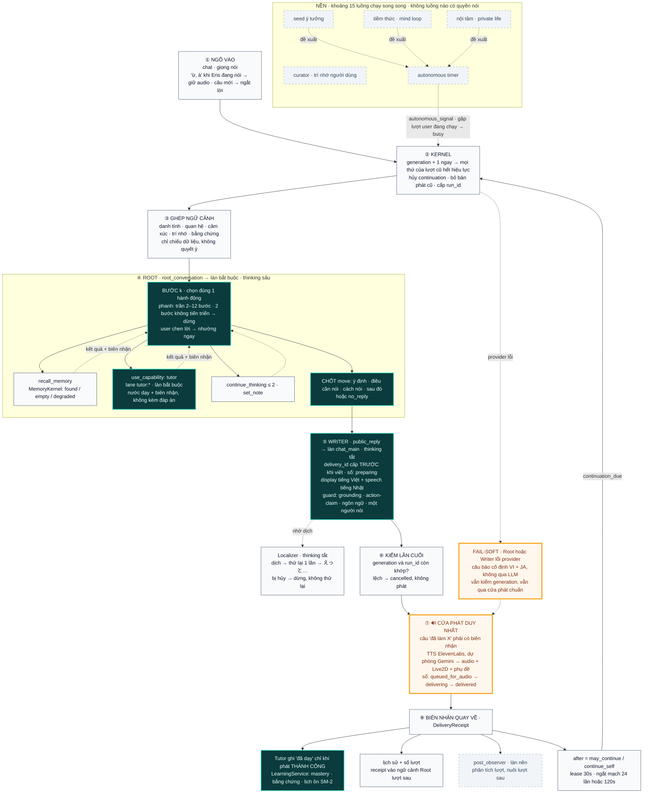

# ERIS: LUỒNG CHẠY THẬT (một lượt nói, từng trạm, từng lane)

> Đây là file chuẩn cho phần kỹ thuật của pitch. Bước nào cũng ghi: làm gì,
> chạy lane nào, có gọi LLM không, bằng chứng nằm ở đâu trong code.
>
> Nguồn: `flow-description.md`, `deep-architecture.md`,
> `.agents/tasks/eris-lane-map/lane-map-report.md`,
> `.agents/tasks/eris-routing/model-routing-reality.md`, đối chiếu bảng đính chính
> trong `docs/knowledge/2026-10-14-eris-runtime-lessons.md` và grep code ngày 16/10/2026.
>
> Ký hiệu: 🟢 làn bắt buộc (không bị cắt) · ⚪ không gọi LLM · ⬜ làn nền (gộp/hoãn/bỏ được) · 🔊 cửa phát

---

## 0. Toàn cảnh trong một câu

**Khoảng 15 luồng nghĩ chạy song song → một bộ não quyết định (Root) → một lớp
diễn đạt (Writer) → một cửa phát lời (Delivery → TTS) → biên nhận quay về.**

Không luồng nền nào gọi được cửa phát. Chúng chỉ đề xuất, Root quyết.
Bằng chứng: chỉ `RuntimeConversationDeliveryAdapter.deliver` gọi
`_send_decision_to_body` cho lời nói. Lối thứ hai `_emit_body_only` chỉ dùng cho
cử động, text rỗng, `should_speak=False` (lane-map-report).

---

## 1. Một lượt nói đi qua 8 trạm

```
① NGÕ VÀO ─► ② KERNEL ─► ③ NGỮ CẢNH ─► ④ ROOT ─► ⑤ WRITER ─► ⑥ KIỂM CUỐI ─► ⑦ 🔊 CỬA PHÁT ─► ⑧ BIÊN NHẬN
                ▲                                                                              │
                └──────────────── continuation_due (khi Root chọn nói tiếp) ◄──────────────────┘
```

| Trạm | Hệ thống làm gì | Lane · LLM | Bằng chứng |
|---|---|---|---|
| ① Ngõ vào | Nhận chat hoặc giọng nói. Phân loại ngắt lời: tiếng phụ họa ("ừ", "à") lúc Eris đang nói thì giữ audio, câu mới thì ngắt. | ⚪ | `incoming_dispatcher._handle_chat`, `chat_cycle`, `AIChatOrchestrator` |
| ② Kernel | Chống trùng sự kiện. Với lượt user: **tăng generation ngay**, hủy continuation, bỏ bản phát cũ, cấp `run_id`. Sự kiện nền gặp lượt đang chạy thì nhận `busy`, không giành quyền. | ⚪ | `ConversationKernel._handle_event_once` (kernel.py) |
| ③ Ghép ngữ cảnh | Chiếu danh tính, quan hệ, cảm xúc, trí nhớ, bằng chứng vào `runtime_context`. Chỉ chiếu dữ liệu, không quyết ý. | ⚪ | `ContextAssembler`, `EvidenceAssembler` (orchestrator.py) |
| ④ Root quyết định | Vòng nhiều bước, mỗi bước đúng một hành động: nhớ lại, gọi năng lực, nghĩ tiếp, ghi chú. Kết thúc bằng `move` hoặc `no_reply`. Trước mỗi bước kiểm lượt còn hiệu lực. | 🟢 `root_conversation` → làn `chat_tool_required`, thinking sâu | `RuntimeModelRootAgent.decide` (agent.py), `RootConversationSession` (root_session.py) |
| ⑤ Writer diễn đạt | Kernel cấp `delivery_id` **trước khi viết** (sổ ghi `preparing`). Writer biến move thành display tiếng Việt + speech tiếng Nhật. Localizer dịch, thử lại 1 lần, hết lượt thì dùng filler `えっと…`; bị hủy thì dừng. Guard: grounding, action-claim, ngôn ngữ, che secret, một người nói. | 🟢 `public_reply` → làn `chat_main`, thinking tắt · Localizer gọi riêng, thinking tắt | `KernelTurn`, `RuntimeWriterAdapter` (runtime_writer.py), `_prelocalize_v03_speech` |
| ⑥ Kiểm lần cuối | generation và run_id còn khớp không? Lệch thì ghi `cancelled` (`stale_after_prepare`), không phát. | ⚪ | kernel.py, `mark_delivery_started` |
| ⑦ 🔊 Cửa phát duy nhất | Câu kiểu "đã làm X" phải có receipt thành công của đúng event/run. Sau đó xuống body: TTS (ElevenLabs, dự phòng Gemini) ra audio, Live2D chạy theo audio, phụ đề hiện cùng. Sổ: `queued_for_audio` → `delivering` → `delivered`. | ⚪ | `delivery_adapter.deliver`, `enforce_completed_action_claims`, `_send_decision_to_body` (public_output_runtime.py) |
| ⑧ Biên nhận quay về | `DeliveryReceipt` tỏa ra: Tutor ghi "đã dạy" nếu phát thành công; lịch sử và sổ lượt; receipt vào ngữ cảnh Root lượt sau; observer phân tích lượt. Nếu `after = may_continue/continue_self` thì lập continuation lease, sự kiện `continuation_due` quay lại ②. | observer ⬜ `post_observer` | `settle_delivery_id`, fan-out trong public_output_runtime.py, `observe_assistant_commit` |

**Nhánh fail-soft.** Ở lượt user, nếu Root hoặc Writer lỗi provider (429, 401…),
Kernel phát một câu báo cố định (display tiếng Việt + speech tiếng Nhật), **không
gọi Root, Writer hay localizer**, vẫn kiểm generation và vẫn đi qua cửa phát chuẩn
(`_deliver_runtime_failure`, kernel.py). Root lỗi kiểu khác thì rơi về
`DeterministicRootAgent`.

**Vòng tiếp nối có ngắt mạch.** Lease sống 30 giây, trễ 1,2 s (`may_continue`)
hoặc 0,15 s (`continue_self`), tối đa 24 lần tự đánh thức hoặc 120 giây mỗi
chuỗi. `wait_user` hủy lease (`ContinuationLeaseScheduler`, continuation.py).

---

## 2. Phóng to trạm ④: Root, vòng suy nghĩ có phanh

```
                ┌──────────────── kết quả + biên nhận ────────────────┐
                ▼                                                      │
  ngữ cảnh ─► [ BƯỚC k ] ── chọn đúng 1 hành động ──┬─ recall_memory ───┤  MemoryKernel: found / empty / degraded
                │  lượt còn hiệu lực?                ├─ use_capability ──┤  tutor · research · work · action
                │  user chen lời → nhường ngay       ├─ continue_thinking (≤ 2)
                │                                    └─ set_note / clear_note
                ▼
            CHỐT: move { intent · say · delivery · after }   hoặc   no_reply
```

| Hành động | Quyền | Vì sao tách riêng |
|---|---|---|
| `move` / `no_reply` | quyền **nói** (hoặc chọn im) | chỉ hai hành động này đi xuống Writer. `move` được chốt thẳng, không tự kiểm lần hai, để khỏi làm phẳng cá tính |
| `use_capability` | quyền **nhờ chuyên môn** | năng lực trả dữ liệu + `CapabilityResultReceipt`, không tự phát tiếng |
| `recall_memory` | quyền **nhớ** | chỉ đọc, kết quả public-safe; ký ức không rõ nguồn không thành fact |
| `continue_thinking` | quyền **nghĩ thầm** | không sinh lời, không gọi TTS, tối đa 2 lần |
| `set_note` | ghi chú làm việc | giữ ý giữa các lượt |

**Ba cái phanh:** trần cứng 2–12 bước (mặc định 8) · 2 bước liền không tiến triển
(trùng, rỗng, lỗi, hết hạn mức…) thì dừng sớm · user chen lời thì trả
`NoReply(root_turn_preempted)`.

**Tiết kiệm ngữ cảnh:** phần "Self" (trạng thái, cái tôi, trí nhớ dài hạn) nạp một
lần; các bước sau chỉ gửi phần thay đổi (delta), receipt neo theo `delivery_id`
(root_session.py).

---

## 3. Hệ thần kinh nhận thức: bản đồ lane

**Một request suy luận được tả bằng ba trục tách rời**
(`_client_inference_profile`, model_router.py):
- *vai trò nhận thức* (`cognitive_lane`): request đang làm việc gì
- *đường truyền* (`backend`): đi qua gateway nào
- *tài nguyên* (`resource_class`): có chiếm VRAM máy không

`inference_tier` chỉ còn là nhãn tương thích cũ.

**Broker xếp lane theo vai trò** (`_run_inference`):

| Làn | Ai chạy ở đây | Tính chất |
|---|---|---|
| 🟢 `chat_tool_required` | Root (`root_conversation`), Tutor (`tutor:*`), `turn_executive`, `chat_intention` | bắt buộc, theo cancel scope của lượt user |
| 🟢 `chat_main` | Writer (`public_reply`) | bắt buộc |
| 🟢 `public_claim_verifier` | cổng kiểm claim | bắt buộc, lane riêng không kế thừa deadline 25 giây của chat |
| 🟢 `capability_deliberation_required` | lập kế hoạch năng lực cho lượt user | bắt buộc |
| ⬜ `post_observer` | observer sau lượt, suy ngẫm | gộp/hoãn/bỏ được |
| ⬜ `autonomous` | hành vi tự khởi | gộp/hoãn/bỏ được |
| ⬜ `tutor_background` | seed, discovery, planner | gộp/hoãn/bỏ được |
| ⬜ `neuro_continuation` · `neuro_deliberation` | suy nghĩ nền, tiếp nối nền | gộp/hoãn/bỏ được |
| ⬜ `capability_deliberation` | lập kế hoạch năng lực nền | gộp/hoãn/bỏ được |
| (ngoài broker) | Localizer VI→JA | gọi thẳng, thinking tắt |

Chỉ làn nền mới được gộp (`coalesce_key`) và mới bị cắt khi quá tải.

**Một model, nhiều vai.** Nhiều lane có thể chạy cùng một model; chúng khác nhau
ở lane, thinking và quyền. Trace thật phiên 15/10: Root bật thinking mức cao để
quyết, Writer tắt thinking để nói nhanh và giữ giọng, Localizer tắt thinking để
dịch cho TTS.

**Bài học thật (kể đúng phiên bản này).** Bước kiểm bắt buộc trước khi phát từng
bị xếp vào làn nền `post_observer`, chỉ vì nó mang nhãn cũ
`inference_tier=subconscious_4b`. Khi chat đang chạy, broker được phép bỏ chính
bước đó. Writer nhận `UNKNOWN`, thử lại, và Eris im lặng. Cách sửa không đổi
model, không đổi nội dung: **xét vai trò nhận thức trước nhãn tài nguyên**. Đến
giờ Root và Tutor vẫn gửi nhãn `subconscious_4b`, nhưng vai trò được xét trước
nên chúng luôn vào làn bắt buộc. (Comment "Character v1 HOTFIX" trong
`_run_inference`; nhãn ở `root_session.py`, `agent.py`, `tutor/model_reasoner.py`.)

**Nhiều luồng nghĩ, một cửa phát.** Khoảng 15 luồng nền chạy song song: seed ý
tưởng, tiềm thức, mind loop, nội tâm, private life, curator trí nhớ, observer…
Docstring của chúng ghi rõ không có quyền phát lời; muốn nói phải đi qua Kernel
rồi Root (lane-map-report).

---

## 4. Vòng biên nhận và Tutor: định nói ≠ đã nói ≠ đã dạy

```
Root ── use_capability(tutor) ──► Tutor: chấm câu trước + chọn nước dạy kế
  ▲                                 │  trả TutorAdvice (KHÔNG kèm đáp án) + CapabilityResultReceipt
  │                                 ▼
  │                        Root chốt move ─► Writer ─► 🔊 cửa phát
  │                                                       │
  │                                             DeliveryReceipt: thành công?
  │                                                       ▼
  └─── receipt vào ngữ cảnh lượt sau ◄── Tutor.commit_delivery: chỉ khi THÀNH CÔNG mới note_taught / advance_kp
                                                          ▼
                                  LearningService commit: mastery · bằng chứng · lịch ôn SM-2
```

**Trạng thái của một câu** (`MoveOutcomeLedger`): `preparing` (định nói) →
`queued_for_audio` (vào hàng đợi, chưa có tiếng) → `delivering` (đang phát) →
`delivered` (phát xong). Nhánh khác: `cancelled` (bị ngắt, không tự phát lại),
`failed_before_delivery`, `delivery_failed`. Sau crash, câu dang dở được ghi
`unconfirmed_after_restart` chứ không bị coi là đã phát.

**Luật của learning kernel:**
- "LLM đề xuất; deterministic kernel commit." `LearningService` là cửa duy nhất
  ghi sự thật học tập; nó không viết lời, không gọi TTS, không tự bật tutor.
- Câu trả lời tự do chỉ thành bằng chứng khi đánh giá đủ tin cậy (mặc định
  ≥ 0,68). Kết quả "uncertain" không được ghi.
- Trắc nghiệm chấm deterministic; phần cần hiểu nghĩa đi qua reasoner + ngưỡng.
- Writer không được cầm đáp án (`to_writer_dict` bỏ `expected_answer`).
- User lạc đề thì Tutor nhả quyền chấm (`suspend_pending_move`); mastery không bị đụng tới.
- Không có model reasoner thì chạy policy bảo thủ (`ConservativeTutorReasoner`),
  chỉ mất phần chấm câu tự do.
- Lịch ôn: SM-2 + đường quên, nửa đời 14 ngày, khoảng ôn tối đa 180 ngày. Lịch
  này tính bằng ngày, tách hẳn continuation lease tính bằng giây.

---

## 5. Cách đưa lên slide (4 slide kỹ thuật)

Mỗi slide gồm: một triết lý (chữ to), một sơ đồ, 2–3 dòng bằng chứng (chữ nhỏ).

### Slide 5: "Mỗi câu Eris nói đi qua 8 trạm. Và chỉ có một cửa ra." · Triết lý 1: chia quyền
- Bố cục chữ U: hàng trên ①→④ từ trái sang phải, hàng dưới ⑤→⑧ từ phải sang
  trái. Mũi tên cong từ ⑧ về ② ghi `continuation_due`.
- Mỗi ô: tên trạm (to), một dòng việc (nhỏ), một chip lane. Màu chip: xanh = làn
  bắt buộc · trắng = không gọi LLM · xám nét đứt = làn nền.
- Trạm ⑦ tô cam, icon loa: "cửa phát duy nhất".
- Góc dưới phải: hộp nhỏ fail-soft.
- Animation: hiện từng trạm theo lời nói.

### Slide 5B: "Root không trả lời. Root quyết định, từng bước một." · Triết lý 4: tự chủ có phanh
- Giữa: vòng tròn "BƯỚC k", bốn nan hoa: nhớ lại · gọi năng lực · nghĩ tiếp (≤2)
  · ghi chú. Mũi tên "biên nhận" quay về tâm. Lối ra phía dưới: "CHỐT move / im lặng".
- Bên phải: ba icon phanh (trần 2–12 bước · 2 bước không tiến triển · user chen lời).
- Dòng nhỏ: "Self nạp một lần, mỗi bước chỉ gửi delta."

### Slide 6: "Nhiều luồng nghĩ. Một giọng nói." · Triết lý 3: chia sự chú ý theo vai trò
- Hai cột. LÀN BẮT BUỘC (xanh đặc): Root · Tutor · Writer · kiểm claim · kế hoạch
  cho lượt user. LÀN NỀN (xám nét đứt): observer · autonomous · seed/planner ·
  neuro · kế hoạch nền.
- Dải đáy hình phễu: "~15 luồng nghĩ → chỉ đề xuất → Root quyết → 1 cửa phát".
- Hộp góc "Bài học thật": chuyện Eris im lặng, ba dòng.
- Dòng nhỏ: "Một model, nhiều vai: Root nghĩ sâu để quyết · Writer nói nhanh để giữ giọng."

### Slide 7: "Định nói ≠ đã nói ≠ đã dạy." · Triết lý 2 + 5: trung thực bằng hệ thống, mở rộng bằng cắm vào
- Vòng khép kín: Root → Tutor → Root chốt → Writer/phát → biên nhận → Tutor ghi
  "đã dạy" → về Root.
- Đáy: thanh tiến trình `preparing → queued → delivering → delivered`, nhánh rẽ `cancelled`.
- Dòng nhỏ: "LLM đề xuất, kernel chốt · ngưỡng tin cậy 0,68 · Writer không cầm đáp án."

**Dựng sơ đồ nhanh:** dán mã mermaid ở cuối file vào https://mermaid.live, Export
SVG hoặc PNG, chèn vào Canva/Gamma rồi tô lại màu theo theme.

---

## 6. Đính chính so với các bản nháp trước

| Bản nháp cũ ghi | Sửa thành | Lý do |
|---|---|---|
| "Một nhãn cũ kéo **bước điều hành** xuống làn có thể cắt" | "**Bước kiểm bắt buộc trước khi phát** từng bị nhãn cũ kéo xuống làn nền"; cơ chế bảo vệ đó nay áp cho Root và Tutor | comment HOTFIX trong code nói về bước kiểm claim |
| Vẽ "cổng kiểm claim" trong luồng mỗi lượt | Để nó trong bản đồ lane, không vẽ vào luồng một lượt | lane và class có, nhưng grep 16/10 chỉ thấy tool nghiên cứu gọi `CharacterClaimVerifier`. Writer ghi rõ không dùng manifest do model sinh làm cổng public. Phần chống bịa đang chạy trên lượt là guard của Writer + `enforce_completed_action_claims` |
| "Eris luôn có tiếng kể cả khi LLM chết" | "Khi model lỗi, Eris không im: câu báo cố định đi thẳng xuống TTS, không qua LLM" | vẫn cần TTS chạy; tài liệu 15/10 dặn không coi fail-soft là bảo đảm toàn pipeline có tiếng |
| "Tách 8 trục" | bỏ con số | con số tôi tự ghép, không có trong code |
| "Không AI nào khác phân biệt định nói/đã nói" | bỏ | không kiểm chứng được |

---

## 7. Biết trước để trả lời phản biện (không đưa lên slide)

Theo `docs/knowledge/2026-10-14-eris-runtime-lessons.md` (cập nhật 15/10) và grep 16/10:
- Khởi tạo lộ trình học (`register_path` / `activate_path`) mới có call site trong test.
- Lỗi prepare trước khi phát chưa được báo ngược về Root ở request sau (phiên 16:47 ngày 15/10).
- `chat_start` có thể hủy audio trước khi kịp phân loại tiếng phụ họa; "ô" chưa nằm trong danh sách phụ họa.
- Hủy TTS đang bị tính như lỗi provider, có thể mở circuit breaker.

Bị hỏi trúng thì trả lời: "Đã khoanh vùng, biết nằm ở đâu, nằm trong lộ trình."

---

## Phụ lục: mã mermaid sơ đồ một lượt


