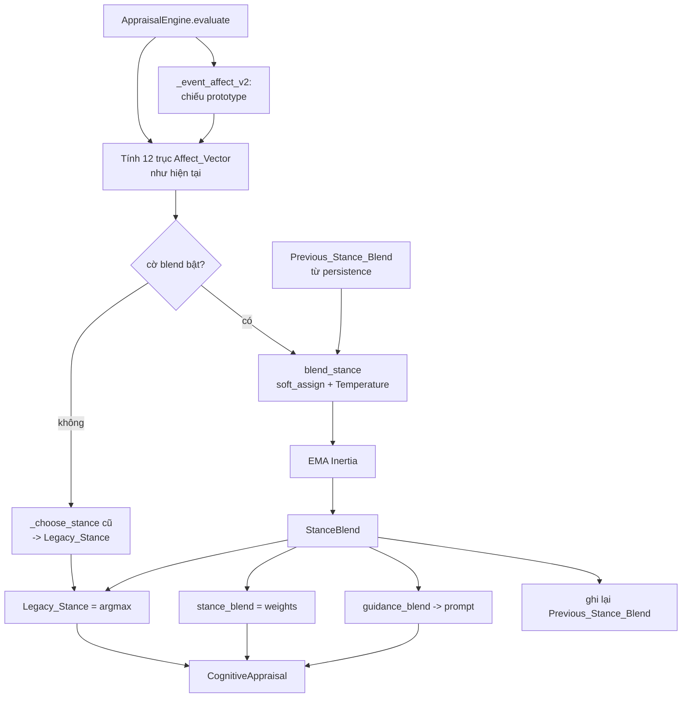

# Design Document

## Overview

Thiết kế thay biểu diễn stance rời rạc trong `AppraisalEngine` bằng **phân bố mềm trên các điểm hút** trong không gian affect, thêm **quán tính cảm xúc (EMA)** giữa các turn, và thay đọc-affect-sự-kiện bằng **phép chiếu prototype**. Toàn bộ quy về một primitive duy nhất là `soft_assign`.

Nền tảng đã có:
- PoC thuần `src/cortex/affect_blend.py` (`soft_assign`, `blend_stance`, `StanceBlend`, `guidance_blend`, `STANCE_ANCHORS`, `STANCE_GUIDANCE`) + `tests/test_affect_blend.py` (15 test, đã pass).
- Hạ tầng embedding/prototype: `event_semantics.py`, `semantic_prototypes.py`, `semantic_hypothesis.py`.
- Quán tính ở tầng process: `internal_state.MentalProcessSystem` (tham chiếu thiết kế cho `_smooth`/EMA).

Nguyên tắc nền (theo nghiên cứu cảm xúc tính toán): cảm xúc không phải nhãn nguyên thủy mà là vùng/điểm hút trong không gian core-affect liên tục, được kiến tạo từ appraisal; trạng thái nên trôi theo động lực có quán tính chứ không cắt ngưỡng.

## Architecture



Vị trí can thiệp tối thiểu, không đổi pipeline ngoài `appraisal.py`, `contracts.py`, và persistence của state:

1. `CognitiveAppraisal` (contracts.py): thêm trường `stance_blend: dict[str, float]` (mặc định rỗng), giữ nguyên `stance: str`.
2. `AppraisalEngine` (appraisal.py): thay nhánh chọn stance; thay `_event_affect`; nhận thêm `prev_stance_blend` và trả về blend để lớp gọi lưu lại.
3. Persistence: nơi đang giữ `PersistentInternalState` lưu thêm `stance_blend` gần nhất.

## Components and Interfaces

### 1. Affect_Blend_Module (đã có, mở rộng nhẹ)

PoC đã đủ cho stance + EMA. Bổ sung cho Requirement 4 và cấu hình:

```python
@dataclass(frozen=True, slots=True)
class AffectBlendConfig:
    temperature: float = 0.18
    inertia: float = 0.6
    dominant_k: int = 2
    dominant_min_weight: float = 0.08
    enabled: bool = True

# Đã có: soft_assign, blend_stance, StanceBlend, guidance_blend,
#         STANCE_ANCHORS, STANCE_GUIDANCE, rms_distance.
```

Event-affect prototype (mới, cùng module để tái dùng `soft_assign`):

```python
@dataclass(frozen=True, slots=True)
class AffectDirectionPrototype:
    name: str
    phrases: tuple[str, ...]        # mô tả nghĩa, không phải keyword
    affect: dict[str, float]        # valence/tenderness/arousal mục tiêu

def project_event_affect(
    event_text: str,
    prototypes: tuple[AffectDirectionPrototype, ...],
    *,
    encode,                         # callable text -> vector | None
    temperature: float = 0.25,
) -> dict[str, float]:
    """Trả {valence, tenderness, arousal} = blend affect của prototype theo
    độ tương đồng cosine giữa embedding(event_text) và embedding(prototype).
    encode trả None -> caller tự fallback (Req 4.6)."""
```

`project_event_affect` dùng đúng pattern `soft_assign`: similarity (cosine thay vì −RMS) → softmax → blend các vector affect mục tiêu. "Một cơ chế, ba chỗ dùng."

### 2. CognitiveAppraisal (contracts.py)

```python
@dataclass(slots=True)
class CognitiveAppraisal:
    ...
    stance: str = "grounded"          # GIỮ NGUYÊN (Legacy_Stance = argmax)
    stance_blend: dict[str, float] = field(default_factory=dict)  # MỚI
    ...
    def to_dict(self):
        return { ..., "stance": self.stance, "stance_blend": dict(self.stance_blend), ... }
```

`stance` đứng trước `stance_blend` và giữ default cũ → không vỡ caller positional nào (các caller hiện đều dùng keyword/đọc thuộc tính).

### 3. AppraisalEngine (appraisal.py)

Chữ ký `evaluate(...)` thêm hai tham số tùy chọn, mặc định giữ hành vi cũ:

```python
def evaluate(self, *, ..., prev_stance_blend: dict | None = None,
             blend_config: AffectBlendConfig | None = None) -> CognitiveAppraisal:
```

Luồng chọn stance thay khối cuối:

```python
cfg = blend_config or AffectBlendConfig()
affect = {  # gom 12 trục đã tính ở trên
    "valence": valence, "arousal": arousal, "certainty": certainty,
    "agency": agency, "controllability": controllability, "intimacy": intimacy,
    "threat": threat, "protectiveness": protectiveness, "jealousy_lite": jealousy_lite,
    "amusement": amusement, "fatigue": fatigue, "tenderness": tenderness,
}
if cfg.enabled:
    blend = blend_stance(affect, temperature=cfg.temperature,
                         prev=prev_stance_blend, inertia=cfg.inertia)
    stance = blend.top()
    stance_blend = blend.to_dict()
else:
    stance = self._choose_stance(...)   # giữ nguyên hàm cũ
    blend = None
    stance_blend = {}
```

`_choose_stance` và `_stance_guidance` cũ **được giữ lại** (cho cờ tắt và parity test). `_stance_guidance` mở rộng để khi có blend thì gọi `guidance_blend(blend)`; khi không thì giữ nhánh cũ.

`render_prompt_context`: dòng `appraisal_stance` tiếp tục dùng `appraisal.stance` (Legacy_Stance); `appraisal_bias` dùng guidance pha trộn nếu có `stance_blend`.

### 4. Event affect v2

`_event_affect` hiện trả `_EventAffect(valence, tenderness, arousal, label)`. Đổi nội tạng, giữ chữ ký + Stake_Gate:

```python
def _event_affect(self, *, broadcast, stakes, state_valence):
    if stakes is None or broadcast is None: return _EventAffect()
    care = clamp01(getattr(stakes, "care_user_mood", 0.0))
    if care <= 0.0: return _EventAffect()
    text = ... # gom broadcast.content + claim như cũ
    if not text: return _EventAffect()
    raw_affect = project_event_affect(text, EVENT_AFFECT_PROTOTYPES, encode=self._encode)
    if raw_affect is None:        # encoder không có -> fallback lexicon cũ (Req 4.6)
        return self._event_affect_lexicon(text, state_valence, care)
    raw = raw_affect["valence"]
    surprise = min(1.0, abs(raw - state_valence) / 2.0)   # GIỮ NGUYÊN
    gate = care * (0.55 + 0.45 * surprise)                # GIỮ NGUYÊN
    return _EventAffect(
        valence=clamp(raw * gate, -1, 1),
        tenderness=clamp01(raw_affect["tenderness"] * gate),
        arousal=clamp01(raw_affect["arousal"] * gate * 0.6 + ...),
        label="scene_mixed" if mixed else ("scene_low" if raw < 0 else "scene_bright"),
    )
```

Lexicon cũ được giữ lại nguyên vẹn dưới tên `_event_affect_lexicon` làm fallback xác định.

### 5. Persistence của Previous_Stance_Blend

Lớp gọi `AppraisalEngine.evaluate` (coordinator/pipeline) đọc `prev_stance_blend` từ state, truyền vào, rồi ghi `result.stance_blend` trở lại state sau mỗi lần. `PersistentInternalState` thêm field `last_stance_blend: dict[str, float]` (default rỗng) cùng serialize/deserialize an toàn. Reset state -> `{}` (Req 3.7).

## Data Models

`STANCE_ANCHORS` (đã có trong PoC) — tọa độ liên tục bám ngữ nghĩa `_choose_stance`:

| stance | trục định nghĩa |
|---|---|
| protective | threat 0.80, protectiveness 0.82, tenderness 0.40 |
| watchful | jealousy_lite 0.55, threat 0.45, certainty 0.50 |
| tender_under_cold | tenderness 0.80, intimacy 0.72, valence 0.30 |
| tired | fatigue 0.78, arousal 0.22 |
| dry_playful | amusement 0.70, valence 0.40, threat 0.10 |
| soft_uncertain | certainty 0.16, arousal 0.30, valence -0.05 |
| grounded | certainty 0.58, valence 0.10, threat 0.12 |

`EVENT_AFFECT_PROTOTYPES` (mới) — mô tả nghĩa + vector affect mục tiêu:

| name | mô tả (rút gọn) | affect mục tiêu |
|---|---|---|
| quiet_struggle | "ai đó đang lặng lẽ chật vật / kiệt sức" | valence −0.6, tenderness 0.7, arousal 0.4 |
| relief_warmth | "việc vừa xong tốt đẹp, nhẹ nhõm và ấm" | valence +0.6, tenderness 0.3, arousal 0.4 |
| focus_threat | "mối đe dọa tới sự tập trung / mạch việc" | valence −0.4, tenderness 0.1, arousal 0.6 |
| bright_excited | "phấn khích, hào hứng tích cực" | valence +0.7, tenderness 0.2, arousal 0.7 |

## Error Handling

- Encoder lỗi/không có (`encode` trả `None`/ném) → `project_event_affect` báo không khả dụng → fallback `_event_affect_lexicon` (Req 4.6). Không ném ra ngoài.
- Affect_Vector chứa NaN/inf → `affect_blend._finite` đã ép về fallback; phân bố vẫn hợp lệ (Req 1.2).
- `prev_stance_blend` hỏng/khác tập khóa → EMA lấy hợp khóa rồi chuẩn hóa; argmax vẫn xác định.
- Anchors rỗng (cấu hình sai) → `soft_assign` trả `{}`; `StanceBlend.top()` trả `"grounded"` an toàn.

## Testing Strategy

Tận dụng `tests/test_affect_blend.py` (đã pass) cho primitive. Bổ sung:

1. **Parity (cờ tắt):** với cùng đầu vào, đường blend-disabled cho đúng Legacy_Stance như `_choose_stance` cũ; `tests/test_appraisal_engine.py` pass ở cả hai trạng thái cờ (Req 7).
2. **Backward-compat:** `to_dict()` có cả `stance` (str) và `stance_blend`; argmax ∈ tập stance hợp lệ (Req 2).
3. **Blend integration:** appraisal với affect hỗn hợp tạo ≥2 dominant stance, không stance nào ≥0.9 (Req 1.5).
4. **Inertia end-to-end:** chuỗi evaluate nhiều turn với `prev_stance_blend` thể hiện hysteresis và cuối cùng vẫn chuyển (Req 3.5, 3.6).
5. **Event-affect:** cảnh hỗn hợp cho valence pha trộn + tenderness>0; thiếu stake → rỗng; encoder None → fallback không ném (Req 4).
6. **Prompt:** `render_prompt_context` vẫn có `appraisal_stance`; bias chứa ≥2 hướng dẫn khi blend đa đỉnh (Req 5).
7. **Property-based (hypothesis):** mọi Affect_Vector ngẫu nhiên → phân bố hợp lệ; Temperature nhỏ hơn → entropy nhỏ hơn (Req 1.2, 6.2).

## Correctness Properties

Các bất biến phải đúng với mọi đầu vào (nền cho property-based tests):

### Property 1: Phân bố hợp lệ
Với mọi Affect_Vector hữu hạn, `blend_stance(...).weights` có mọi trọng số ≥ 0 và tổng = 1 (sai số ≤ 1e-6). Đúng cả sau khi áp EMA.
**Validates: Requirements 1.2, 3.2**

### Property 2: Tập khóa ổn định
Tập tên stance của Stance_Blend luôn bằng tập khóa của `STANCE_ANCHORS` đang dùng.
**Validates: Requirements 1.3**

### Property 3: Đơn điệu theo Temperature
Với cùng Affect_Vector, Temperature nhỏ hơn ⇒ trọng số lớn nhất không giảm và entropy không tăng.
**Validates: Requirements 6.2**

### Property 4: EMA là tổ hợp lồi
Với Inertia ∈ [0,1], mỗi trọng số sau EMA nằm giữa giá trị prev và current tương ứng (trước chuẩn hóa); Inertia=1 ⇒ prev, Inertia=0 ⇒ current.
**Validates: Requirements 3.3, 3.4**

### Property 5: Điểm bất động anchor
Affect_Vector trùng một Stance_Anchor ⇒ argmax của Stance_Blend là chính stance đó (với Temperature đủ nhỏ).
**Validates: Requirements 1.4**

### Property 6: Tương thích ngược
`to_dict()` luôn chứa `stance` kiểu `str` ∈ tập stance hợp lệ và `stance_blend` kiểu dict.
**Validates: Requirements 2.3, 2.5**

### Property 7: An toàn fallback
Encoder không khả dụng ⇒ Event_Affect đi đường lexicon xác định, không ném lỗi; affect NaN/inf ⇒ vẫn cho phân bố hợp lệ.
**Validates: Requirements 4.6, 7.2**

### Property 8: Không khóa cứng
Áp lặp một Affect_Vector mới đủ nhiều turn với Inertia < 1 ⇒ argmax cuối cùng hội tụ về stance của Affect_Vector mới.
**Validates: Requirements 3.6**

## Migration & Rollout

- Mặc định `AffectBlendConfig.enabled = True`; có thể tắt qua cấu hình để fallback `_choose_stance`.
- Không xóa `_choose_stance`, `_stance_guidance`, lexicon cũ trong giai đoạn này — giữ làm fallback + parity.
- Blast radius (đã dò): chỉ `cognitive_frame_recorder.py` (đọc string), `appraisal.py`, `contracts.py`. `private_mind_daemon` dùng `ComfortAppraiser` khác, không ảnh hưởng.
