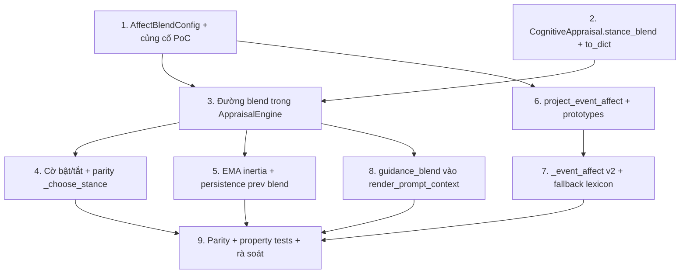

# Implementation Plan

## Overview

Triển khai tăng dần, test-driven, an toàn-trước. Thứ tự: củng cố primitive (đã có PoC) → mở rộng contract tương thích ngược → đường blend trong engine sau cờ → quán tính EMA qua persistence → event-affect prototype → prompt guidance → parity + property tests. Mặc định BẬT, có cờ tắt để fallback `_choose_stance`. Mỗi task bám acceptance criteria cụ thể.

## Task Dependency Graph



```json
{
  "waves": [
    { "wave": 1, "tasks": ["1", "2"] },
    { "wave": 2, "tasks": ["3", "6"] },
    { "wave": 3, "tasks": ["4", "5", "7", "8"] },
    { "wave": 4, "tasks": ["9"] }
  ]
}
```

## Tasks

- [x] 1. Củng cố Affect_Blend_Module và thêm cấu hình
  - Thêm `AffectBlendConfig` (temperature, inertia, dominant_k, dominant_min_weight, enabled) với mặc định vào `src/cortex/affect_blend.py`.
  - Cho `blend_stance` và `guidance_blend` nhận cfg (hoặc giữ tham số rời, đọc default từ cfg).
  - Mở rộng `tests/test_affect_blend.py`: Temperature nhỏ hơn ⇒ entropy nhỏ hơn (đã có), thêm test cfg mặc định.
  - _Requirements: 1.1, 1.2, 1.3, 6.1, 6.2, 6.3_

- [x] 2. Mở rộng `CognitiveAppraisal` giữ tương thích ngược
  - Thêm `stance_blend: dict[str, float] = field(default_factory=dict)` vào `CognitiveAppraisal` (contracts.py), đặt SAU `stance`, giữ `stance: str` nguyên.
  - Cập nhật `to_dict()` thêm khóa `stance_blend`, giữ khóa `stance` kiểu chuỗi.
  - Test: `to_dict()` chứa cả hai khóa; instance cũ tạo bằng keyword vẫn hợp lệ.
  - _Requirements: 1.6, 2.1, 2.5_

- [x] 3. Đường stance dạng blend trong `AppraisalEngine`
  - Gom 12 trục đã tính thành dict `affect` trong `evaluate`.
  - Thêm tham số `prev_stance_blend`, `blend_config` (mặc định None) vào `evaluate`.
  - Khi bật: gọi `blend_stance(affect, ...)`, đặt `stance = blend.top()`, `stance_blend = blend.to_dict()`.
  - Gán `stance` và `stance_blend` vào `CognitiveAppraisal` trả về.
  - Test: argmax ∈ tập stance hợp lệ; affect trùng anchor ⇒ argmax đúng anchor; affect hỗn hợp ⇒ ≥2 dominant, không stance ≥0.9.
  - _Requirements: 1.1, 1.4, 1.5, 2.2, 2.3_

- [x] 4. Cờ bật/tắt và parity với `_choose_stance`
  - Giữ nguyên `_choose_stance`, `_stance_guidance` cũ.
  - Khi `blend_config.enabled = False`: dùng `_choose_stance`, `stance_blend = {}`.
  - Parity test: với các đầu vào của `tests/test_appraisal_engine.py`, đường tắt cho đúng Legacy_Stance như trước thay đổi.
  - Chạy `tests/test_appraisal_engine.py` ở cả hai trạng thái cờ, đảm bảo pass.
  - _Requirements: 7.1, 7.2, 7.3, 7.4, 2.4_

- [x] 5. EMA inertia + persistence Previous_Stance_Blend
  - Thêm `last_stance_blend: dict[str, float]` vào `PersistentInternalState` với serialize/deserialize an toàn; reset ⇒ `{}`.
  - Lớp gọi (coordinator/pipeline) đọc `last_stance_blend` truyền vào `evaluate` qua `prev_stance_blend`, ghi `result.stance_blend` trở lại state.
  - Test: Inertia=1 ⇒ bằng prev; Inertia=0 ⇒ bằng blend mới; Inertia cao ⇒ stance cũ giữ trọng số lớn hơn so với thấp; lặp nhiều turn ⇒ cuối cùng chuyển; chưa có prev ⇒ không EMA.
  - _Requirements: 3.1, 3.2, 3.3, 3.4, 3.5, 3.6, 3.7_

- [x] 6. `project_event_affect` + `EVENT_AFFECT_PROTOTYPES`
  - Thêm `AffectDirectionPrototype` và `project_event_affect(event_text, prototypes, *, encode, temperature)` vào affect_blend.py, dùng pattern `soft_assign` (cosine → softmax → blend vector affect).
  - Định nghĩa `EVENT_AFFECT_PROTOTYPES` (quiet_struggle, relief_warmth, focus_threat, bright_excited).
  - `encode` trả None/ném ⇒ `project_event_affect` báo không khả dụng (trả None), không raise.
  - Test: cảnh hỗn hợp ⇒ valence pha trộn + tenderness>0; encoder None ⇒ trả None.
  - _Requirements: 4.1, 4.2, 4.4, 4.6_

- [x] 7. `_event_affect` v2 trong AppraisalEngine
  - Đổi nội tạng `_event_affect` để dùng `project_event_affect`, GIỮ chữ ký và Stake_Gate (care × surprise).
  - Giữ lexicon cũ dưới tên `_event_affect_lexicon` làm fallback xác định khi encoder không có.
  - Nối encoder của engine (injectable, mặc định None ⇒ luôn fallback an toàn).
  - Test: thiếu stake ⇒ rỗng; có stake + cảnh buồn ⇒ valence âm, tenderness>0; encoder None ⇒ đi fallback, không ném.
  - _Requirements: 4.3, 4.5, 4.6_

- [x] 8. Prompt guidance pha trộn
  - `_stance_guidance`: khi có `stance_blend`, trả `guidance_blend(blend)`; khi không, giữ nhánh cũ.
  - `render_prompt_context`: dòng `appraisal_stance` dùng Legacy_Stance; `appraisal_bias` dùng guidance pha trộn nếu có blend.
  - Test: prompt vẫn có `appraisal_stance`; blend đa đỉnh ⇒ bias chứa ≥2 hướng dẫn; blend áp đảo ⇒ tương đương guidance cũ.
  - _Requirements: 5.1, 5.2, 5.3, 5.4_

- [x] 9. Parity tổng, property tests và rà soát cuối
  - Property (hypothesis, @settings(max_examples≥100)): mọi Affect_Vector ⇒ phân bố hợp lệ; Temperature nhỏ hơn ⇒ entropy nhỏ hơn; EMA bảo toàn tính phân bố với mọi Inertia.
  - Chạy toàn bộ test cortex liên quan, xác nhận không hồi quy; xác nhận blast radius (recorder chỉ đọc string).
  - Rà soát: không còn ngưỡng cứng mới nào cho chọn stance ngoài Temperature + dominant_min_weight.
  - _Requirements: 1.2, 6.2, 6.4, 7.4_

## Notes

- **PoC đã sẵn:** `src/cortex/affect_blend.py` + `tests/test_affect_blend.py` (15 test pass) phủ phần lõi của Task 1, 3 (primitive), 5 (EMA). Các task tích hợp chủ yếu là nối dây và bảo toàn tương thích.
- **Không xóa code cũ giai đoạn này:** `_choose_stance`, `_stance_guidance`, lexicon event cũ được giữ làm fallback + parity. Việc gỡ bỏ (nếu muốn) là một spec dọn dẹp riêng sau khi đường blend chạy ổn định.
- **Blast radius đã dò:** chỉ `cognitive_frame_recorder.py` (đọc `appraisal.stance` dạng string), `appraisal.py`, `contracts.py`. `private_mind_daemon` dùng `ComfortAppraiser` (stance "soothed"/"hardened") — KHÁC đối tượng, không ảnh hưởng.
- **Encoder cho event-affect:** tái dùng hạ tầng `event_semantics.py`/`semantic_hypothesis.py`; mặc định injectable = None để test và môi trường thiếu model luôn đi đường fallback an toàn.
- **Mặc định bật:** `AffectBlendConfig.enabled = True`. Cờ tắt để hồi quy nhanh về hành vi cũ khi cần.
- **Một cơ chế, ba chỗ dùng:** stance, event-affect, và (tương lai) meaning/intent đều quy về `soft_assign`. Giữ nguyên tắc này khi mở rộng để tránh sinh thêm magic number.
