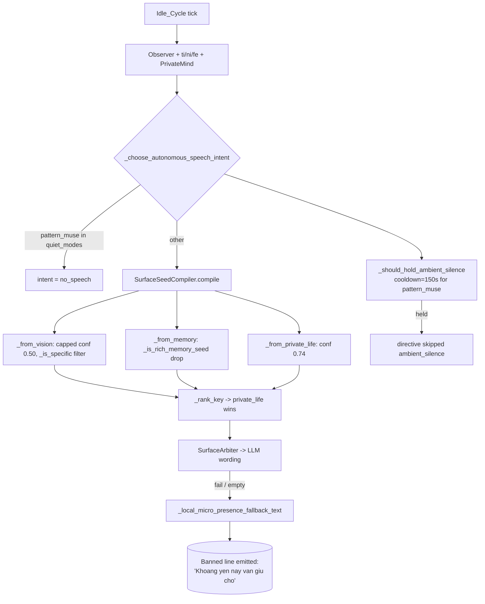
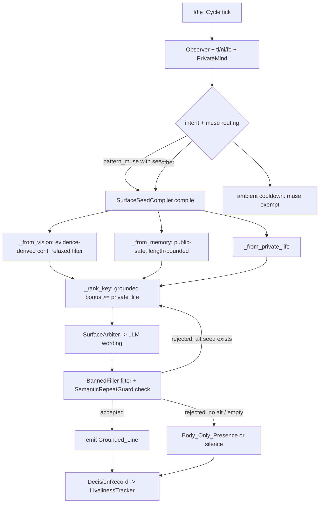

# Design Document

## Overview

This design makes the autonomous (idle) presence loop of the Eris/Monika character read as *alive* instead of dead. It is a brownfield, surgical change to existing components — not a rewrite. The redesign targets the exact path that today collapses an hour of rich internal cognition into two banned filler lines.

The work splits into five cooperating changes plus shared plumbing:

1. **Seed grounding** — make `SurfaceSeedCompiler` treat current Vision/Memory evidence as first-class so grounded seeds can win ranking against the generic `private_life` seed.
2. **Repeat variety** — widen and strengthen `SemanticRepeatGuard` so repeats across 60–120s idle cycles are actually caught, with an alternative-seed retry.
3. **Banned-filler single source of truth** — extract the "stale micro template" list into one shared module consumed by both the LLM prompt (`service.py`) and the output filter (`presence_controller._local_micro_presence_fallback_text`), so a banned line can never be emitted.
4. **Muse activation** — stop the ambient-silence cooldown and quiet-mode classification from auto-suppressing `pattern_muse`, so self-initiated grounded lines can fire.
5. **Liveliness metrics + observability** — a per-cycle decision record and a rolling liveliness tracker that make "alive" measurable and debuggable.

A guiding rule throughout: when there is nothing grounded to say, the character expresses **Body_Only_Presence or silence** — never a generic spoken filler. Less talking that is grounded reads as more alive than constant hollow talking.

### Goals

- Grounded autonomous lines that reference what is actually observed now.
- No verbatim/semantic repetition across an extended session.
- Zero banned-filler emissions, enforced at output, not just requested in the prompt.
- Proactive muse lines that actually surface when cognition grants permission.
- Measurable liveliness and inspectable per-cycle decisions.

### Non-Goals

- User-facing chat behavior (already works; out of scope).
- LLM API resilience / key rotation (covered by the separate `private-mind-api-resilience` spec).
- New cognition layers or model changes; this reuses existing signals (vision facts, memory resonance, thought stream, private life, `ti_report.mode`).

## Architecture

### Current flow (problem)



Two independent things kill liveliness: the **ranking** never lets grounded evidence win, and the **fallback** emits the very lines the prompt bans. Muse is suppressed both by quiet-mode classification and a 150s cooldown.

### Target flow



### Code-duplication note (important for implementation)

The idle-loop logic exists in **two parallel files** with near-identical methods:

- `src/runtime/coordinator.py` — `_choose_autonomous_speech_intent`, `_ambient_silence_cooldown_seconds`, `_should_hold_ambient_silence` (~lines 5260–5330, 6660–6790).
- `src/runtime/autonomous_cycle.py` — the same methods (~lines 1120–1190, 380–490).

Both classify `pattern_muse` into `quiet_modes` (→ `no_speech`) and both return `150` cooldown for `pattern_muse`. Every behavioral change in this design must be applied to **both** files, or — preferred — the shared logic should be lifted into one mixin/module that both import, to prevent drift. The design assumes a small shared helper module (`runtime/ambient_silence_policy.py`) to hold the cooldown/muse policy so the two drivers stay consistent.

## Components and Interfaces

### 1. `SurfaceSeedCompiler` (src/cortex/surface_seed_compiler.py) — grounding

**`_from_vision` confidence derivation (Req 1.2, 1.3)**
- Replace the flat cap `confidence=max(0.40, cue_conf, 0.50)` with an evidence-derived confidence in `[0.0, 1.0]`:
  - base from `cue_conf`, plus a bonus for fact specificity (e.g. window/app title present, novelty == `new_screen_fact`), capped at 1.0.
  - Target: a fresh, specific vision fact reaches confidence comparable to or above the generic private_life 0.74 so it can win `_rank_key`.
- Add freshness gate (Req 1.1): only emit a Vision_Fact candidate when the fact was last observed within `ERIS_LIVELINESS_VISION_FRESH_SEC` (default 30s). Reuse the existing `vision_last_capture_at` / `_surface_has_fresh_vision_evidence` plumbing in `presence_controller.py` rather than inventing a new timestamp.

**`_is_specific_vision_fact` relaxation (Req 1.1)**
- Today a window title like `"Execution Changes (5 files) - eris - Kiro"` is filtered out. Loosen so a concrete window/app title with a recognizable subject counts as specific, while still rejecting pure `focus=unknown intent=unknown` blobs (the `_GENERIC_VISION` markers stay).

**`_rank_key` (Req 1.2)**
- Add a `grounded` bonus so vision/memory candidates are not structurally below private_life. Concretely raise `vision_fact` source_bonus and introduce a `grounded_now` term:
  - `source_bonus`: `vision_fact` and `memory_resonance` get a bonus at least equal to the effective `anchor_bonus` advantage private_life enjoys, so an equal-confidence grounded seed ranks `>=` private_life.
  - Tie-break ordering: grounded sources first, then confidence, then pressure.
- Acceptance check: with vision confidence derived to ~0.74+ and an added bonus, `rank(vision) >= rank(private_life)` holds (Req 1.2 objective comparison).

**`_from_memory_resonance` / `_is_rich_memory_seed` (Req 1.4, 1.7)**
- Replace the length-based rejection (`len(words) < 5 and len(text) < 32`) with a public-safety + non-empty check: retain any Memory_Seed that is public-safe and has ≥1 non-whitespace character, up to `ERIS_LIVELINESS_SEED_MAX_LEN` (default 240). Keep the `_GENERIC_MEMORY_SEED_RE` rejection (still drop literal "memory resonance").
- Add explicit exclusion: a Memory_Seed failing `_candidate_text_public` is dropped (Req 1.7).

**Observability hook (Req 6.1, 6.2)**
- `compile()` already returns `debug` with `reason` and `candidate_count`. Extend it to also surface `selected_source`, `selected_confidence`, and, on no-seed, a reason from an enumerated set (`NoSeedReason`) instead of free text. The caller logs these into the DecisionRecord.

### 2. `SemanticRepeatGuard` (src/cortex/micro_repeat_guard.py) — variety

**Window sizing (Req 2.1, 2.2)**
- `exact_repeat_seconds` default 90s is shorter than the max idle interval (~120s), so consecutive repeats slip. Change the effective exact-repeat window to be at least the max idle interval. Introduce config:
  - `ERIS_LIVELINESS_REPEAT_WINDOW_SEC` (default 180; minimum enforced to `>= max_idle_interval`, treat max idle as 120s).
  - Keep `window_seconds` (semantic family window) ≥ repeat window.

**Similarity threshold (Req 2.3)**
- Expose the semantic similarity threshold as config `ERIS_LIVELINESS_SIM_THRESHOLD_PCT` (0–100, default 78 — matches current `semantic_threshold=0.78`). A same-family line at or above threshold within the window is rejected.

**Defaulting on bad config (Req 2.7)**
- All new config readers clamp to valid range and fall back to default on parse error, logging once; never raise into the loop.

The guard's `check()`/`remember()` interface is unchanged; only thresholds and defaults move to config. The caller (presence_controller) drives the retry loop.

### 3. Banned filler — single source of truth (Req 3)

**New module `src/cortex/banned_filler.py`**
```python
# Canonical stale-template lines the character must never speak autonomously.
BANNED_FILLER_LINES: tuple[str, ...] = (
    "Mạch này vẫn giữ chỗ.",
    "Nhịp này im hơi lâu rồi.",
    "Vẫn đang đợi chút nhé.",
    "Khoảng yên này vẫn giữ chỗ.",
    "Nhịp này vẫn yên thêm chút.",
    "Tôi ở đây.", "Tôi đang nghe.", "Tôi vẫn quan sát.", "Tôi vẫn ở đây.",
)

def normalize_banned(text: str) -> str: ...      # lowercase + strip
def is_banned_filler(text: str) -> bool: ...      # normalized membership
```

**`service.py` (~line 2709)** — build the "avoid" prompt fragment by joining `BANNED_FILLER_LINES` instead of a hardcoded literal. Adding/removing a line updates both prompt and filter at once (Req 3.4).

**`presence_controller._local_micro_presence_fallback_text` (Req 3.1, 3.2, 3.3)**
- Run every candidate (including the trailing default `candidates.extend((...))` block that currently contains the two banned lines) through `is_banned_filler`; drop matches. Remove the banned lines from the hardcoded candidate list.
- If all candidates are banned/empty, return `""` → arbiter routes to Body_Only_Presence (matches the existing `no_fallback_mode_enabled()` empty-return contract).
- Also gate the final output in `_surface_arbiter_llm_generate`: if the LLM returns a banned line, treat as empty (`return "", "banned_filler_blocked"`).

This converges with the existing `SEMANTIC_PROTOTYPES["ambient_presence_status_ping"]` list in `micro_repeat_guard.py`; that prototype set should import from `banned_filler` to avoid a third copy.

### 4. Muse activation (Req 4) — `runtime/ambient_silence_policy.py` (new shared helper)

Lift the duplicated policy out of `coordinator.py` and `autonomous_cycle.py`:

```python
def ambient_silence_cooldown_seconds(snapshot, ti_report) -> int: ...
def should_hold_ambient_silence(*, snapshot, ti_report, last_text,
                                last_autonomous_spoken_at,
                                speech_intent="", now=None) -> bool: ...
def muse_directive_active(ti_report) -> bool:   # ti_report.mode == "pattern_muse"
```

Changes:
- **Cooldown exemption (Req 4.2):** when `muse_directive_active(ti_report)` is true, `should_hold_ambient_silence` returns `False` (do not hold solely on cooldown). The 150s value remains for non-muse ambient pacing.
- **Quiet-mode reclassification (Req 4.1, 4.3):** remove `"pattern_muse"` from `quiet_modes` in `_choose_autonomous_speech_intent`. When `pattern_muse` is active AND the SurfaceSeedCompiler yields a usable seed, route intent to a self-initiated surface (emit exactly one Grounded_Line). When `pattern_muse` is active but no usable seed exists, fall through to `no_speech` (Req 4.4) and record the no-seed suppression reason.
- **Suppression recording (Req 4.4, 4.5):** every muse suppression writes a reason to the DecisionRecord identifying component (`ambient_silence_policy` / `surface_seed_compiler`) and cause (`cooldown` / `no_seed`). The existing `[directive skipped] ambient_silence ...` log line stays but is augmented with the structured record.

Both drivers call the shared helper, eliminating drift.

### 5. Liveliness tracking + observability (Req 5, 6)

**New `src/runtime/liveliness_tracker.py`**

```python
@dataclass(frozen=True)
class DecisionRecord:
    cycle_id: str
    emitted_kind: str          # "grounded_line" | "body_only" | "silence"
    seed_source: str           # vision_fact | memory_resonance | thought_stream | private_life | muse | none
    seed_confidence: float     # 0.0..1.0
    candidate_count: int       # >= 0
    grounding_evidence: tuple[str, ...]
    no_seed_reason: str        # enum, "" if seed selected
    repeat_rejection: str      # reason + family/fingerprint, "" if none
    ambient_suppression: str   # "mode=...;cooldown_remaining=Ns", "" if none
    timestamp: float

class LivelinessTracker:
    def record(self, rec: DecisionRecord) -> None: ...     # ring buffer, keep >=100 cycles
    def recent(self, n: int = 100) -> tuple[DecisionRecord, ...]: ...
    def window_metrics(self, window_sec: float = 3600) -> LivelinessMetrics: ...
```

`LivelinessMetrics` exposes: `distinct_grounded_count`, `grounded_proportion`, `max_subinterval_gap_sec`, `single_line_max_repeat`. These map directly to Req 5 thresholds.

**Config (env, following existing `ERIS_*` convention):**

| Env var | Default | Requirement |
|---|---|---|
| `ERIS_LIVELINESS_VISION_FRESH_SEC` | 30 | 1.1 |
| `ERIS_LIVELINESS_SEED_MAX_LEN` | 240 | 1.4 |
| `ERIS_LIVELINESS_REPEAT_WINDOW_SEC` | 180 | 2.2 |
| `ERIS_LIVELINESS_SIM_THRESHOLD_PCT` | 78 | 2.3 |
| `ERIS_LIVELINESS_MAX_LINE_REPEAT` | 3 | 2.4 |
| `ERIS_LIVELINESS_MAX_ALT_SEEDS` | 3 | 2.5 |
| `ERIS_LIVELINESS_MIN_GROUNDED_PER_HR` | 20 | 5.1 |
| `ERIS_LIVELINESS_SUBINTERVAL_SEC` | 300 | 5.2 |
| `ERIS_LIVELINESS_MIN_GROUNDED_PCT` | 60 | 5.3 |
| `ERIS_LIVELINESS_DECISION_RETENTION` | 100 | 6.6 |

All readers clamp to a valid range and apply the default on error (Req 2.7).

**Alternative-seed retry (Req 2.5, 2.6):** the presence controller, on a repeat-guard rejection, asks the compiler for the next-best candidate (up to `MAX_ALT_SEEDS`). The compiler already builds a ranked candidate list; expose the ranked list (not just the top pick) so the controller can iterate. On exhaustion → Body_Only_Presence, repeat history unchanged (Req 2.6).

**Body-only instead of no-op (Req 5.4):** in both drivers, the `ambient_silence` / no-speech branch currently sets `final_decision` to empty text with no body action. Add a Body_Only_Presence motion (e.g. `idle_shift` / `quiet_observe_scene`) whenever a cycle would otherwise end with neither speech nor body action.

## Data Models

- **DecisionRecord** / **LivelinessMetrics** — defined above (`liveliness_tracker.py`).
- **NoSeedReason** (enum/str constants in `surface_seed_compiler.py`): `no_candidates`, `all_filtered_private`, `all_below_threshold`, `all_banned`, `no_fresh_vision`. Replaces today's free-text `_no_seed_reason`.
- **BannedFiller** — `banned_filler.py` tuple + helpers (single source of truth).
- **LivelinessConfig** — thin dataclass reading the env table once per process with clamping.

## Error Handling

- **Bad/missing config:** clamp to range, apply default, log once at startup; never raise into the loop (Req 2.7).
- **Generation failure / empty text:** route to Body_Only_Presence or silence; never banned filler (Req 3.2).
- **All candidates banned or repeat-rejected:** Body_Only_Presence, repeat history preserved (Req 2.6, 3.3).
- **Muse with no usable seed:** discard directive, record `no_seed` reason, fall through to silence (Req 4.4).
- **Tracker overflow:** ring buffer bounded to `DECISION_RETENTION` (default 100); oldest evicted (Req 6.6).
- **Vision timestamp missing:** treat as not-fresh → no vision candidate (fail closed for grounding claims).

## Testing Strategy

Unit tests (pytest, alongside existing `tests/test_surface_seed_compiler.py`, `tests/test_runtime_coordinator.py`, `tests/test_internal_state.py`):

- **Grounding (Req 1):** fresh specific vision fact + private_life present → compiler selects vision; `rank(vision) >= rank(private_life)`; short public-safe memory seed retained; non-public-safe memory seed excluded; stale vision (>30s) not selected.
- **Variety (Req 2):** identical line at 100s apart rejected (window ≥120s); same-family ≥78% similar rejected; >3 repeats of one text across simulated hour flagged; rejection triggers alt-seed; exhaustion → body-only with history intact; out-of-range config → default applied.
- **Banned filler (Req 3):** `is_banned_filler` matches case/space variants; fallback never returns a banned line; LLM returning a banned line → blocked; editing `BANNED_FILLER_LINES` reflected in both prompt fragment and filter (single source).
- **Muse (Req 4):** `pattern_muse` + usable seed → exactly one Grounded_Line in same cycle; cooldown does not hold muse; muse + no seed → silence + recorded `no_seed`; suppression record carries component + cause.
- **Felt life / metrics (Req 5):** simulated 60-min transcript → `distinct_grounded_count >= 20`, `grounded_proportion >= 60%`, no 5-min gap when grounded content available; a no-speech-no-body cycle gets a body action.
- **Observability (Req 6):** select/no-seed/reject/suppress each produce a DecisionRecord with required fields and a cycle_id; retention keeps ≥100 cycles.

Both `coordinator.py` and `autonomous_cycle.py` paths are exercised (or the shared `ambient_silence_policy` is tested once and both drivers verified to import it).

## Correctness Properties

Invariants that must hold for any idle-cycle sequence, suitable for property-based testing.

### Property 1: No banned output
For every emitted Autonomous_Line `L`, `is_banned_filler(L)` is false — regardless of generation success, fallback path, or muse path.

**Validates: Requirements 3.1, 3.2, 3.3**

### Property 2: Grounding dominance
For any cycle where both a fresh specific Vision_Fact candidate and a generic private_life candidate exist, the selected seed's `rank_key` is `>=` the private_life candidate's `rank_key`.

**Validates: Requirements 1.2**

### Property 3: No exact repeat within window
For any two emitted Autonomous_Lines `Li`, `Lj` with identical normalized text, `|t_i - t_j| > REPEAT_WINDOW_SEC`; and `REPEAT_WINDOW_SEC >= max_idle_interval (120s)`.

**Validates: Requirements 2.1, 2.2**

### Property 4: Repeat-cap
Over any 60-minute window, no single normalized Autonomous_Line text appears more than `MAX_LINE_REPEAT` times.

**Validates: Requirements 2.4**

### Property 5: Liveliness floor
Over any 60-minute window with grounded content available, `distinct_grounded_count >= MIN_GROUNDED_PER_HR` and `grounded_proportion >= MIN_GROUNDED_PCT`.

**Validates: Requirements 5.1, 5.3**

### Property 6: No empty no-op
Every Idle_Cycle terminates in exactly one of: a Grounded_Line, a Body_Only_Presence action, or an explicit silence decision — never a cycle that attempted generation yet ended with neither speech nor body action.

**Validates: Requirements 5.4**

### Property 7: Muse-cooldown independence
If `muse_directive_active(ti_report)` is true, `should_hold_ambient_silence(...)` is false for the cooldown reason alone.

**Validates: Requirements 4.2**

### Property 8: Record completeness
Every Idle_Cycle produces exactly one DecisionRecord carrying a `cycle_id`; the tracker retains the most recent `>= DECISION_RETENTION` records.

**Validates: Requirements 6.5, 6.6**

### Property 9: Config safety
For any config value (absent, malformed, or out of range), the effective value is the clamped default and no exception propagates into the loop.

**Validates: Requirements 2.7**

## Requirements Traceability

| Requirement | Design element |
|---|---|
| 1.1 | `_from_vision` freshness gate (`VISION_FRESH_SEC`), relaxed `_is_specific_vision_fact` |
| 1.2 | `_rank_key` grounded bonus → `rank(vision) >= rank(private_life)` |
| 1.3 | `_from_vision` evidence-derived confidence in [0,1] |
| 1.4 | `_from_memory_resonance` length/public-safety rule, `SEED_MAX_LEN` |
| 1.5 | Grounded_Line tied to selected seed in arbiter path |
| 1.6 | Empty fallback → Body_Only_Presence/silence |
| 1.7 | Non-public-safe Memory_Seed excluded |
| 2.1–2.3 | `SemanticRepeatGuard` window sizing + `SIM_THRESHOLD_PCT` |
| 2.4 | `MAX_LINE_REPEAT` + LivelinessTracker count |
| 2.5–2.6 | Ranked candidate list + alt-seed retry, history-preserving fallback |
| 2.7 | Config clamping/defaults |
| 3.1–3.4 | `banned_filler.py` shared module, fallback + arbiter filters, prompt join |
| 4.1–4.5 | `ambient_silence_policy` muse exemption + quiet-mode reclassification + suppression records |
| 5.1–5.3 | LivelinessMetrics thresholds |
| 5.4 | Body_Only_Presence on no-speech-no-body cycle |
| 5.5 | DecisionRecord seed source + grounding evidence |
| 6.1–6.6 | DecisionRecord fields, NoSeedReason enum, cycle_id association, retention ≥100 |
