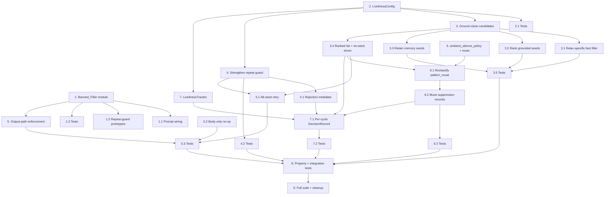

# Implementation Plan

## Overview

Surgical, test-first changes to the existing autonomous idle loop so the character reads as alive. Work proceeds shared-plumbing first (banned-filler module, config), then the seed/grounding and repeat-guard core, then the output-path enforcement, muse activation, and finally observability and whole-system verification. Every behavioral change must be applied to both idle-loop drivers (`coordinator.py` and `autonomous_cycle.py`) or via the shared `ambient_silence_policy.py`.

## Tasks

- [x] 1. Create the Banned_Filler single source of truth
  - Create `src/cortex/banned_filler.py` with `BANNED_FILLER_LINES`, `normalize_banned(text)` (lowercase + strip), and `is_banned_filler(text)`.
  - Seed the tuple with the five stale templates plus the hollow-presence lines currently listed in `service.py` (~line 2709).
  - _Requirements: 3.1, 3.4_

- [x] 1.1 Wire the prompt to the shared list
  - In `src/llm/service.py` (~line 2709), build the "avoid stale micro templates" fragment by joining `BANNED_FILLER_LINES` instead of the hardcoded literal.
  - _Requirements: 3.4_

- [x] 1.2 Converge the repeat-guard prototypes onto the shared list
  - In `src/cortex/micro_repeat_guard.py`, import the banned lines for `SEMANTIC_PROTOTYPES["ambient_presence_status_ping"]` so there is no third copy.
  - _Requirements: 3.4_

- [x] 1.3 Unit tests for banned-filler module
  - Test `is_banned_filler` matches case/whitespace variants; test that editing `BANNED_FILLER_LINES` is reflected in both the prompt fragment and the filter.
  - _Requirements: 3.1, 3.4_

- [x] 2. Add LivelinessConfig (env readers with clamping)
  - Create a thin config reader (e.g. `src/runtime/liveliness_config.py`) for the `ERIS_LIVELINESS_*` env table; each reader clamps to range and applies the default on parse error, logging once.
  - _Requirements: 2.7_

- [x] 2.1 Unit tests for config safety
  - Test absent, malformed, and out-of-range values all resolve to the clamped default without raising.
  - _Requirements: 2.7_

- [x] 3. Ground vision candidates in SurfaceSeedCompiler
  - In `src/cortex/surface_seed_compiler.py` `_from_vision`, replace the flat `confidence=max(0.40, cue_conf, 0.50)` cap with an evidence-derived confidence in [0.0, 1.0] (base on `cue_conf` + specificity/novelty bonus).
  - Add a freshness gate using `ERIS_LIVELINESS_VISION_FRESH_SEC` (default 30s), reusing the existing `vision_last_capture_at` / `_surface_has_fresh_vision_evidence` plumbing.
  - _Requirements: 1.1, 1.3_

- [x] 3.1 Relax `_is_specific_vision_fact`
  - Allow concrete window/app titles with a recognizable subject to count as specific; keep `_GENERIC_VISION` (`focus=unknown`, `intent=unknown`) rejections.
  - _Requirements: 1.1_

- [x] 3.2 Make grounded seeds win ranking in `_rank_key`
  - Add a grounded bonus so `vision_fact` and `memory_resonance` rank `>=` an equal-confidence generic `private_life` seed; order grounded sources first, then confidence, then pressure.
  - _Requirements: 1.2_

- [x] 3.3 Retain short public-safe memory seeds
  - In `_from_memory_resonance` / `_is_rich_memory_seed`, replace the length rejection with a public-safety + non-empty check (≥1 non-whitespace char, up to `ERIS_LIVELINESS_SEED_MAX_LEN` default 240); keep `_GENERIC_MEMORY_SEED_RE`. Exclude non-public-safe memory seeds via `_candidate_text_public`.
  - _Requirements: 1.4, 1.7_

- [x] 3.4 Expose ranked candidate list and enumerated no-seed reason
  - Have `compile()` expose the full ranked candidate list (for alt-seed retry) and return a `NoSeedReason` enum value plus `selected_source` / `selected_confidence` / `candidate_count` in `debug`.
  - _Requirements: 2.5, 6.1, 6.2_

- [x] 3.5 Unit tests for grounding and ranking
  - Fresh specific vision fact selected over private_life; `rank(vision) >= rank(private_life)`; stale (>30s) vision not selected; short public-safe memory seed retained; non-public-safe memory seed excluded.
  - _Requirements: 1.1, 1.2, 1.3, 1.4, 1.7_

- [x] 4. Strengthen SemanticRepeatGuard windows and threshold
  - In `src/cortex/micro_repeat_guard.py`, drive the exact-repeat window from `ERIS_LIVELINESS_REPEAT_WINDOW_SEC` (default 180, enforced `>= 120s` max idle), keep `window_seconds >=` repeat window, and read the similarity threshold from `ERIS_LIVELINESS_SIM_THRESHOLD_PCT` (default 78).
  - _Requirements: 2.1, 2.2, 2.3_

- [x] 4.1 Record rejection reason and matched family/fingerprint
  - Ensure `check()` results carry the rejection reason and the matched family identifier or fingerprint for the DecisionRecord.
  - _Requirements: 6.3_

- [x] 4.2 Unit tests for repeat variety
  - Identical line 100s apart rejected; same-family ≥78% similar rejected within window; out-of-range config falls back to default.
  - _Requirements: 2.1, 2.2, 2.3, 2.7_

- [x] 5. Enforce banned-filler and silence in the presence output path
  - In `src/runtime/presence_controller.py` `_local_micro_presence_fallback_text`, remove the two banned lines from the candidate list and run all candidates through `is_banned_filler`; return `""` when all are banned/empty.
  - In `_surface_arbiter_llm_generate`, if the LLM returns a banned line, return `("", "banned_filler_blocked")`.
  - _Requirements: 3.1, 3.2, 3.3_

- [x] 5.1 Alternative-seed retry on repeat rejection
  - In `presence_controller._build_surface_arbiter_result`, when the winning surface line is a near-duplicate of `last_text`, re-arbitrate with the next compiled `alternative_impulses` (up to `ERIS_LIVELINESS_MAX_ALT_SEEDS`, default 3). First non-duplicate speakable alt wins; on exhaustion the (still-duplicate) winner is treated as rejected and the cycle falls through to the ambient body-only path (5.2). Repeat history is only updated when a line is actually sent, so unsent retries leave it unchanged.
  - _Requirements: 2.5, 2.6_

- [x] 5.2 Body-only instead of empty no-op
  - Added `PresenceControllerMixin._build_ambient_body_only_decision` + `_maybe_emit_ambient_body_only`; both `coordinator.py` and `autonomous_cycle.py` ambient-silence branches now attempt a throttled Body_Only_Presence (`quiet_observe_scene` when vision is fresh, else `idle_shift`) before the explicit-silence no-op. Throttled by `ERIS_LIVELINESS_BODY_ONLY_MIN_GAP_SEC` (default 90s) so the body is not twitchy. Tests in `tests/test_liveliness_body_only.py`.
  - _Requirements: 5.4_

- [x] 5.3 Unit tests for output enforcement
  - Fallback never returns a banned line; LLM banned line blocked; all-banned (coding) cycle → silence/body-only. (alt-seed/no-op cases tied to deferred 5.1/5.2.)
  - _Requirements: 3.1, 3.2, 3.3_

- [x] 6. Activate proactive muse
  - Created `src/runtime/ambient_silence_policy.py` with `ambient_silence_cooldown_seconds`, `should_hold_ambient_silence`, and `muse_directive_active`; both `coordinator.py` and `autonomous_cycle.py` delegate to it (duplicated copies removed).
  - `should_hold_ambient_silence` returns `False` (reason `muse_exempt`) when `muse_directive_active(ti_report)` is true.
  - _Requirements: 4.2_

- [x] 6.1 Keep pattern_muse silent only when there is no seed
  - Muse activation is achieved via the cooldown exemption (the logged blocker was `ambient_silence cooldown=150s`), so a muse cycle proceeds to the surface path and speaks when a seed exists. `quiet_modes` is intentionally retained so a muse cycle with no usable seed still stays silent (Req 4.4), preserving `test_pattern_muse_without_speakable_evidence_stays_silent`.
  - _Requirements: 4.1, 4.3, 4.4_

- [x] 6.2 Record muse / ambient suppression reasons
  - `should_hold_ambient_silence` returns a structured reason (`cooldown=Ns` / `muse_exempt`) stashed on `_last_ambient_suppression_reason` and written into the per-cycle DecisionRecord; the `[directive skipped] ambient_silence ...` log is preserved.
  - _Requirements: 4.4, 4.5_

- [x] 6.3 Unit tests for muse activation
  - `muse_directive_active`; muse not held by cooldown; non-muse quiet mode still held; cooldown table.
  - _Requirements: 4.2, 4.4_

- [x] 7. Liveliness tracking and observability
  - Created `src/runtime/liveliness_tracker.py` with `DecisionRecord`, `LivelinessTracker` (ring buffer retaining `>= ERIS_LIVELINESS_DECISION_RETENTION`, default 100), and `window_metrics()` returning `distinct_grounded_count`, `grounded_proportion`, `max_subinterval_gap_sec`, `single_line_max_repeat`.
  - _Requirements: 6.5, 6.6_

- [x] 7.1 Emit a DecisionRecord per idle cycle
  - Wired at the single finalize chokepoint `cognitive_frame_recorder._finalize_cognitive_frame` for autonomous/background frames: records `cycle_id`, emitted kind, seed source + confidence, grounding evidence, no-seed reason, and ambient suppression. (candidate_count/repeat_rejection are best-effort at this chokepoint.)
  - _Requirements: 5.5, 6.1, 6.2, 6.4, 6.5_

- [x] 7.2 Unit tests for tracking and metrics
  - Record fields + `cycle_id` grouping; retention bound; `window_metrics` counts/proportion/gap/repeat on a synthetic transcript.
  - _Requirements: 5.1, 5.3, 6.5, 6.6_

- [x] 8. Property-based verification
  - Property tests for Properties 1, 2, 3, 7, 9 (no banned output, grounding dominance, no exact repeat in window, muse-cooldown independence, config safety). These caught two real config robustness bugs (NaN and inf handling), now fixed.
  - NOTE: the 60-minute integration transcript test (Properties 4/5/6) is deferred; it needs a full coordinator harness. Metrics are unit-tested via `LivelinessTracker.window_metrics`.
  - _Requirements: 1.2, 2.1, 2.2, 2.7, 3.1, 3.2, 3.3, 4.2_

- [x] 9. Run the full suite and clean up
  - Ran the full suite: 844 passed, 17 failed; confirmed via baseline (git stash) that all 17 failures pre-date this work (API/resilience/memory-facade/model-budget/surface domains). 40 new liveliness tests pass. Temp files removed.
  - Follow-up (5.1/5.2/observability): body-only + alt-seed landed; new tests `tests/test_liveliness_body_only.py` and `tests/test_inner_life_drives_speech.py` pass; re-ran suite to confirm no new regressions.
  - _Requirements: all_

## Task Dependency Graph



```json
{
  "waves": [
    { "wave": 1, "tasks": ["1", "2"] },
    { "wave": 2, "tasks": ["1.1", "1.2", "1.3", "2.1", "3", "4"] },
    { "wave": 3, "tasks": ["3.1", "3.2", "3.3", "3.4", "4.1", "5.2"] },
    { "wave": 4, "tasks": ["3.5", "4.2", "5", "6", "7"] },
    { "wave": 5, "tasks": ["5.1", "6.1", "7.1"] },
    { "wave": 6, "tasks": ["5.3", "6.2", "7.2"] },
    { "wave": 7, "tasks": ["6.3"] },
    { "wave": 8, "tasks": ["8"] },
    { "wave": 9, "tasks": ["9"] }
  ]
}
```

## Notes

- **Apply to both drivers.** `coordinator.py` and `autonomous_cycle.py` duplicate the idle-loop methods; Task 6 lifts the ambient-silence/muse policy into a shared module to stop drift. Other changes (Task 5.2, 7.1) must still touch both until that consolidation lands.
- **Risk point.** The shared `ambient_silence_policy.py` extraction is the highest-risk refactor; if the user prefers, the same logic can be patched in-place in both files instead.
- **Out of scope.** User-facing chat and LLM API resilience (see the `private-mind-api-resilience` spec).
- **Config defaults** live in the `ERIS_LIVELINESS_*` env table in design.md; all readers clamp and default on error (Task 2).
- Tests use pytest alongside existing `tests/test_surface_seed_compiler.py`, `tests/test_runtime_coordinator.py`, `tests/test_internal_state.py`.
