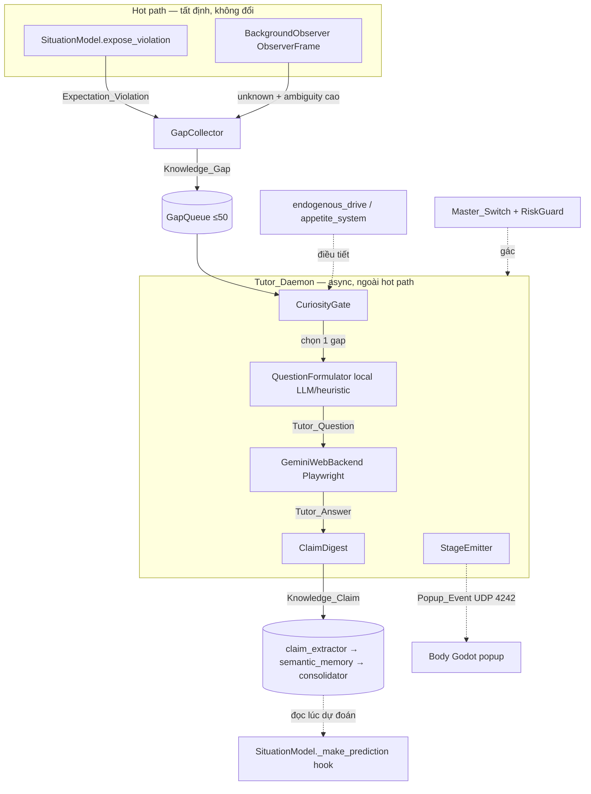

# Design Document

## Overview

**Curiosity Tutor** đóng vòng học còn thiếu của ERIS: *bị bất ngờ → muốn biết → đi hỏi →
tiêu hóa → lần sau hiểu hơn*. Nó nối ngõ cụt hiện tại — `SituationModel.expose_violation()`
phơi vi phạm kỳ vọng rồi không dẫn đi đâu — vào một daemon tò mò chạy ngoài hot path: khi
một Knowledge_Gap đủ đáng, ERIS hình thành câu hỏi, **mở trình duyệt thật** tới
`gemini.google.com` bằng hồ sơ Google đăng nhập sẵn, gõ câu hỏi như người, đọc trả lời,
rồi chưng cất thành claim đưa vào trí nhớ ngữ nghĩa.

Hai cọc neo thiết kế (từ requirements):

1. **Tiêu hóa, không nhại lại** — Tutor_Answer → Knowledge_Claim qua đường commit claim
   hiện có; không bao giờ phát nguyên văn ra kênh nói (Req 5).
2. **Cô lập khỏi hot path** — toàn bộ chạy trong `Tutor_Daemon`; lõi `SituationModel`/
   `CognitivePipeline` giữ nguyên tính tất định; chỉ *claim đã commit* chảy ngược về (Req 7, 8).

Mặc định **TẮT** (Master_Switch). Khi tắt, không gì khởi động — đặc biệt không mở trình
duyệt, không truy cập mạng (Req 4.7, 8.2).

## Architecture



### Tách tầng

- **Tầng thu thập (trong/ngay sau hot path):** `GapCollector` đọc `expose_violation()` và
  `ObserverFrame`, biến thành `Knowledge_Gap`, đẩy vào `GapQueue`. Rẻ, không gọi LLM, không I/O mạng.
- **Tầng daemon (async):** `Tutor_Daemon` chạy vòng đời `Tutor_Episode`. Đây là nơi duy
  nhất gọi local LLM (hình thành câu hỏi), mở trình duyệt, và commit claim.
- **Tầng body:** nhận `Popup_Event` để diễn cảnh. Cửa sổ trình duyệt thật (Playwright
  headed) chính là "cái web nhỏ" hiện lên; body thêm phản ứng của ERIS (liếc nhìn, bong
  bóng "để em hỏi thầy...").

### Vị trí trong runtime

`Tutor_Daemon` đứng cạnh các daemon nền hiện có (`private_mind_daemon`,
`private_life_daemon`, `background_memory_digest`): cùng được `Coordinator` khởi tạo và
dừng, cùng nguyên tắc "không bao giờ giết hot path".

## Các thành phần mới

| Thành phần | File (đề xuất) | Vai trò |
|---|---|---|
| `KnowledgeGap`, `TutorQuestion`, `TutorAnswer`, `TutorEpisode`, `TutorStage` | `src/cortex/tutor/contracts.py` | Data models + Literal contracts |
| `GapCollector` | `src/cortex/tutor/gap_collector.py` | Dẫn xuất Knowledge_Gap từ violation/observer, dedupe, giới hạn queue |
| `CuriosityGate` | `src/cortex/tutor/curiosity_gate.py` | Chọn gap đáng hỏi: rảnh + rate-limit + ưu tiên + drive |
| `QuestionFormulator` | `src/cortex/tutor/question_formulator.py` | Gap → Tutor_Question (local LLM/heuristic), lọc PII |
| `TutorBackend` (ABC) + `GeminiWebBackend` | `src/llm/tutor_backend.py` | Trừu tượng + bản Playwright điều khiển gemini.google.com |
| `ClaimDigest` | `src/cortex/tutor/claim_digest.py` | Tutor_Answer → Knowledge_Claim qua đường claim hiện có |
| `LearningShareImpulse` | `src/cortex/tutor/share_impulse.py` | Sau commit: tạo Learning_Highlight + đẩy Share_Impulse vào thought stream/agenda để ERIS tự nhiên "khoe" (Req 10) |
| `TutorDaemon` | `src/runtime/tutor_daemon.py` | Orchestrator vòng đời episode, async, cô lập lỗi |
| `TutorStageEmitter` | `src/runtime/tutor_daemon.py` | Gửi Popup_Event UDP 4242 |
| `TutorConfig`, `TutorRiskGuard` | `src/cortex/tutor/config.py` | Cấu hình + Master_Switch + cooldown/lỗi liên tiếp |
| `TutorLogger` | `src/cortex/tutor/config.py` | Observability, KHÔNG log định danh |

### Tái dùng từ code hiện có

- `SituationModel.expose_violation()` — nguồn Knowledge_Gap chính (đã có).
- `BackgroundObserver`/`ObserverFrame` (`focus_kind`, `activity_intent`, `ambiguity`) — nguồn gap phụ.
- `claim_extractor` → `semantic_memory` → `claim_consolidator` — đường commit Knowledge_Claim (Req 5.1).
- `attention_salience.clamp01/safe_float` + embedding cache trong `event_semantics` — dedupe gap theo ngữ nghĩa (Req 1.4).
- Local LLM hiện có (qwen3 qua `llm/local_llama_engine`/`llm/service`) — hình thành câu hỏi (Req 3.2) và sinh Learning_Highlight (Req 10.1).
- `thought_stream`/`internal_agenda`/`spontaneous_life` — kênh nhận Share_Impulse để vòng autonomous tự nhiên khoe (Req 10.2, 10.3).
- `transport/udp.py` `UdpTransport.send_json` (cổng 4242) — Popup_Event (Req 6.1, 6.2).
- Mẫu daemon của `private_mind_daemon`/`private_life_daemon` — khuôn cho `Tutor_Daemon` (Req 8.1).
- `endogenous_drive`/`appetite_system` — điều tiết Curiosity_Gate (Req 2.6).

## Data Models

```python
TutorStage = Literal["forming", "opening", "asking", "reading", "digesting", "done", "failed"]

FailReason = Literal[
    "timeout", "captcha_or_expired", "selector_miss", "network_error",
    "empty_answer", "formulation_failed", "gate_rejected",
]

GapSource = Literal["expectation_violation", "observer_unknown"]

@dataclass(slots=True)
class KnowledgeGap:
    gap_id: str                       # ổn định theo nội dung để dedupe
    description: str                  # cái ERIS chưa hiểu
    context: str                      # prediction kỳ vọng + percept thực tế / mô tả observer
    source: GapSource
    stake_relevance: float = 0.0      # [0,1] (Req 1.3)
    prediction_error: float = 0.0     # [0,1] nếu từ violation
    created_ts: float = 0.0
    updated_ts: float = 0.0
    resolved: bool = False
    embedding: tuple[float, ...] = () # để dedupe ngữ nghĩa (Req 1.4)

@dataclass(slots=True)
class TutorQuestion:
    text: str                         # 1..400 ký tự (Req 3.1)
    gap_id: str

@dataclass(slots=True)
class TutorAnswer:
    text: str = ""
    citations: tuple[str, ...] = ()   # nguồn nếu trang có
    ok: bool = False
    fail_reason: Optional[FailReason] = None

@dataclass(slots=True)
class TutorEpisode:
    episode_id: str
    gap: KnowledgeGap
    question: Optional[TutorQuestion] = None
    answer: Optional[TutorAnswer] = None
    stage: TutorStage = "forming"
    claims_committed: int = 0
    started_ts: float = 0.0
    ended_ts: float = 0.0
    fail_reason: Optional[FailReason] = None
```

`Knowledge_Claim` **không** là type mới: nó là claim của hệ trí nhớ hiện có, chỉ thêm
provenance `source="tutor"` + tham chiếu `gap_id`/citation (Req 5.2).

## Components and Interfaces

### `TutorConfig` + Master_Switch

```python
@dataclass(slots=True)
class TutorConfig:
    enabled: bool = False                         # Master_Switch — mặc định TẮT (Req 8.2)
    # Curiosity gate
    curiosity_threshold: float = 0.5              # Req 2.5
    min_seconds_between_episodes: float = 120.0   # Req 2.2
    max_episodes_per_hour: int = 20               # Req 2.3
    observer_ambiguity_threshold: float = 0.6     # Req 1.2
    max_gap_queue: int = 50                       # Req 1.5
    # Web backend
    profile_dir: str = ""                         # user-data-dir Google profile (Req 4.1)
    nav_url: str = "https://gemini.google.com"
    episode_timeout_s: float = 90.0               # Req 4.4
    answer_stable_window_s: float = 2.5           # "ổn định" = không đổi trong N giây (Req 4.2)
    type_delay_ms: tuple[int, int] = (40, 120)    # nhịp gõ giống người (Req 4.3)
    # Selector (Req 4.6) — chỉnh một chỗ khi Gemini đổi UI
    sel_input: str = ""                           # ô nhập
    sel_send: str = ""                            # nút gửi (hoặc Enter)
    sel_response: str = ""                         # container câu trả lời mới nhất
    # Risk guard
    max_consecutive_failures: int = 3             # Req 8.6
    failure_cooldown_s: float = 1800.0            # Req 8.6 / 4.5
    captcha_pause_s: float = 3600.0               # Req 4.5
    # Khoe (Req 10)
    share_window_s: float = 600.0                 # tối đa 1 lần khoe / cửa sổ (Req 10.5)
    share_novelty_threshold: float = 0.5          # dưới ngưỡng = tri thức tầm thường, không khoe (Req 10.4)

    def normalized(self) -> "TutorConfig": ...    # clamp + ép enabled=False nếu cờ không hợp lệ (Req 8.3)
```

Đọc từ env (`ERIS_TUTOR_*`) + `secrets.json` như phần còn lại của ERIS. `profile_dir`,
selector để ở config/env, **không** hardcode trong logic (Req 4.6). Không có trường nào
chứa email/mật khẩu — đăng nhập là việc người dùng làm tay vào `profile_dir` một lần.

### `GapCollector`

```python
class GapCollector:
    def collect_from_violation(self, violation, *, stake_relevance: float, now: float) -> Optional[KnowledgeGap]: ...
    def collect_from_observer(self, frame, *, now: float) -> Optional[KnowledgeGap]: ...
    def push(self, gap: KnowledgeGap) -> None: ...          # dedupe ngữ nghĩa + giới hạn 50 (Req 1.4, 1.5)
    def drain_candidates(self) -> list[KnowledgeGap]: ...   # cho gate đọc
```

Dedupe: so embedding (cosine) với các gap chưa giải quyết; nếu vượt ngưỡng tương đồng →
cập nhật `updated_ts` thay vì thêm mới. Khi vượt 50 phần tử → bỏ phần tử cũ nhất có
`stake_relevance` thấp nhất.

### `CuriosityGate`

```python
class CuriosityGate:
    def select(self, gaps: list[KnowledgeGap], *, idle: bool, now: float,
               drive_level: float) -> Optional[KnowledgeGap]:
        # Req 2.1 idle; 2.2 rate-limit; 2.3 trần/giờ; 2.4 ưu tiên; 2.5 ngưỡng; 2.6 drive
```

Điểm ưu tiên: `priority = clamp01(w1*stake_relevance + w2*prediction_error) * drive_factor`
— không giảm theo `stake_relevance` và theo `prediction_error` (Req 2.4); `drive_factor`
giảm khi drive nội sinh thấp (Req 2.6). Trả `None` nếu bận, dính rate-limit/trần giờ, hoặc
mọi gap dưới ngưỡng.

### `QuestionFormulator`

```python
class QuestionFormulator:
    def formulate(self, gap: KnowledgeGap) -> Optional[TutorQuestion]:
        # local LLM/heuristic; 1..400 ký tự; lọc PII/định danh (Req 3.1–3.4)
```

Dùng local LLM (qwen) với prompt kiểu "ERIS không hiểu <gap>; viết một câu hỏi ngắn,
trung tính để hỏi gia sư". Fallback heuristic khi model lỗi. Lọc bỏ email/tên tài khoản
và rút gọn nội dung người dùng còn mức tối thiểu (Req 3.3). Trả `None` ⇒ episode bỏ qua
với `fail_reason="formulation_failed"` (Req 3.4).

### `TutorBackend` + `GeminiWebBackend`

```python
class TutorBackend(Protocol):
    def ask(self, question: TutorQuestion, *, on_stage=None) -> TutorAnswer: ...
    def close(self) -> None: ...

class GeminiWebBackend:
    """Playwright headed, persistent context = Browser_Profile đăng nhập sẵn."""
    def __init__(self, config: TutorConfig, logger: TutorLogger): ...
    def ask(self, question, *, on_stage=None) -> TutorAnswer:
        # opening -> goto nav_url (persistent profile)
        # asking  -> type theo nhịp người (type_delay_ms) vào sel_input, submit
        # reading -> chờ sel_response ổn định trong answer_stable_window_s
        # trả TutorAnswer(text, citations, ok=True) hoặc fail_reason
```

Chi tiết hiện thực:

- **Persistent context** (`launch_persistent_context(profile_dir, headless=False)`) để
  giữ phiên Google qua các lần chạy (Req 4.1). Người dùng đăng nhập tay vào `profile_dir`
  một lần trước.
- **Nhịp người** (Req 4.3): gõ từng ký tự với delay ngẫu nhiên trong `type_delay_ms`,
  thêm delay ngẫu nhiên có giới hạn trước submit và trước khi đọc.
- **Đọc khi ổn định** (Req 4.2): poll text của `sel_response`; coi là xong khi không đổi
  trong `answer_stable_window_s`.
- **Timeout tổng** `episode_timeout_s` bọc toàn bộ `ask()`; vượt ⇒ `fail_reason="timeout"`,
  hủy thao tác, không treo (Req 4.4).
- **Captcha/hết phiên** (Req 4.5): phát hiện qua URL/selector đăng nhập hoặc challenge;
  trả `fail_reason="captcha_or_expired"`, không tự vượt, kích `RiskGuard` tạm ngưng
  `captcha_pause_s`.
- **Selector cấu hình** (Req 4.6): mọi selector lấy từ `TutorConfig`.
- **KHÔNG log** cookie/email/HTML trang đăng nhập (Req 4.1, 8.5). Chỉ log độ dài câu trả
  lời, thời gian, kết quả.

> Playwright là phụ thuộc mới (`pip install playwright` + `playwright install chromium`).
> Ghi vào README mục cài đặt + `.env.example` cho các `ERIS_TUTOR_*`.

### `ClaimDigest`

```python
class ClaimDigest:
    def digest(self, episode: TutorEpisode) -> int:
        # Tutor_Answer -> claim_extractor -> semantic_memory -> consolidator
        # gắn source="tutor", gap_id, citations. Trả số claim đã commit. (Req 5)
```

Không tạo store mới (Req 5.1). Không phát ra kênh nói (Req 5.3) — `ClaimDigest` chỉ ghi
trí nhớ. Việc ERIS có *nói* về điều mới học hay không là quyết định của cognition thường ở
chu kỳ sau, dựa trên claim đã có trong trí nhớ.

### `LearningShareImpulse` (Eris khoe — Req 10)

```python
class LearningShareImpulse:
    def __init__(self, config: TutorConfig, *, formulator, thought_sink, novelty_fn,
                 logger: TutorLogger): ...

    def maybe_emit(self, episode: TutorEpisode, *, now: float) -> bool:
        # 1. novelty = novelty_fn(episode) so với tri thức đã biết (Req 10.4)
        # 2. nếu novelty*stake < ngưỡng -> bỏ (tri thức tầm thường không khoe)
        # 3. rate-limit: <= 1 lần / share_window_s (mặc định 600s) (Req 10.5)
        # 4. highlight = formulator.summarize_learning(episode)  # gist diễn đạt lại, 1..200 ký tự (Req 10.1)
        #    KHÔNG dùng nguyên văn answer; lỗi/rỗng -> bỏ (Req 10.6)
        # 5. thought_sink.push_share_impulse(highlight, priority=...)  # vào thought stream/agenda (Req 10.2)
        ...
```

- **Không phát thẳng ra kênh nói** (Req 10.2): chỉ đẩy `Share_Impulse` vào `thought_stream`/
  `internal_agenda`. Vòng autonomous (`autonomous_cycle`) sau đó *có thể* chọn nói, và khi
  nói thì lời ra do cognition thường sinh — giọng của ERIS, không nguyên văn answer (Req 10.3).
- **Diễn đạt lại** (Req 10.1): `formulator.summarize_learning` dùng local LLM tóm tắt điều
  vừa học thành một gist ngắn của riêng ERIS, không sao chép answer.
- **Lọc tầm thường** (Req 10.4): `novelty_fn` so highlight với trí nhớ ngữ nghĩa; tri thức
  đã biết/ít liên quan ⇒ không tạo xung.
- **Chống khoe liên tục** (Req 10.5): rate-limit cửa sổ `share_window_s`.
- Master_Switch tắt ⇒ không tạo xung nào (Req 10.7). Lỗi tạo highlight ⇒ bỏ khoe, **không**
  ảnh hưởng claim đã commit (Req 10.6).

### `TutorDaemon` + vòng đời episode

```python
class TutorDaemon:
    def run_once(self, *, idle: bool, now: float) -> Optional[TutorEpisode]:
        if not self.config.enabled: return None            # Req 8.2
        if self.risk_guard.is_paused(now): return None      # Req 4.5 / 8.6
        gap = self.gate.select(self.collector.drain_candidates(), idle=idle, now=now,
                               drive_level=self._drive_level())
        if gap is None: return None
        ep = TutorEpisode(...); self._emit(ep, "forming")
        q = self.formulator.formulate(gap)
        if q is None: return self._fail(ep, "formulation_failed")
        ep.question = q
        try:
            ans = self.backend.ask(q, on_stage=lambda s: self._emit(ep, s))   # opening/asking/reading
        except Exception as exc:
            return self._fail(ep, self._classify(exc))                         # Req 8.1 cô lập
        if not ans.ok or not ans.text:
            return self._fail(ep, ans.fail_reason or "empty_answer")           # Req 5.5
        self._emit(ep, "digesting")
        ep.claims_committed = self.digest.digest(ep)
        if ep.claims_committed > 0:
            gap.resolved = True; self.collector.resolve(gap)                   # Req 5.4
            self.share_impulse.maybe_emit(ep, now=now)                         # Req 10 — Eris khoe
        self._emit(ep, "done"); self.logger.log_episode(ep)                    # Req 9.1
        self.risk_guard.note_success(now)
        return ep
```

- Chạy trong luồng nền do `Coordinator` quản, gọi `run_once` theo nhịp rảnh. Lỗi bất kỳ ⇒
  `_fail` + log, **không** ném ra hot path (Req 8.1).
- `_fail` đếm lỗi liên tiếp; vượt `max_consecutive_failures` ⇒ `RiskGuard` cooldown
  `failure_cooldown_s` (Req 8.6).
- `stop()` đóng `backend` (đóng context/profile) trong khoảng cấu hình (Req 8.4).

### Popup_Event (UDP 4242)

`TutorStageEmitter.emit(episode, stage)` gửi qua `UdpTransport.send_json`:

```json
{
  "parse_mode": "tutor_event",
  "tutor": {
    "episode_id": "ep_8f1a",
    "stage": "asking",
    "question_preview": "Vì sao test pytest này fail khi...",
    "claims": 0
  },
  "should_speak": false,
  "animation": ""
}
```

- `parse_mode="tutor_event"` để body phân biệt với decision nói (Req 6.2). Body **bỏ qua**
  payload này ở đường render lời thoại, chỉ dùng cho popup.
- Không chứa email/định danh (Req 6.3); `question_preview` đã qua lọc PII và cắt ngắn.
- Gói nhỏ, thừa sức dưới `MAX_UDP_PAYLOAD_BYTES` (Req 6.2).
- `done`/`failed` gửi event đóng popup (Req 6.4).
- Gửi lỗi/không có body ⇒ nuốt lỗi, episode tiếp tục (Req 6.5).

> Phần body (Godot/C#) hiện thực popup nằm ngoài phạm vi Python của repo `src/`; spec này
> định nghĩa hợp đồng UDP để body bám theo. "Cái web nhỏ" trực quan chính là cửa sổ
> Playwright headed; body thêm phản ứng của ERIS quanh nó.

### Phản hồi vào dự đoán (Req 7)

`SituationModel._make_prediction` nhận một hook tùy chọn `knowledge_provider`:

```python
def _make_prediction(self, percept, observed_count, cycle) -> Prediction:
    base = f"Ngài tiếp tục: {percept.text or self.state.content_thread}"
    kp = self._knowledge_provider                  # tùy chọn, mặc định None
    if kp is not None:
        enriched = kp.enrich(content_thread=self.state.content_thread, percept_text=percept.text)
        if enriched: base = enriched[:_MAX_PREDICTION_LEN]
    ...
```

- `knowledge_provider.enrich` **chỉ đọc claim đã commit** từ trí nhớ ngữ nghĩa (Req 7.2);
  không gọi backend/LLM trong lõi (giữ tất định khi provider không có nguồn ngẫu nhiên).
- Không có claim liên quan ⇒ trả rỗng ⇒ giữ heuristic cũ (Req 7.3).
- Provider mặc định `None` ⇒ hành vi `SituationModel` không đổi (an toàn di trú).

## Error Handling

| Tình huống | Xử lý | Req |
|---|---|---|
| Master_Switch tắt/không hợp lệ | Không xử lý gì, không mở trình duyệt | 8.2, 8.3 |
| Hình thành câu hỏi lỗi | Bỏ gap, `formulation_failed`, không mở trình duyệt | 3.4 |
| Timeout episode | Hủy, `timeout`, không treo | 4.4 |
| Captcha/hết phiên | Dừng, không tự vượt, tạm ngưng `captcha_pause_s`, tín hiệu cần can thiệp | 4.5 |
| Selector trượt | `selector_miss`, đếm lỗi liên tiếp | 4.6, 8.6 |
| Lỗi mạng/Playwright | `network_error`, cô lập, không giết hot path | 8.1 |
| Câu trả lời rỗng/không trích được claim | Kết thúc không commit, giữ gap chưa giải quyết | 5.5 |
| Lỗi gửi Popup_Event | Nuốt lỗi, episode tiếp tục | 6.5 |
| Lỗi liên tiếp ≥ ngưỡng | Cooldown `failure_cooldown_s`, ngừng thử | 8.6 |
| Dừng daemon | Đóng context/profile sạch trong khoảng cấu hình | 8.4 |

## Correctness Properties

### Property 1: Cô lập hot path
Mọi exception trong `Tutor_Daemon`/backend đều bị bắt trong `run_once`; `SituationModel`
và vòng autonomous/chat không quan sát được lỗi của Tutor.
**Validates: Requirements 8.1**

### Property 2: Tắt là im
Khi `enabled=False`, không có lệnh mở trình duyệt, không truy cập mạng, `run_once` trả
`None` ngay.
**Validates: Requirements 4.7, 8.2, 8.3**

### Property 3: Không rò định danh
Trong mọi record/log/Popup_Event, không xuất hiện email/mật khẩu/cookie thô/HTML trang
đăng nhập.
**Validates: Requirements 4.1, 6.3, 8.5**

### Property 4: Tôn trọng rate-limit & trần giờ
Số Tutor_Episode khởi động không vượt 1 trong mỗi `min_seconds_between_episodes` và không
vượt `max_episodes_per_hour`.
**Validates: Requirements 2.2, 2.3**

### Property 5: Không nhại lại
Không tồn tại đường nào đẩy `TutorAnswer` (nguyên văn/gần nguyên văn) ra payload có
`should_speak=true`.
**Validates: Requirements 5.3**

### Property 6: Tất định của lõi dự đoán giữ nguyên
Với `knowledge_provider=None` hoặc không có claim liên quan, `SituationModel.serialize()`
sau cùng chuỗi percept bằng đúng baseline trước tích hợp.
**Validates: Requirements 7.2, 7.3**

### Property 7: Đơn điệu ưu tiên gate
Giữ nguyên yếu tố khác, điểm ưu tiên không giảm khi `stake_relevance` tăng và khi
`prediction_error` tăng.
**Validates: Requirements 2.4**

### Property 8: Dedupe & giới hạn queue
`len(GapQueue) ≤ max_gap_queue` mọi lúc; gap tương đương ngữ nghĩa không tạo bản trùng.
**Validates: Requirements 1.4, 1.5**

### Property 9: Khoe không nhại & có tiết chế
Learning_Highlight không trùng nguyên văn/gần nguyên văn Tutor_Answer; số lần khoe không
vượt 1 trong mỗi `share_window_s`; tắt Master_Switch ⇒ không Share_Impulse nào.
**Validates: Requirements 10.1, 10.3, 10.5, 10.7**

## Testing Strategy

Test tại `tests/test_curiosity_tutor.py` (đơn vị, dùng backend giả) + `tests/test_tutor_daemon.py`
(tích hợp daemon). Backend web KHÔNG test online — dùng `FakeTutorBackend` trả answer cố
định; `GeminiWebBackend` chỉ test phần parse/timeout/captcha qua trang HTML giả/cố định.

| Test | Kiểm | Req |
|---|---|---|
| `test_gap_from_violation` | violation → Knowledge_Gap đủ trường | 1.1, 1.3 |
| `test_gap_from_observer_unknown` | observer unknown + ambiguity cao → gap | 1.2 |
| `test_gap_dedupe_semantic` | gap tương đương không nhân đôi | 1.4 |
| `test_gap_queue_cap` | queue ≤ 50, bỏ cũ/ít liên quan | 1.5 |
| `test_gate_idle_only` | bận ⇒ không chọn | 2.1 |
| `test_gate_rate_limit` | tôn trọng khoảng cách + trần giờ | 2.2, 2.3 |
| `test_gate_priority_monotonic` | ưu tiên đơn điệu theo stake/PE | 2.4 |
| `test_gate_threshold` | dưới ngưỡng ⇒ không hỏi | 2.5 |
| `test_gate_drive_modulation` | drive thấp ⇒ hạ ưu tiên | 2.6 |
| `test_question_len_and_pii` | 1..400 ký tự, lọc định danh | 3.1, 3.3 |
| `test_question_formulation_fail` | model lỗi ⇒ bỏ gap, không mở web | 3.4 |
| `test_backend_disabled_no_network` | tắt ⇒ không mở trình duyệt | 4.7, 8.2 |
| `test_backend_timeout` | vượt timeout ⇒ fail timeout, không treo | 4.4 |
| `test_backend_captcha_pause` | captcha ⇒ tạm ngưng, không tự vượt | 4.5 |
| `test_digest_commits_claims` | answer → claim qua đường hiện có, source=tutor | 5.1, 5.2 |
| `test_no_verbatim_speech` | không có đường phát answer ra kênh nói | 5.3 |
| `test_gap_resolved_after_commit` | commit ≥1 claim ⇒ gap resolved | 5.4 |
| `test_empty_answer_keeps_gap` | answer rỗng ⇒ giữ gap, log lý do | 5.5 |
| `test_popup_event_contract` | parse_mode=tutor_event, không PII, dưới trần payload | 6.1–6.4 |
| `test_popup_send_failure_isolated` | UDP lỗi ⇒ episode vẫn chạy | 6.5 |
| `test_prediction_enrich_optional` | có claim ⇒ prediction giàu hơn; không ⇒ heuristic | 7.1, 7.3 |
| `test_prediction_core_deterministic` | provider None ⇒ serialize == baseline | 7.2 |
| `test_daemon_error_isolated` | lỗi backend ⇒ hot path không hề hay biết | 8.1 |
| `test_master_switch_invalid_off` | cờ không hợp lệ ⇒ tắt + cảnh báo | 8.3 |
| `test_consecutive_failures_cooldown` | lỗi liên tiếp ⇒ cooldown | 8.6 |
| `test_no_identity_in_logs` | log không chứa email/cookie | 8.5, 9.1 |
| `test_episode_log_fields` | log đủ trường, phân loại fail_reason | 9.1, 9.3 |
| `test_share_highlight_not_verbatim` | highlight không trùng nguyên văn answer, 1..200 ký tự | 10.1, 10.3 |
| `test_share_pushed_to_thought_stream` | Share_Impulse vào thought stream, không phát thẳng kênh nói | 10.2 |
| `test_share_skips_trivial` | novelty thấp ⇒ không khoe | 10.4 |
| `test_share_rate_limited` | ≤ 1 khoe / share_window_s | 10.5 |
| `test_share_failure_keeps_claims` | lỗi highlight ⇒ vẫn giữ claim đã commit | 10.6 |
| `test_share_off_when_disabled` | Master_Switch tắt ⇒ không Share_Impulse | 10.7 |

## Requirements traceability

- **Req 1** → `GapCollector` + `KnowledgeGap` + dedupe/queue cap.
- **Req 2** → `CuriosityGate` (idle, rate-limit, trần giờ, ưu tiên, drive).
- **Req 3** → `QuestionFormulator` (local LLM/heuristic, lọc PII).
- **Req 4** → `GeminiWebBackend` (persistent profile, nhịp người, timeout, captcha, selector cấu hình, tắt-là-im).
- **Req 5** → `ClaimDigest` (đường claim hiện có, provenance, không nhại, resolve gap).
- **Req 6** → `TutorStageEmitter` + hợp đồng Popup_Event UDP 4242.
- **Req 7** → hook `knowledge_provider` trong `SituationModel._make_prediction`.
- **Req 8** → `TutorDaemon` cô lập, `Master_Switch`, `TutorRiskGuard`, stop sạch, không rò định danh.
- **Req 9** → `TutorLogger` + serialize trạng thái.
- **Req 10** → `LearningShareImpulse`: gist diễn đạt lại + đẩy Share_Impulse vào thought stream/agenda, lọc tầm thường, rate-limit, tôn trọng Master_Switch.

## Quyết định đã chốt

1. **"Cái web nhỏ" = cửa sổ Playwright headed thật.** Web thật, login thật; body vẽ phản
   ứng của ERIS quanh cửa sổ đó. (Không dùng gdCEF.)
2. **ERIS có khoe.** Sau khi học, tạo Learning_Highlight và đẩy Share_Impulse vào thought
   stream/agenda; vòng autonomous tự nhiên nói bằng giọng ERIS, có tiết chế (Req 10).
3. **Câu hỏi + highlight sinh bằng local LLM (qwen).** Heuristic chỉ là fallback khi model lỗi.

## Còn để ngỏ (không chặn triển khai)

- **Vị trí/kích thước cửa sổ + cảnh báo riêng tư:** cửa sổ Gemini thật có thể lộ email/tab
  khác. Đề xuất thêm cấu hình vị trí/kích thước + một lần cảnh báo lúc bật Master_Switch.
  Có thể chốt khi làm tasks.
