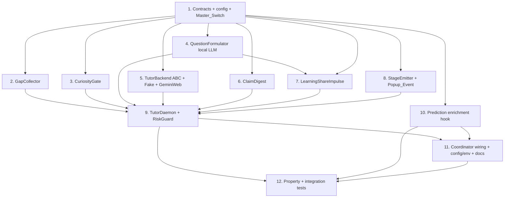

# Implementation Plan

## Overview

Kế hoạch triển khai Curiosity Tutor theo hướng tăng dần, test-driven, và **cô lập tuyệt
đối khỏi hot path**. Thứ tự: dựng contracts + config (Master_Switch mặc định TẮT) → thu
thập Knowledge_Gap → cổng tò mò → hình thành câu hỏi (local LLM) → backend gia sư web
(Playwright headed, có FakeBackend để test) → tiêu hóa claim → xung khoe → diễn cảnh popup
→ daemon orchestrator + risk guard → hook làm giàu dự đoán → nối Coordinator + cấu hình +
tài liệu → property/integration tests.

Mỗi bước có test bám vào acceptance criteria. Backend web **không test online**: dùng
`FakeTutorBackend` và trang HTML cố định. Mọi thứ chỉ chạy khi Master_Switch bật; mặc định
tắt để an toàn di trú.

## Task Dependency Graph



```json
{
  "waves": [
    { "wave": 1, "tasks": ["1"] },
    { "wave": 2, "tasks": ["2", "3", "4", "5", "6", "8", "10"] },
    { "wave": 3, "tasks": ["7"] },
    { "wave": 4, "tasks": ["9"] },
    { "wave": 5, "tasks": ["11"] },
    { "wave": 6, "tasks": ["12"] }
  ]
}
```

## Tasks

- [x] 1. Contracts, config và Master_Switch
  - Tạo package `src/cortex/tutor/` (`__init__.py`) và `src/cortex/tutor/contracts.py` với các literal (`TutorStage`, `FailReason`, `GapSource`) và dataclass (`KnowledgeGap`, `TutorQuestion`, `TutorAnswer`, `TutorEpisode`).
  - Áp ràng buộc field: `TutorQuestion.text` 1–400 ký tự; các giá trị [0,1] (`stake_relevance`, `prediction_error`) clamp khi gán.
  - Tạo `src/cortex/tutor/config.py` với `TutorConfig` (đầy đủ field theo design, `enabled=False`), `normalized()` (clamp + ép `enabled=False` khi cờ không hợp lệ), `TutorRiskGuard`, và `TutorLogger` (không log định danh).
  - Viết test: `normalized()` clamp đúng; cờ không hợp lệ ⇒ `enabled=False` + cảnh báo.
  - _Requirements: 3.1, 8.2, 8.3, 8.5_

- [x] 2. GapCollector
  - [x] 2.1 Dẫn xuất Knowledge_Gap
    - `collect_from_violation(violation, *, stake_relevance, now)` từ `ExpectationViolation` (mô tả lỗ + ngữ cảnh prediction/percept + prediction_error).
    - `collect_from_observer(frame, *, now)` khi `focus_kind="unknown"` hoặc `activity_intent="unknown"` và `ambiguity >= observer_ambiguity_threshold`.
    - _Requirements: 1.1, 1.2, 1.3_
  - [x] 2.2 Dedupe ngữ nghĩa + giới hạn queue
    - `push(gap)`: so embedding cosine với gap chưa giải quyết; tương đương ⇒ cập nhật `updated_ts` thay vì thêm mới. Vượt `max_gap_queue` ⇒ bỏ phần tử cũ nhất/`stake_relevance` thấp nhất.
    - `drain_candidates()` và `resolve(gap)`.
    - Viết test: dedupe không nhân đôi; queue ≤ 50.
    - _Requirements: 1.4, 1.5_

- [x] 3. CuriosityGate
  - Cài `select(gaps, *, idle, now, drive_level)`: chỉ khi `idle`; tôn trọng `min_seconds_between_episodes` và `max_episodes_per_hour`; bỏ gap dưới `curiosity_threshold`.
  - Điểm ưu tiên `clamp01(w1*stake_relevance + w2*prediction_error) * drive_factor`, không giảm theo stake/PE; `drive_factor` giảm khi drive thấp.
  - Viết test: idle-only, rate-limit + trần giờ, đơn điệu ưu tiên, ngưỡng, điều tiết drive.
  - _Requirements: 2.1, 2.2, 2.3, 2.4, 2.5, 2.6_

- [x] 4. QuestionFormulator (local LLM + fallback)
  - `formulate(gap) -> Optional[TutorQuestion]` dùng local LLM (qwen qua `llm/service`/`local_llama_engine`); prompt trung tính từ mô tả + ngữ cảnh gap. Heuristic fallback khi model lỗi.
  - Lọc PII/định danh (email/tên tài khoản) và rút gọn nội dung người dùng còn mức tối thiểu; ép 1–400 ký tự.
  - Trả `None` ⇒ caller bỏ gap với `fail_reason="formulation_failed"`.
  - Viết test: độ dài + lọc PII; model lỗi ⇒ fallback/None, không mở web.
  - _Requirements: 3.1, 3.2, 3.3, 3.4_

- [x] 5. TutorBackend: ABC + Fake + GeminiWeb
  - [x] 5.1 Interface + FakeTutorBackend
    - Định nghĩa `TutorBackend` (Protocol/ABC) với `ask(question, *, on_stage=None) -> TutorAnswer` và `close()`.
    - `FakeTutorBackend` trả answer cố định + cho phép giả lập timeout/captcha/empty cho test.
    - _Requirements: (hạ tầng test cho) 4.2, 4.4, 4.5_
  - [x] 5.2 GeminiWebBackend (Playwright headed)
    - `launch_persistent_context(profile_dir, headless=False)`; điều hướng `nav_url`; gõ theo nhịp người (`type_delay_ms` + delay ngẫu nhiên có giới hạn) vào `sel_input`, submit; đọc `sel_response` khi ổn định trong `answer_stable_window_s`; trích citations nếu có.
    - Timeout tổng `episode_timeout_s` bọc toàn bộ `ask()`; phát hiện Captcha_Or_Expired qua URL/selector đăng nhập ⇒ `fail_reason="captcha_or_expired"`, không tự vượt.
    - Selector lấy từ config; KHÔNG log cookie/email/HTML trang đăng nhập. Tắt Master_Switch ⇒ không khởi động trình duyệt, không truy cập mạng.
    - Viết test phần parse/timeout/captcha bằng trang HTML cố định (không online); test tắt-là-im.
    - _Requirements: 4.1, 4.2, 4.3, 4.4, 4.5, 4.6, 4.7_

- [x] 6. ClaimDigest
  - `digest(episode) -> int`: đưa `Tutor_Answer` qua đường commit claim hiện có (`claim_extractor` → trí nhớ ngữ nghĩa → consolidator), gắn provenance `source="tutor"` + `gap_id` + citations. Trả số claim commit.
  - Không tạo store mới; không phát answer ra kênh nói. Answer rỗng/không trích được ⇒ trả 0, giữ gap chưa giải quyết.
  - Viết test: commit qua đường hiện có với `source="tutor"`; không có đường phát answer ra payload `should_speak=true`; answer rỗng ⇒ giữ gap.
  - _Requirements: 5.1, 5.2, 5.3, 5.5_

- [x] 7. LearningShareImpulse (Eris khoe)
  - `maybe_emit(episode, *, now)`: tính novelty so trí nhớ; dưới `share_novelty_threshold` ⇒ bỏ. Rate-limit ≤ 1 lần/`share_window_s`.
  - `formulator.summarize_learning(episode)` sinh Learning_Highlight (gist diễn đạt lại, 1–200 ký tự, KHÔNG nguyên văn answer); đẩy Share_Impulse vào `thought_stream`/`internal_agenda`, không phát thẳng kênh nói.
  - Lỗi/rỗng highlight ⇒ bỏ khoe, không ảnh hưởng claim đã commit. Master_Switch tắt ⇒ không xung nào.
  - Viết test: highlight không nguyên văn + đúng độ dài; đẩy vào thought stream; lọc tầm thường; rate-limit; lỗi giữ claim; tắt ⇒ không xung.
  - _Requirements: 10.1, 10.2, 10.3, 10.4, 10.5, 10.6, 10.7_

- [x] 8. TutorStageEmitter + Popup_Event
  - `emit(episode, stage)` gửi `UdpTransport.send_json` cổng 4242 với `parse_mode="tutor_event"`, khối `tutor` (episode_id, stage, question_preview đã lọc PII + cắt ngắn, claims). `done`/`failed` gửi event đóng popup.
  - Gói nhỏ dưới `MAX_UDP_PAYLOAD_BYTES`; không chứa định danh. Lỗi gửi ⇒ nuốt lỗi, không chặn episode.
  - Viết test: hợp đồng payload (parse_mode, không PII, dưới trần); lỗi gửi được cô lập.
  - _Requirements: 6.1, 6.2, 6.3, 6.4, 6.5_

- [x] 9. TutorDaemon + RiskGuard
  - Cài `TutorDaemon.run_once(*, idle, now)` ghép vòng đời theo design: gate → formulate → backend.ask (emit stage) → digest → (commit>0) resolve gap + share_impulse → done/log. Mọi exception bắt trong `run_once`, phân loại `fail_reason`, không ném ra ngoài.
  - `RiskGuard`: đếm lỗi liên tiếp, vượt `max_consecutive_failures` ⇒ cooldown `failure_cooldown_s`; Captcha_Or_Expired ⇒ tạm ngưng `captcha_pause_s`. `stop()` đóng backend/profile sạch trong khoảng cấu hình.
  - Viết test: lỗi backend ⇒ hot path không hề hay biết; lỗi liên tiếp ⇒ cooldown; captcha ⇒ tạm ngưng; stop đóng tài nguyên.
  - _Requirements: 8.1, 8.4, 8.6, 4.5, 9.1, 9.2, 9.3, 9.4_

- [x] 10. Hook làm giàu dự đoán trong SituationModel
  - Thêm tham số keyword-only `knowledge_provider=None` vào `SituationModel.__init__`; trong `_make_prediction`, nếu provider có và trả gist liên quan thì dùng làm mô tả Prediction (cắt ≤ 280 ký tự), ngược lại giữ heuristic cũ.
  - Provider `enrich()` CHỈ đọc claim đã commit (không gọi backend/LLM trong lõi), giữ tất định.
  - Viết test: có claim ⇒ prediction giàu hơn; không có/provider None ⇒ serialize == baseline (tất định lõi giữ nguyên).
  - _Requirements: 7.1, 7.2, 7.3_

- [x] 11. Nối Coordinator, cấu hình và tài liệu
  - [x] 11.1 Khởi tạo + dừng `TutorDaemon` trong `runtime/coordinator.py` (qua `runtime/tutor_wiring.py`) cạnh các daemon nền; cấp `idle`/`now` + observer gap từ vòng autonomous; chỉ chạy khi Master_Switch bật (mặc định TẮT ⇒ no-op).
  - [x] 11.2 Đọc `ERIS_TUTOR_*` từ env; ghi `.env.example` + mục README §8 (cài Playwright, đăng nhập profile tay một lần, cảnh báo ToS/riêng tư). Hook `knowledge_provider` đã có trong `SituationModel` (Task 10).
  - [x] 11.3 Nối `tutor_ingest_fn` thật: commit bài học vào `semantic_memory` qua `memory_core.commit` (storage_permission + evidence_ids + confidence 0.66), store đã gắn `embedding_index` ⇒ bài học **có embedding**. Thêm `KnowledgeProvider` (recall claim tag "tutor") nối vào `SituationModel.set_knowledge_provider` ⇒ dự đoán lần sau dùng tri thức đã học.
  - _Requirements: 8.2, 8.3, 4.1, 7.1_

- [x] 12. Property-based + integration tests và rà soát cuối
  - Property tests: cô lập hot path (P1), tắt-là-im (P2), không rò định danh (P3), rate-limit/trần giờ (P4), không nhại lại (P5), tất định lõi dự đoán giữ nguyên (P6), đơn điệu ưu tiên gate (P7), dedupe/queue cap (P8), khoe không nhại & tiết chế (P9).
  - Integration `tests/test_tutor_daemon.py` với `FakeTutorBackend`: chạy trọn episode → commit claim → share impulse → popup events đúng thứ tự.
  - Chạy toàn bộ test suite, sửa lỗi phát sinh, dọn file tạm.
  - _Requirements: 1.4, 1.5, 2.2, 2.3, 2.4, 4.7, 5.3, 7.2, 7.3, 8.1, 8.2, 8.5, 10.1, 10.3, 10.5, 10.7_

## Notes

- Master_Switch mặc định TẮT xuyên suốt; chỉ bật sau khi Task 5.2 + 11 hoàn tất và đăng nhập profile tay.
- Backend web tuyệt đối không test online. `FakeTutorBackend` là đường test chính; `GeminiWebBackend` chỉ test parse/timeout/captcha qua HTML cố định.
- Toàn bộ Tutor chạy trong daemon riêng (Task 9); không bước nào được phép ném exception vào `CognitivePipeline`/autonomous/chat.
- Luật "tiêu hóa, không nhại lại" (Req 5.3, 10.3) là bất biến: không có đường nào đẩy `TutorAnswer` nguyên văn ra payload `should_speak=true`. Giữ điều này khi review Task 6, 7, 8.
- Điểm còn để ngỏ (vị trí/kích thước cửa sổ + cảnh báo riêng tư) chốt khi làm Task 5.2/11.
- Property test có thể chạy lâu; giới hạn số mẫu khi chạy CI.
