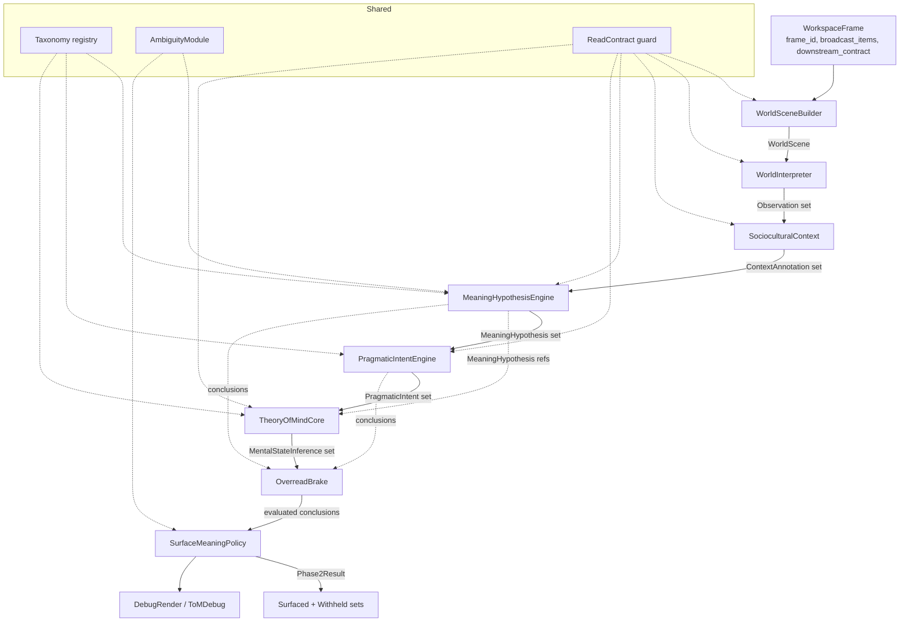
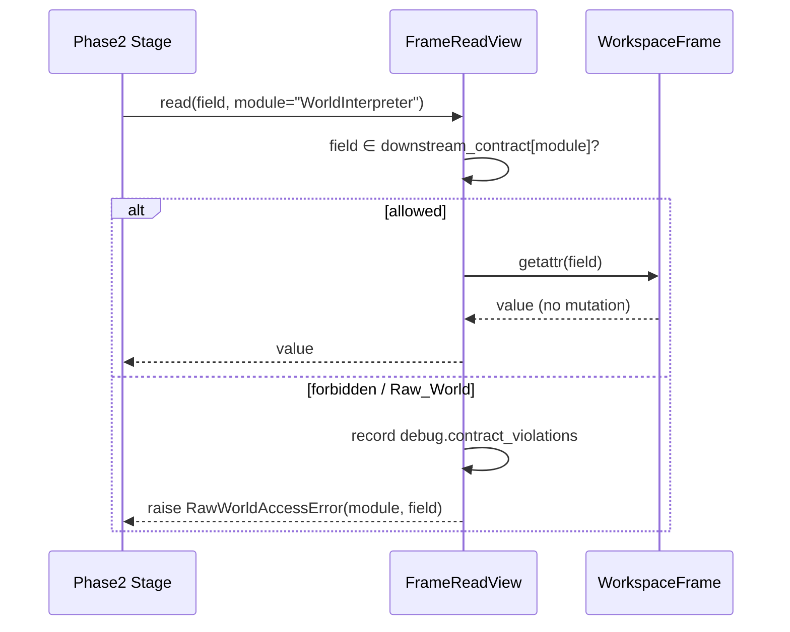

# Design Document — Phase 2: Meaning & Theory of Mind

## Overview

Phase 2 dựng tầng **hiểu ý nghĩa** (meaning) và **lý thuyết tâm trí** (Theory of Mind) cho ERIS. Mục tiêu cốt lõi: ERIS hiểu được ý nghĩa thật đằng sau tín hiệu/lời nói **mà không phán bậy** (no over-read). Phase 2 **không viết lại** logic scoring đã có — nó **bọc** (`wrap`) các module hiện hữu (`semantic_hypothesis.py`, `meaning.py`, `affect_semantics.py`, `continuity_threat.py`) vào các contract Phase 2 rõ ràng, đặt trong hai package mới: `src/cortex/meaning/` và `src/cortex/tom/`.

Thiết kế xoay quanh một pipeline tuyến tính, mỗi stage nhận đầu ra của stage trước và bổ sung thêm một lớp diễn giải, kèm ba chỉ số định lượng nhất quán toàn pipeline:

- **Confidence** ∈ [0.0, 1.0] — độ tin cậy.
- **Ambiguity** ∈ [0.0, 1.0] — độ mơ hồ giữa các giả thuyết cạnh tranh.
- **Overread_Risk** ∈ [0.0, 1.0] — rủi ro suy diễn vượt bằng chứng.

Hai ràng buộc kiến trúc xương sống được cưỡng chế ở mức cấu trúc (không chỉ bằng quy ước):

1. **WorkspaceFrame-only contract** (R1): mọi module Phase 2 chỉ đọc `WorkspaceFrame` (và đầu ra của các stage Phase 2 phía trước), không bao giờ đọc `Raw_World` (`raw_signals`/`evidence`/`memory` thô) trực tiếp. Vi phạm sẽ ném lỗi nêu rõ tên module.
2. **ToM-after-Meaning contract** (R7): `TheoryOfMindCore` từ chối chạy cho đến khi `MeaningHypothesisEngine` và `PragmaticIntentEngine` đã sinh đầu ra cho đúng `frame_id` hiện tại; ToM chỉ suy luận từ các đầu ra đó, không bao giờ từ câu thô của người dùng.

### Nguồn sự thật về đầu vào

Đầu vào duy nhất của Phase 2 là `WorkspaceFrame` (định nghĩa tại `src/cortex/global_workspace.py`, `@dataclass(slots=True)`). Các trường được dùng làm contract:

- Định danh & metadata: `frame_id: str`, `timestamp: float`, `budget_mode`.
- Đã chọn: `selected_evidence`, `selected_memory: list[str]`, `selected_affect`, `selected_goal`, `selected_risk`, `selected_social_hypothesis`, `selected_body_state`, `broadcast_reason`.
- Atom broadcast: `broadcast_items: list[WorkspaceItem]` (mỗi item có `evidence_ids`, `priority`, `confidence`, `kind`, `summary`).
- `suppressed_items`, `risks: list[WorkspaceRisk]`, `social_hypotheses: list[WorkspaceSocialHypothesis]`.
- `forbidden_assumptions: list[str]`, `active_threads: list[str]`, `dominant_thread: Optional[str]`.
- Chỉ số: `context_pressure`, `broadcast_priority`, `confidence`, `uncertainty` (float).
- `downstream_contract: dict[str, list[str]]` — liệt kê module nào được đọc field nào (R1.3 ràng `WorldSceneBuilder` vào hợp đồng này).
- `debug: dict`.
- Helper: `evidence_ids()`, `items_by_kind(kind)`, `surface_items(scope)`.

## Architecture

### Pipeline tổng thể



Thứ tự pipeline là **bắt buộc**:
`WorkspaceFrame → WorldSceneBuilder → WorldInterpreter → SocioculturalContext → MeaningHypothesisEngine → PragmaticIntentEngine → TheoryOfMindCore → OverreadBrake → SurfaceMeaningPolicy → Debug + Test Matrix`.

### Package layout

```
src/cortex/meaning/
  __init__.py               # export pipeline + facade Phase2MeaningPipeline
  taxonomy.py               # registry meaning/intent/mental-state categories + startup validation
  world_scene_builder.py    # WorkspaceFrame -> WorldScene
  world_interpreter.py      # WorldScene -> Observation set
  sociocultural_context.py  # Observation set -> ContextAnnotation set
  meaning_hypothesis.py     # ContextAnnotation set -> MeaningHypothesis set (wrap semantic_hypothesis + meaning)
  pragmatic_intent.py       # MeaningHypothesis set -> PragmaticIntent set
  ambiguity.py              # AmbiguityModule (định lượng mơ hồ)
  overread_brake.py         # OverreadBrake (phanh phán bậy)
  surface_meaning_policy.py # phân vùng surfaced / withheld
  debug_render.py           # DebugRender
  read_contract.py          # ReadContract guard (WorkspaceFrame-only enforcement)

src/cortex/tom/
  __init__.py
  contracts.py              # MentalStateInference, ToM dataclasses, lỗi contract
  theory_of_mind.py         # TheoryOfMindCore (ToM-after-Meaning guard)
  mental_state_ranker.py    # MentalStateRanker
  counterfactual_corrector.py
  tom_history_adapter.py    # ToMHistoryAdapter (history từ WorkspaceFrame only)
  tom_debug.py              # ToMDebug

tests/
  test_world_scene_builder.py
  test_sociocultural_context.py
  test_meaning_hypothesis.py
  test_pragmatic_intent.py
  test_theory_of_mind.py
  test_overread_brake.py
  test_phase2_integration.py
```

### Hai cơ chế cưỡng chế xương sống

#### 1. WorkspaceFrame-only — `ReadContract` guard

Vấn đề: cần đảm bảo không stage nào lén đọc `Raw_World`. Vì mọi stage Phase 2 đều nhận một `WorkspaceFrame`, ta đặt một **typed read boundary**: thay vì truyền thẳng `WorkspaceFrame` cho các stage, pipeline bọc nó trong một `FrameReadView`.

- `FrameReadView` chỉ expose các getter ứng với những field mà `downstream_contract` cho phép module hiện tại đọc (R1.3). Mỗi getter gắn tên module gọi.
- `FrameReadView` **không** expose bất kỳ kênh nào tới `raw_signals` / evidence chưa lọc / memory chưa chọn. Phase 2 không import các module Raw_World; lint/test cưỡng chế điều này.
- Nếu một stage gọi một field ngoài hợp đồng của nó, `FrameReadView` ném `RawWorldAccessError(module_name, field_name)` — đây là "contract violation error that identifies the offending module by name" (R1.2). Lần đọc đang diễn ra trả về dữ liệu không bị mutate, và vi phạm được ghi vào `debug.contract_violations`.
- Một test tĩnh (R13.5) quét AST các module Phase 2 để khẳng định không có import/tham chiếu tới symbol Raw_World.



#### 2. ToM-after-Meaning — `StageLedger`

Mỗi lần chạy pipeline có một `StageLedger` ghi nhận stage nào đã sinh đầu ra cho `frame_id` nào. `TheoryOfMindCore.infer(...)` mở đầu bằng cách kiểm tra ledger:

- Nếu `MeaningHypothesisEngine` **hoặc** `PragmaticIntentEngine` chưa có entry cho `frame_id` hiện tại → từ chối chạy, trả về kết quả rỗng, ghi `ToMOrderingViolation(missing_stage)` vào debug (R7.2, R13.3).
- ToM chỉ nhận tham số là `list[MeaningHypothesis]` và `list[PragmaticIntent]`; chữ ký hàm không có tham số nào cho câu thô — ràng buộc "không đọc câu thô" được cưỡng chế bằng kiểu (R7.1).

## Components and Interfaces

Tất cả interface dưới đây là Python; các kiểu dữ liệu chi tiết ở mục Data Models. Mọi stage đều nhận `frame_id` để gắn vào artifact (R1.5) và một `FrameReadView`/đầu vào stage trước, trả về `(output, StageDebug)`.

### Taxonomy (`taxonomy.py`)

```python
class Taxonomy:
    MEANING: frozenset[str]        # >= 1 category
    INTENT: frozenset[str]         # >= 1 category
    MENTAL_STATE: frozenset[str]   # >= 1 category

    @classmethod
    def validate_on_startup(cls) -> None:
        """Kiểm tra mỗi set có id duy nhất; trùng -> ConfigurationError(id, set)."""

    @classmethod
    def require(cls, set_name: str, category_id: str) -> str:
        """Trả về category_id nếu hợp lệ; nếu không -> ConfigurationError(category_id, set_name)."""
```

- Vì `frozenset` tự khử trùng, registry nguồn được khai báo dưới dạng `tuple` rồi `validate_on_startup` so độ dài tuple với độ dài set để phát hiện trùng id (R11.4).
- `require()` là cổng bắt buộc trước mọi gán category (R11.2, R11.3): gán không qua `require()` bị coi là bug và bị test chặn.

### WorldSceneBuilder (`world_scene_builder.py`)

```python
class WorldSceneBuilder:
    def build(self, view: FrameReadView | None) -> tuple[WorldScene, StageDebug]:
        ...
```

- Đọc chỉ các field trong `downstream_contract["WorldSceneBuilder"]` (R1.3); field ngoài hợp đồng bị bỏ qua.
- `view is None` → `WorldScene` rỗng, `confidence=0.0`, debug ghi lý do (R1.4); không đọc Raw_World.
- Có `broadcast_items` → đúng một `WorldScene` với `entities`, `salient_signals`, `active_threads`; mỗi element có `confidence ∈ [0,1]` (R2.1, R2.2). Mục tiêu thời gian < 500ms (logic thuần, không I/O).
- `dominant_thread` tồn tại → đúng một element được đánh `is_dominant_focus=True` (R2.3).
- Bảo toàn nguyên vẹn mọi `evidence_id` từ frame lên element phụ thuộc (R2.5).
- `broadcast_items` rỗng → một `WorldScene` rỗng có `reason`, vẫn tính là một scene (R2.4).
- Frame malformed/không parse được → không sinh scene, trả `InvalidWorkspaceFrameError` (R2.6).
- Thiếu field bắt buộc → `confidence` của kết quả bị cap ở 0.5, ghi tên field thiếu (R1.6).

### WorldInterpreter (`world_interpreter.py`)

```python
class WorldInterpreter:
    def interpret(self, scene: WorldScene, *, low_conf_threshold: float = 0.5
                  ) -> tuple[list[Observation], StageDebug]:
        ...
```

- Scene có ≥1 element → tập 0..n `Observation`, mỗi observation có `confidence ∈ [0,1]` và ≥1 `evidence_id` (R3.1).
- **Không** sinh intent/mental-state (scope guard R3.2).
- Element có `confidence < low_conf_threshold` (mặc định 0.5, cấu hình trong [0,1]) → observation dẫn xuất bị đánh `low_confidence=True` (R3.3).
- Mỗi observation giữ tham chiếu `source_element_id` về element gốc (R3.4).
- Scene rỗng/None/sai cấu trúc → không sinh observation, trả error chỉ rõ thất bại; observation cũ giữ nguyên (R3.5).
- Candidate không gắn được ≥1 `evidence_id` → loại khỏi tập (R3.6).

### SocioculturalContext (`sociocultural_context.py`)

```python
class SocioculturalContext:
    def annotate(self, observations: list[Observation], view: FrameReadView
                 ) -> tuple[list[ContextAnnotation], StageDebug]:
        ...
```

- Đủ ba ngữ cảnh (relationship, register, social-norm) từ frame → annotate mỗi observation cả ba loại (R4.1).
- `social_hypotheses` của frame → đưa vào dạng `unconfirmed`, không coi là fact (R4.2).
- Thiếu loại nào → áp **neutral default** không thiên kiến cho loại đó trước khi xử lý (R4.3), và ghi nhận default đã áp theo từng loại (R4.4).
- Mỗi annotation có `confidence ∈ [0,1]` (R4.5).
- Observation set rỗng → không annotation, kết thúc không lỗi (R4.6).

### MeaningHypothesisEngine (`meaning_hypothesis.py`)

Đây là module **wrap** — không reimplement scoring (R5.7).

```python
class MeaningHypothesisEngine:
    def __init__(self, *, semantic_engine: SemanticHypothesisEngine,
                 meaning_layer: MeaningLayer, max_hypotheses: int = 4,
                 ambiguity_margin: float = 0.08, low_conf_threshold: float = 0.2,
                 ambiguity_module: AmbiguityModule): ...

    def generate(self, annotations: list[ContextAnnotation], *, frame_id: str
                 ) -> tuple[list[MeaningHypothesis], StageDebug]:
        ...
```

- Gọi `SemanticHypothesisEngine.compare/compare_many` để lấy `SemanticHypothesisReport`, và `MeaningLayer` để lấy vật liệu meaning-slot; **adapt** `SemanticHypothesis` → `MeaningHypothesis` (giữ `confidence`, dùng `report.ambiguity`/`_estimate_ambiguity` cho `ambiguity`, suy `overread_risk` từ fallback/biên độ/đủ evidence).
- Sinh 1..`max_hypotheses` (mặc định 4) instance (R5.1).
- Mỗi hypothesis: tập `evidence_ids` không rỗng + `confidence`, `ambiguity`, `overread_risk` đều ∈ [0,1] (R5.2).
- Hai+ hypothesis có `|Δconfidence| ≤ margin` (mặc định 0.08) → tăng `ambiguity` của chúng, không vượt 1.0 (R5.3).
- Không hypothesis nào được evidence chống đỡ → đúng một hypothesis "insufficient evidence" với `confidence < low_conf_threshold` (mặc định 0.2) (R5.4).
- Xếp giảm dần theo `confidence` (R5.5); bằng `confidence` → tie-break tăng dần theo `ambiguity` (R5.6).

### PragmaticIntentEngine (`pragmatic_intent.py`)

```python
class PragmaticIntentEngine:
    def derive(self, hypotheses: list[MeaningHypothesis], *, frame_id: str
               ) -> tuple[list[PragmaticIntent], StageDebug]:
        ...
```

- Tập ranked không rỗng → 1..8 pragmatic intent, mỗi cái thuộc đúng một category trong `Taxonomy.INTENT` (qua `require()`) (R6.1).
- Chỉ suy từ `MeaningHypothesis`, không đọc/không tham chiếu Raw_World (R6.2).
- Mỗi intent có `confidence ∈ [0,1]` + ≥1 tham chiếu `MeaningHypothesis`, giữ tham chiếu cả khi `confidence == 0.0` (R6.3).
- Có hypothesis hỗ trợ với `ambiguity > 0.7` → intent dẫn xuất nhận `confidence` **nghiêm ngặt thấp hơn** so với khi cùng tập hỗ trợ nhưng mọi `ambiguity ≤ 0.7` (R6.4).
- Tập hypothesis rỗng → 0 intent + chỉ báo "no pragmatic intent" (R6.5).

### TheoryOfMindCore + cộng sự (`tom/`)

```python
class TheoryOfMindCore:
    def infer(self, *, meaning: list[MeaningHypothesis], intents: list[PragmaticIntent],
              ledger: StageLedger, frame_id: str, history: ToMHistory
              ) -> tuple[list[MentalStateInference], ToMDebugRecord]:
        ...
```

- Guard ToM-after-Meaning qua `ledger` (R7.2). Chỉ suy từ `meaning`/`intents`, không Raw_World/câu thô (R7.1).
- Mỗi inference có category trong `Taxonomy.MENTAL_STATE`, `confidence ∈ [0,1]`, tham chiếu `MeaningHypothesis` hỗ trợ (R7.6).
- Không gắn được tham chiếu hỗ trợ → vẫn sinh inference nhưng đánh cờ `unsupported=True` (R7.7).
- `MentalStateRanker.rank()`: giảm dần theo `confidence`; bằng confidence → `overread_risk` thấp hơn xếp trên (R7.3).
- `CounterfactualCorrector.correct()`: tồn tại giải thích phản thực có `confidence ≥ threshold` → giảm `confidence` của inference (không dưới 0.0) và ghi lại counterfactual đã kích hoạt (R7.4).
- `ToMHistoryAdapter.load(view)`: chỉ lấy history từ `WorkspaceFrame` (R7.5); thiếu history → cấp rỗng, ghi "history unavailable", ToM vẫn chạy tiếp (R7.8).

### OverreadBrake (`overread_brake.py`)

```python
class OverreadBrake:
    def __init__(self, *, reduction_threshold: float = 0.70,
                 suppression_threshold: float = 0.90,
                 reduced_conf_cap: float = 0.50, min_evidence_count: int = 2): ...

    def evaluate(self, conclusions: list[Conclusion], *, forbidden_assumptions: list[str]
                 ) -> tuple[list[EvaluatedConclusion], StageDebug]:
        ...
```

Áp cho mọi `Conclusion` (MeaningHypothesis | PragmaticIntent | MentalStateInference):

- `reduction_threshold ≤ overread_risk < suppression_threshold` → giảm `confidence` xuống ≤ `reduced_conf_cap` (mặc định 0.50) (R8.1).
- `overread_risk ≥ suppression_threshold` (mặc định 0.90) → đánh `overread_suppressed=True` (R8.2).
- `len(evidence_ids) < min_evidence_count` (mặc định 2) → `overread_suppressed=True` (R8.3).
- Conclusion khẳng định một `forbidden_assumption` như fact → suppressed, ghi forbidden assumption đã khớp làm lý do (R8.6).
- Mọi lần giảm/suppress: ghi `reason`, `metric_name`, `metric_value` (R8.4).
- Conclusion bị suppress được **giữ** trong debug kèm `confidence` gốc và metric gốc, không vứt đi (R8.5).

### AmbiguityModule (`ambiguity.py`)

```python
class AmbiguityModule:
    def compute(self, hypotheses: list[ScoredHypothesis]) -> AmbiguityResult:
        ...  # giữ giá trị trước đó nếu input invalid
```

- ≥2 hypothesis → `ambiguity ∈ [0,1]` cho tập (R9.1).
- Đúng 1 hypothesis, không đối thủ → `ambiguity ∈ [0.0, 0.1]` (R9.2).
- `|Δconfidence| top-2 ≤ 0.05` → `ambiguity ∈ [0.9, 1.0]` (R9.3).
- 0 hypothesis → `ambiguity = 0.0` + chỉ báo "no hypotheses" (R9.4).
- Có `confidence` ngoài [0,1] → từ chối tập, chỉ báo invalid, giữ nguyên ambiguity trước đó (R9.5).

### SurfaceMeaningPolicy (`surface_meaning_policy.py`)

```python
class SurfaceMeaningPolicy:
    def __init__(self, *, surface_conf_threshold: float, ambiguity_threshold: float): ...
    def partition(self, evaluated: list[EvaluatedConclusion], *, frame_id: str
                  ) -> Phase2Result:
        ...
```

Phân **mỗi** conclusion vào đúng một trong hai tập — `surfaced` hoặc `withheld` (R10.1). Thứ tự kiểm tra (quyết định, ưu tiên trên xuống):

1. Bị OverreadBrake suppress → withheld, ghi lý do (R10.7).
2. Không có `evidence_id` hỗ trợ → withheld (R10.8).
3. `ambiguity == 1.0` → withheld bất kể confidence (R10.4).
4. `confidence < surface_conf_threshold` → withheld, ghi lý do (R10.2).
5. `confidence ≥ surface_conf_threshold` và `ambiguity_threshold ≤ ambiguity < 1.0` → surfaced, đánh `tentative` (R10.3).
6. `confidence ≥ surface_conf_threshold` và `ambiguity < ambiguity_threshold` → surfaced, đánh `asserted` (R10.6).

Trả `Phase2Result` ghi cả hai tập và trạng thái surface/withheld từng conclusion (R10.5). Bất biến: mọi phần tử trong `surfaced` đều có ≥1 `evidence_id` (R10.8, R13.8).

### DebugRender / ToMDebug (`debug_render.py`, `tom/tom_debug.py`)

```python
class DebugRender:
    def render(self, run: Phase2Run) -> str: ...
class ToMDebug:
    def render(self, inferences: list[MentalStateInference]) -> str: ...
```

- Bản ghi người-đọc-được: mỗi stage kèm `confidence`/`ambiguity`/`overread_risk` ∈ [0,1] (R12.1); mọi conclusion suppressed/withheld kèm lý do (R12.2); `frame_id` của run (R12.4).
- `ToMDebug`: mỗi mental-state inference + tham chiếu `MeaningHypothesis` hỗ trợ (R12.3).
- Thiếu một trong ba chỉ số ở stage → ghi "unavailable" cho chỉ số đó, vẫn render tiếp các stage còn lại (R12.5).
- Không có `frame_id` → ghi "frame_id unavailable" (R12.6).

## Data Models

Mọi dataclass dùng `@dataclass(slots=True)` cho nhất quán với `global_workspace.py`. Ba chỉ số `confidence`/`ambiguity`/`overread_risk` luôn là `float` được clamp về [0.0, 1.0] tại điểm khởi tạo (helper `clamp01`).

```python
# ---- WorldScene ----
@dataclass(slots=True)
class WorldSceneElement:
    element_id: str
    kind: str                      # entity | salient_signal | thread
    summary: str
    evidence_ids: list[str]        # bảo toàn nguyên vẹn từ frame (R2.5)
    confidence: float              # [0,1] (R2.2)
    is_dominant_focus: bool = False
    source_item_id: str | None = None

@dataclass(slots=True)
class WorldScene:
    frame_id: str | None           # R1.5
    entities: list[WorldSceneElement]
    salient_signals: list[WorldSceneElement]
    active_threads: list[WorldSceneElement]
    confidence: float              # cap 0.5 nếu thiếu field (R1.6); 0.0 nếu rỗng (R1.4)
    is_empty: bool = False
    reason: str = ""               # lý do rỗng (R1.4, R2.4)

# ---- Observation ----
@dataclass(slots=True)
class Observation:
    observation_id: str
    summary: str
    evidence_ids: list[str]        # >=1 (R3.1, R3.6)
    confidence: float
    source_element_id: str         # R3.4
    low_confidence: bool = False   # R3.3

# ---- Sociocultural ----
@dataclass(slots=True)
class ContextAnnotation:
    observation: Observation
    relationship: str              # neutral default nếu thiếu (R4.3)
    register: str
    social_norm: str
    unconfirmed_social: list[str]  # social_hypotheses dạng chưa xác nhận (R4.2)
    defaults_applied: list[str]    # loại nào dùng default (R4.4)
    confidence: float              # R4.5

# ---- Meaning ----
@dataclass(slots=True)
class MeaningHypothesis:
    hypothesis_id: str
    category: str                  # Taxonomy.MEANING (qua require())
    summary: str
    evidence_ids: list[str]        # non-empty (R5.2)
    confidence: float
    ambiguity: float
    overread_risk: float
    is_insufficient_evidence: bool = False   # R5.4
    source_semantic_label: str | None = None # truy vết về SemanticHypothesis được wrap

# ---- Pragmatic intent ----
@dataclass(slots=True)
class PragmaticIntent:
    intent_id: str
    category: str                  # Taxonomy.INTENT
    confidence: float
    supporting_meaning_ids: list[str]   # >=1, giữ cả khi confidence==0 (R6.3)
    overread_risk: float = 0.0

# ---- Theory of Mind ----
@dataclass(slots=True)
class MentalStateInference:
    inference_id: str
    category: str                  # Taxonomy.MENTAL_STATE
    summary: str
    confidence: float
    overread_risk: float
    supporting_meaning_ids: list[str]   # R7.6
    unsupported: bool = False           # R7.7
    counterfactual_reason: str = ""     # R7.4

@dataclass(slots=True)
class ToMHistory:
    items: list[str]
    available: bool = True              # R7.8

# ---- OverreadBrake / Surface ----
Conclusion = MeaningHypothesis | PragmaticIntent | MentalStateInference

@dataclass(slots=True)
class EvaluatedConclusion:
    conclusion: Conclusion
    kind: str                      # "meaning" | "intent" | "mental_state"
    confidence: float              # có thể đã bị giảm (R8.1)
    original_confidence: float     # giữ giá trị gốc cho debug (R8.5)
    overread_suppressed: bool = False
    brake_reason: str = ""
    metric_name: str = ""
    metric_value: float = 0.0

@dataclass(slots=True)
class SurfaceDecision:
    conclusion_id: str
    status: str                    # "surfaced_asserted" | "surfaced_tentative" | "withheld"
    reason: str = ""

@dataclass(slots=True)
class Phase2Result:
    frame_id: str | None           # R1.5, R12.4
    surfaced: list[EvaluatedConclusion]
    withheld: list[EvaluatedConclusion]
    decisions: list[SurfaceDecision]   # R10.5
    debug: dict                        # contract_violations, missing_fields, stage debugs

# ---- Hỗ trợ guard ----
@dataclass(slots=True)
class StageDebug:
    stage: str
    confidence: float | None = None
    ambiguity: float | None = None
    overread_risk: float | None = None
    missing_fields: list[str] = field(default_factory=list)
    notes: list[str] = field(default_factory=list)

class StageLedger:
    """Ghi stage nào đã sinh output cho frame_id nào (ToM-after-Meaning guard)."""
    def record(self, stage: str, frame_id: str) -> None: ...
    def has(self, stage: str, frame_id: str) -> bool: ...
```

### Lỗi & ngoại lệ (kiểu dữ liệu)

```python
class RawWorldAccessError(RuntimeError):     # R1.2  -> (module_name, field_name)
class InvalidWorkspaceFrameError(ValueError):# R2.6
class WorldSceneValidationError(ValueError): # R3.5
class ToMOrderingViolation(RuntimeError):    # R7.2, R13.3 -> (missing_stage, frame_id)
class ConfigurationError(ValueError):        # R11.3, R11.4 -> (category_id, set_name)
```

## Correctness Properties

*A property is a characteristic or behavior that should hold true across all valid executions of a system — essentially, a formal statement about what the system should do. Properties serve as the bridge between human-readable specifications and machine-verifiable correctness guarantees.*

Các property dưới đây được rút ra từ phần prework, đã loại bỏ trùng lặp (xem Property Reflection trong prework). Mỗi property là một mệnh đề lượng từ phổ quát ("for all"/"for any") và sẽ được hiện thực bằng đúng một property-based test (hypothesis), tối thiểu 100 vòng lặp.

### Property 1: Surfaced conclusions always carry evidence (no-overread flagship)

*For any* set of at least 100 generated WorkspaceFrame inputs run through the full Phase 2 pipeline, every conclusion placed in the surfaced set carries at least one supporting evidence_id.

**Validates: Requirements 10.8, 13.8**

### Property 2: Surface partition is total and disjoint

*For any* set of OverreadBrake-evaluated conclusions, the SurfaceMeaningPolicy assigns each conclusion to exactly one of {surfaced, withheld} — the union equals the input set and the intersection is empty — and records exactly one SurfaceDecision per input conclusion.

**Validates: Requirements 10.1, 10.5**

### Property 3: Surface classification rules hold

*For any* evaluated conclusion, its surface status follows the precedence rules: suppressed → withheld; no evidence_id → withheld; ambiguity == 1.0 → withheld; confidence below the surface threshold → withheld; confidence at/above threshold with ambiguity in [ambiguity_threshold, 1.0) → surfaced tentative; confidence at/above threshold with ambiguity below the ambiguity threshold → surfaced asserted.

**Validates: Requirements 10.2, 10.3, 10.4, 10.6, 10.7**

### Property 4: WorkspaceFrame-only boundary

*For any* generated WorkspaceFrame, every Phase 2 stage produces its output referencing only fields exposed by the frame (and upstream stage outputs), and no stage references Raw_World data; mutating any field not in a stage's downstream_contract entry leaves that stage's output unchanged.

**Validates: Requirements 1.1, 1.3, 6.2, 7.1, 7.5**

### Property 5: Frame_id traceability

*For any* generated WorkspaceFrame run through the pipeline, every produced artifact (WorldScene, observations bundle, Phase2Result, debug record) carries the same frame_id as the input frame.

**Validates: Requirements 1.5, 12.4**

### Property 6: Missing-field confidence cap

*For any* WorkspaceFrame missing at least one required field, the produced result has Confidence ≤ 0.5 and records the name of each missing field in debug output.

**Validates: Requirements 1.6**

### Property 7: WorldScene structure and confidence bounds

*For any* WorkspaceFrame containing at least one broadcast item, the WorldSceneBuilder produces exactly one WorldScene containing entities, salient signals, and active threads, and every WorldScene element has a Confidence value in [0.0, 1.0].

**Validates: Requirements 2.1, 2.2**

### Property 8: Exactly one dominant focus when dominant_thread present

*For any* WorkspaceFrame that exposes a dominant_thread, exactly one WorldScene element is marked as the dominant focus.

**Validates: Requirements 2.3**

### Property 9: Empty-frame yields exactly one empty scene

*For any* WorkspaceFrame with no broadcast items, the WorldSceneBuilder produces exactly one empty WorldScene that records a non-empty reason indicating the absence of broadcast items.

**Validates: Requirements 2.4**

### Property 10: Evidence_id preservation

*For any* WorkspaceFrame, every evidence_id carried by a WorldScene element that depends on evidence is preserved exactly (unmodified) from the originating WorkspaceFrame evidence_ids.

**Validates: Requirements 2.5**

### Property 11: Observations are well-formed and traceable

*For any* WorldScene with at least one element, every produced observation carries a Confidence value in [0.0, 1.0], at least one supporting evidence_id, and a reference to an existing originating WorldScene element.

**Validates: Requirements 3.1, 3.4, 3.6**

### Property 12: WorldInterpreter stays in scope

*For any* WorldScene, the WorldInterpreter output contains only Observation instances and no intent or mental-state inferences.

**Validates: Requirements 3.2**

### Property 13: Low-confidence propagation

*For any* WorldScene and configured low-confidence threshold, every observation derived from an element whose Confidence is below the threshold is marked low-confidence.

**Validates: Requirements 3.3**

### Property 14: Full sociocultural annotation when contexts present

*For any* non-empty observation set where relationship, register, and social-norm contexts are all available, every produced annotation carries all three context types and a Confidence value in [0.0, 1.0].

**Validates: Requirements 4.1, 4.5**

### Property 15: Social hypotheses remain unconfirmed

*For any* WorkspaceFrame exposing social_hypotheses, all such hypotheses appear in the annotation's unconfirmed bucket and none are treated as confirmed fact.

**Validates: Requirements 4.2**

### Property 16: Neutral defaults applied and recorded

*For any* observation set where one or more of the three context types is unavailable, each missing context type is set to its predefined neutral default value and recorded in the per-type defaults-applied record.

**Validates: Requirements 4.3, 4.4**

### Property 17: Meaning hypotheses count and metric bounds

*For any* context-annotated observation set, the MeaningHypothesisEngine produces between 1 and the configured maximum (default 4) MeaningHypothesis instances, and every produced hypothesis has a non-empty set of evidence_ids and Confidence, Ambiguity, and Overread_Risk values each in [0.0, 1.0].

**Validates: Requirements 5.1, 5.2**

### Property 18: Near-tie hypotheses raise ambiguity

*For any* set of produced MeaningHypothesis instances, any two whose Confidence values differ by at most the configured margin (default 0.08) have their Ambiguity values increased without exceeding 1.0.

**Validates: Requirements 5.3**

### Property 19: Insufficient-evidence fallback

*For any* context-annotated observation set in which no hypothesis can be supported by available evidence, the engine produces exactly one explicit insufficient-evidence hypothesis with Confidence below the configured low-confidence threshold (default 0.2).

**Validates: Requirements 5.4**

### Property 20: Meaning hypotheses ordering

*For any* set of produced MeaningHypothesis instances, the output is ordered by Confidence descending, with ties broken by Ambiguity ascending.

**Validates: Requirements 5.5, 5.6**

### Property 21: Pragmatic intent count and valid categories

*For any* non-empty ranked set of MeaningHypothesis instances, the PragmaticIntentEngine produces between 1 and 8 pragmatic intents, each classified as exactly one category defined in the Taxonomy intent set.

**Validates: Requirements 6.1, 11.2**

### Property 22: Intents retain supporting references and confidence bounds

*For any* non-empty set of MeaningHypothesis instances, every produced pragmatic intent carries a Confidence value in [0.0, 1.0] and at least one supporting MeaningHypothesis reference, retained even when the Confidence value is 0.0.

**Validates: Requirements 6.3**

### Property 23: High ambiguity lowers intent confidence

*For any* set of supporting MeaningHypothesis instances, when at least one supporter has Ambiguity greater than 0.7, the derived pragmatic intent receives a Confidence strictly lower than the Confidence derived from the same supporters when all their Ambiguity values are 0.7 or lower.

**Validates: Requirements 6.4**

### Property 24: Mental-state inferences are bounded and supported

*For any* meaning and pragmatic-intent inputs, every produced mental-state inference carries a Confidence value in [0.0, 1.0], a category defined in the Taxonomy mental-state set, and supporting MeaningHypothesis references; an inference that cannot attach supporting references is still produced and flagged unsupported.

**Validates: Requirements 7.6, 7.7, 11.2**

### Property 25: Mental-state ranking order

*For any* set of mental-state inferences, the MentalStateRanker orders them by Confidence descending, with ties broken by Overread_Risk ascending.

**Validates: Requirements 7.3**

### Property 26: Counterfactual reduction stays in range and is recorded

*For any* mental-state inference for which a counterfactual explanation with Confidence at or above the configured threshold exists, the CounterfactualCorrector reduces the inference's Confidence to a value no lower than 0.0 and records the triggering counterfactual explanation.

**Validates: Requirements 7.4**

### Property 27: Overread confidence reduction band

*For any* conclusion whose Overread_Risk is at or above the reduction threshold (default 0.70) and below the suppression threshold, the OverreadBrake reduces its Confidence to at most the configured reduced-confidence cap (default 0.50).

**Validates: Requirements 8.1**

### Property 28: Overread suppression conditions

*For any* conclusion, the OverreadBrake marks it overread-suppressed when its Overread_Risk is at or above the suppression threshold (default 0.90), when it is supported by fewer evidence_ids than the configured minimum (default 2), or when it asserts a listed forbidden assumption as fact.

**Validates: Requirements 8.2, 8.3, 8.6, 13.6**

### Property 29: Non-suppression below threshold

*For any* conclusion whose Overread_Risk is at or below the configured suppression threshold and which otherwise satisfies evidence and forbidden-assumption constraints, the OverreadBrake does not mark it suppressed on the basis of Overread_Risk.

**Validates: Requirements 13.7**

### Property 30: Brake records and preserves originals

*For any* conclusion whose Confidence is reduced or which is suppressed by the OverreadBrake, the brake records the reason, the triggering metric name, and the triggering metric value, and preserves the conclusion in debug output retaining its original Confidence and metric values.

**Validates: Requirements 8.4, 8.5**

### Property 31: Ambiguity computation bounds

*For any* set of hypotheses provided to the AmbiguityModule: a set of two or more yields an Ambiguity value in [0.0, 1.0]; a single hypothesis with no competitor yields a value in [0.0, 0.1]; and a set whose top two Confidence values differ by at most 0.05 yields a value in [0.9, 1.0].

**Validates: Requirements 9.1, 9.2, 9.3**

### Property 32: Debug record completeness

*For any* completed Phase 2 pipeline run, the debug record contains, for each pipeline stage, its Confidence, Ambiguity, and Overread_Risk values (each in [0.0, 1.0] or marked unavailable), includes every suppressed and withheld conclusion together with its reason, records the run's frame_id (or marks it unavailable), and the ToM debug record references each mental-state inference together with its supporting MeaningHypothesis references.

**Validates: Requirements 12.1, 12.2, 12.3, 12.4**

## Error Handling

The Phase 2 pipeline distinguishes four error tiers. Errors never silently corrupt downstream state; an erroring stage produces a typed error and the run is recorded in debug.

- **Contract violations (hard, named).** `RawWorldAccessError(module_name, field_name)` is raised by `FrameReadView` when a stage reads outside its `downstream_contract` allowance or any Raw_World channel (R1.2). The in-progress read returns un-mutated data and the violation is appended to `debug.contract_violations`. `ToMOrderingViolation(missing_stage, frame_id)` is raised when `TheoryOfMindCore` runs before `MeaningHypothesisEngine`/`PragmaticIntentEngine` for the current frame; ToM returns an empty inference set and records the violation (R7.2, R13.3).

- **Malformed / invalid inputs (stage-local).** `InvalidWorkspaceFrameError` (R2.6) — WorldSceneBuilder produces no scene. `WorldSceneValidationError` (R3.5) — WorldInterpreter produces no observations and leaves previously produced observations unchanged. The AmbiguityModule rejects sets containing a Confidence outside [0,1], returns an invalid indication, and retains its previously computed Ambiguity value (R9.5).

- **Degraded inputs (graceful fallback).** Missing WorkspaceFrame → empty WorldScene, Confidence 0.0, reason recorded (R1.4). Missing required field → Confidence capped at 0.5 with field names recorded (R1.6). Missing context types → neutral defaults (R4.3, R4.4). Missing history → `ToMHistory(available=False)`, ToM continues (R7.8). No supportable meaning → single insufficient-evidence hypothesis (R5.4). Empty inputs → empty outputs without raising (R4.6, R6.5, R9.4).

- **Configuration errors (startup / assignment).** `ConfigurationError(category_id, set_name)` is raised by `Taxonomy.validate_on_startup` on duplicate identifiers (R11.4) and by `Taxonomy.require` on any reference to an undefined category, halting the operation without mutating existing state (R11.3).

All clamp operations route through a single `clamp01` helper so Confidence/Ambiguity/Overread_Risk can never escape [0.0, 1.0] regardless of upstream arithmetic.

## Testing Strategy

Phase 2 logic is overwhelmingly pure (frame → structured outputs, scoring adapters, ranking, partitioning), so **property-based testing applies and is the primary correctness mechanism**, complemented by example/edge unit tests and one integration test. The project already uses `pytest` + `hypothesis` (see `tests/test_pbt_*.py`), with `sys.path.insert(..., "src")` to import `cortex.*`. Phase 2 tests follow the same conventions.

### Dual approach

- **Property tests (hypothesis):** implement the 32 correctness properties above. Each property is implemented as exactly one property-based test, configured with `@settings(max_examples=100)` minimum (Property 1 / R13.8 uses ≥100 generated frames explicitly). Each test is tagged with a comment in the form:
  `# Feature: phase2-meaning-tom, Property {number}: {property_text}`
  and annotated with `**Validates: Requirements X.Y**` in its docstring.
- **Unit / example tests:** cover deterministic scenarios and edge cases classified as EXAMPLE/EDGE_CASE in prework — e.g. `build(None)` empty scene (R1.4), malformed frame errors (R2.6, R3.5), empty-input completions (R4.6, R6.5, R9.4), ToM ordering violation (R7.2/R13.3), AmbiguityModule invalid-input retention (R9.5), debug "unavailable" handling (R12.5, R12.6), and the forbidden-read guard (R1.2).
- **Smoke / structural tests:** Taxonomy startup uniqueness and three-set presence (R11.1, R11.4); the no-direct-read AST scan over `src/cortex/meaning/` and `src/cortex/tom/` asserting no Raw_World symbol is imported/referenced (R13.5); a spy/mock test asserting `MeaningHypothesisEngine` delegates to `SemanticHypothesisEngine` and `MeaningLayer` rather than reimplementing scoring (R5.7).
- **Integration test:** one end-to-end run `WorkspaceFrame → SurfaceMeaningPolicy` producing a `Phase2Result` (R13.2), plus the positive ordering case ToM-after-Meaning (R13.4).

### Generators (hypothesis strategies)

A shared `frames` strategy builds valid `WorkspaceFrame` instances: random `frame_id`/`timestamp`/`budget_mode`, 0..N `WorkspaceItem` (each with non-empty `evidence_ids`, `priority`/`confidence` in [0,1], a `kind` from the literal set), optional `dominant_thread` drawn from `active_threads`, optional `social_hypotheses`, `forbidden_assumptions`, and a `downstream_contract` mapping each stage to an allowed field list. Specialized derived strategies cover: frames with empty `broadcast_items` (Property 9), frames missing a required field (Property 6), near-tie hypothesis sets (Properties 18, 31), evidence-less candidates (Properties 1, 11), and conclusions spanning the OverreadBrake threshold bands (Properties 27–29).

### Test file mapping

- `test_world_scene_builder.py` — Properties 5–10, 13; R1.4/R2.6 edge cases.
- `test_sociocultural_context.py` — Properties 14–16; R4.6 example.
- `test_meaning_hypothesis.py` — Properties 17–20; R5.4 case; R5.7 delegation spy.
- `test_pragmatic_intent.py` — Properties 21–23; R6.5 example.
- `test_theory_of_mind.py` — Properties 24–26; R7.2/R13.3 ordering violation; R7.8 history-absent; R13.4 positive ordering.
- `test_overread_brake.py` — Properties 27–30; threshold-band edges.
- `test_phase2_integration.py` — Properties 1 (flagship ≥100 frames), 2, 3, 4, 11, 12, 31, 32; Taxonomy smoke (R11.1/R11.4); no-direct-read AST scan (R13.5); end-to-end integration (R13.2).

### Configuration defaults (single source)

All thresholds live in one config object so tests and runtime agree: `max_hypotheses=4`, `ambiguity_margin=0.08`, `meaning_low_conf=0.2`, `interpreter_low_conf=0.5`, `overread_reduction_threshold=0.70`, `overread_suppression_threshold=0.90`, `reduced_conf_cap=0.50`, `min_evidence_count=2`, plus `surface_conf_threshold` and `ambiguity_threshold` for `SurfaceMeaningPolicy`.
