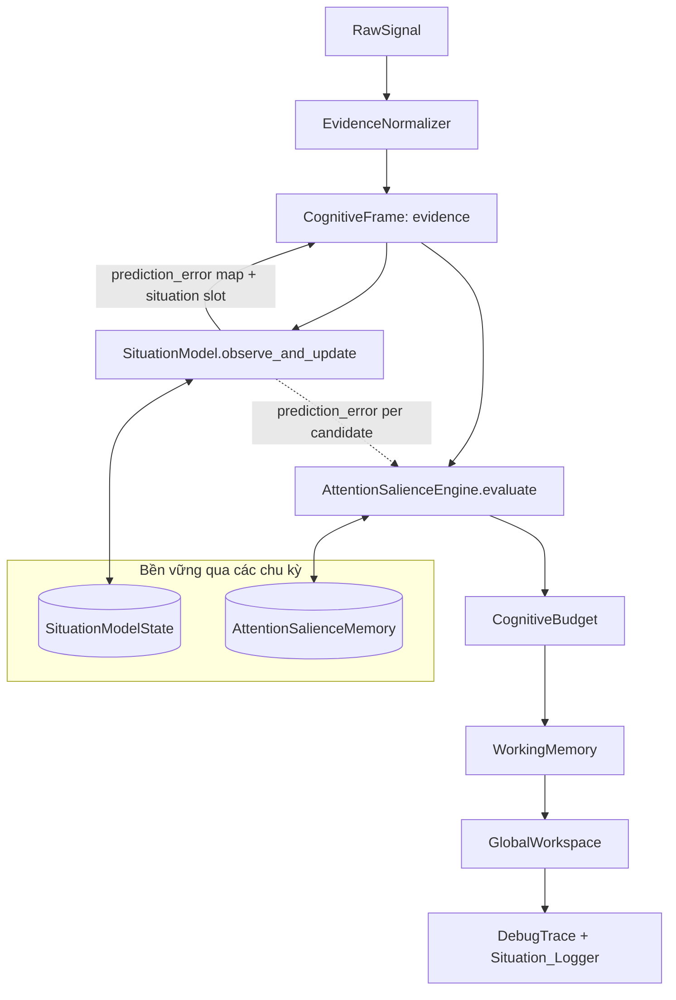
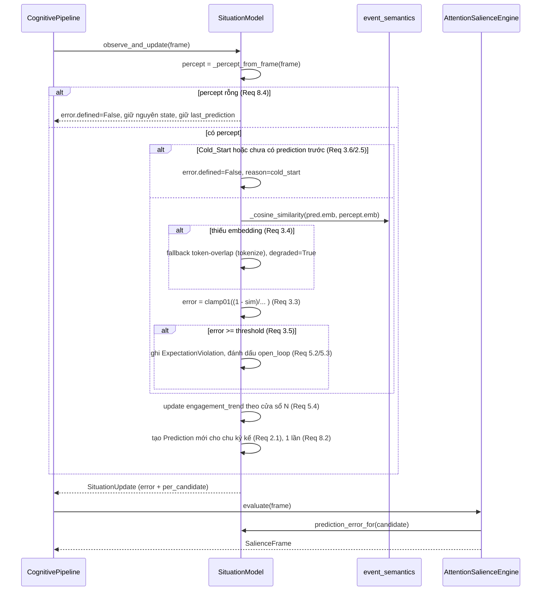

# Design Document

## Overview

Tài liệu này thiết kế **Situation Model** — một mô hình tình huống bền vững mang trạng thái qua các chu kỳ nhận thức (Cognitive_Cycle), thay thế bản chất "máy đếm lặp" hiện tại của novelty bằng một vòng **dự đoán → quan sát → sai số dự đoán (prediction error)**.

Vấn đề cốt lõi cần giải quyết (theo `requirements.md`):

- `AttentionSalienceEngine._novelty_score()` chỉ là bảng tra theo `repeat_count`/`age_seconds`. "Novelty" hiện nghĩa là "chưa thấy fingerprint này gần đây", không phải "thực tế khác với điều tôi kỳ vọng".
- Thứ duy nhất sống qua các chu kỳ là `AttentionSalienceMemory` (đếm fingerprint). Không có mô hình nào để bị vi phạm → `repetition=1.00` kẹt mãi.
- `event_semantics.py` đã có sẵn hạ tầng embedding/cosine (`_cosine_similarity`, `_normalize_vector`, `EventEmbeddingCache`) nhưng chỉ dùng để gom family, chưa dùng đo prediction error.

Nguyên tắc thiết kế:

1. **Không phá pipeline hiện tại.** Tính năng có cờ bật/tắt; khi tắt, salience tính y hệt `_novelty_score` cũ (Req 6.1).
2. **Không đổi chữ ký công khai** của `evaluate()`, `select()`, `broadcast()` (Req 6.2). Tích hợp qua tham chiếu nội bộ + slot frame, không qua tham số mới bắt buộc.
3. **Tái dùng hạ tầng sẵn có**, không tạo cơ chế đo tương đồng mới (Req 3.2).
4. **Cô lập lỗi**: bất kỳ lỗi nào của Situation_Model đều fallback về `_novelty_score` và chu kỳ vẫn hoàn tất (Req 6.3).
5. **Tất định**: cùng đầu vào + cùng trạng thái đầu → cùng kết quả, không nguồn ngẫu nhiên/biến thời gian trong lõi cập nhật (Req 8.3).

## Architecture

### Vị trí trong pipeline

Situation_Model là một object bền vững được sở hữu bởi `CognitivePipeline` (giống cách engine sở hữu `self.memory`). Nó được cập nhật trong `CognitivePipeline.run()` ngay **trước** bước attention, để prediction_error của chu kỳ sẵn sàng cho việc chấm salience.



### Các thành phần mới

| Thành phần | File (đề xuất) | Vai trò |
|---|---|---|
| `SituationModel` | `src/cortex/situation_model.py` | Object bền vững, chứa vòng đời observe → error → update → predict |
| `SituationModelState` | `src/cortex/situation_model.py` | Dataclass trạng thái (Content_Thread, activity, Engagement_Trend, Open_Loop, Prediction, Prediction_Error, observed count) |
| `Prediction` | `src/cortex/situation_model.py` | Dự đoán: mô tả văn bản, confidence, embedding (tùy chọn), cờ embedding khả dụng |
| `ExpectationViolation` | `src/cortex/situation_model.py` | Bản ghi vi phạm kỳ vọng (prediction kỳ vọng, percept, prediction_error) |
| `PredictionErrorResult` | `src/cortex/situation_model.py` | Kết quả đo sai số: value [0,1], `defined: bool`, `degraded: bool`, `reason` |
| `SituationModelConfig` | `src/cortex/situation_model.py` | Cấu hình: cờ bật/tắt, ngưỡng, cửa sổ |
| `SituationLogger` | `src/cortex/situation_model.py` | Serialize + ghi log prediction vs reality vs error mỗi chu kỳ |

### Tái dùng từ code hiện có

- `event_semantics._cosine_similarity`, `event_semantics._normalize_vector`, `event_semantics.EventEmbeddingCache` — đo khoảng cách ngữ nghĩa (Req 3.2).
- `attention_salience.tokenize` — fallback token-overlap (Req 3.4).
- `attention_salience.StandingStakes.theme_overlap / care_user_activity / care_user_mood / relational_pull` — nguồn của Stake_Relevance (Req 4.2).
- `attention_salience.clamp01`, `safe_float` — chuẩn hóa số an toàn.
- Mẫu persistence của `AttentionSalienceEngine.memory` — khuôn cho persistence của Situation_Model (Req 1.4).

## Data Models

```python
EngagementTrend = Literal["tang", "giam", "on_dinh"]   # tăng / giảm / ổn định

@dataclass(slots=True)
class Prediction:
    description: str = ""                 # 1..280 ký tự (Req 2.2)
    confidence: float = 0.0               # [0,1] (Req 2.2); Cold_Start -> 0.0 (Req 2.7)
    embedding: tuple[float, ...] = ()     # tùy chọn (Req 2.3)
    embedding_available: bool = False     # Req 2.3 / 2.4
    created_cycle: int = 0

    @property
    def is_empty(self) -> bool:
        return not self.description.strip()

@dataclass(slots=True)
class OpenLoop:
    loop_id: str
    description: str
    is_open: bool = True
    expectation_violated: bool = False
    updated_ts: float = 0.0               # update timestamp (Req 5.3)

@dataclass(slots=True)
class PredictionErrorResult:
    value: float = 0.0                    # [0,1], 0=khớp, 1=trái (Req 3.3)
    defined: bool = False                 # False khi Cold_Start / không percept (Req 2.5, 8.4)
    degraded: bool = False                # True khi dùng fallback token-overlap (Req 3.4)
    reason: str = ""                      # {cold_start, missing_prediction_embedding,
                                          #  missing_percept_embedding, no_percept, ok} (Req 7.5)

@dataclass(slots=True)
class ExpectationViolation:
    expected: str                         # mô tả Prediction kỳ vọng
    observed: str                         # mô tả Percept thực tế
    prediction_error: float
    cycle: int

@dataclass(slots=True)
class SituationModelState:
    content_thread: str = ""
    current_activity: str = ""
    engagement_trend: EngagementTrend = "on_dinh"     # trung tính mặc định (Req 1.4)
    open_loops: list[OpenLoop] = field(default_factory=list)   # tối đa 100 (Req 1.1)
    last_prediction: Prediction = field(default_factory=Prediction)
    last_error: PredictionErrorResult = field(default_factory=PredictionErrorResult)
    observed_percept_count: int = 0
    cycle_count: int = 0
    recent_engagement: list[float] = field(default_factory=list)  # cửa sổ N (Req 5.4)
    last_violation: Optional[ExpectationViolation] = None
```

Lưu ý `Percept`: không tạo type nặng mới. Percept của một chu kỳ là **văn bản tổng hợp** rút từ frame (dominant claim + các claim salient) cùng embedding của nó nếu có. Một hàm `_percept_from_frame(frame) -> PerceptView` gom: `text` (ghép claim), `tokens`, `embedding` (qua cache/provider).

## Components and Interfaces

### `SituationModelConfig`

```python
@dataclass(slots=True)
class SituationModelConfig:
    enabled: bool = True                        # Req 6.4 — mặc định BẬT
    expectation_violation_threshold: float = 0.5   # Req 3.5
    cold_start_min_percepts: int = 5            # Req 4.6
    engagement_window: int = 3                  # Req 5.4
    high_prediction_error_threshold: float = 0.65  # Req 4.8
    salience_floor: float = 0.30                # Req 4.8 — sàn cho percept có nghĩa
    max_open_loops: int = 100                   # Req 1.1
    prediction_error_weight: float = 1.00       # trọng số số hạng PE trong salience
    habituation_weight: float = 0.35            # < prediction_error_weight (Req 4.5)

    def normalized(self) -> "SituationModelConfig": ...   # clamp như AttentionSalienceConfig.normalized()
```

Đọc cờ `enabled` lúc khởi tạo pipeline; nếu vắng/không hợp lệ → mặc định bật + cảnh báo (Req 6.5).

### `SituationModel` — API chính

```python
class SituationModel:
    def __init__(self, config: SituationModelConfig | None = None,
                 *, embedding_cache: EventEmbeddingCache | None = None,
                 embedding_provider=None,
                 logger: "SituationLogger | None" = None) -> None: ...

    def observe_and_update(self, frame, *, now: float | None = None) -> "SituationUpdate":
        """Vòng đời 1 chu kỳ (Req 8.1): observe → error → update → predict.
        Cập nhật đúng 1 lần (Req 8.2). Tất định (Req 8.3).
        Trả SituationUpdate gồm prediction_error tổng hợp + map theo candidate."""

    def prediction_error_for(self, candidate) -> PredictionErrorResult:
        """Sai số dự đoán cho một AttentionCandidate cụ thể (Attention dùng)."""

    def reset(self) -> None:                       # Req 1.5 / 1.6
    def serialize(self) -> dict[str, Any]:         # Req 7.4
    def expose_violation(self) -> Optional[ExpectationViolation]:  # Req 5.1
```

`SituationUpdate` (kết quả 1 chu kỳ): `error: PredictionErrorResult`, `per_candidate_error: dict[str, PredictionErrorResult]` (key = `candidate.fingerprint`/`evidence_id`), `violation: Optional[ExpectationViolation]`, `state_snapshot: dict`.

### Tích hợp với `AttentionSalienceEngine`

Để **không đổi chữ ký** `evaluate()` (Req 6.2), engine nhận một tham chiếu tùy chọn tới nguồn prediction error qua constructor / setter:

```python
class AttentionSalienceEngine:
    def __init__(self, config=None, *, situation_model: "SituationModel | None" = None):
        ...
        self.situation_model = situation_model   # có thể None -> hành vi cũ

    def set_situation_model(self, sm): self.situation_model = sm
```

Trong `_score_candidate`, thay điểm novelty:

```python
breakdown.novelty = self._novelty_term(candidate, repeat_count=repeat_count, age_seconds=age_seconds)
```

với:

```python
def _novelty_term(self, candidate, *, repeat_count, age_seconds) -> float:
    sm = self.situation_model
    if sm is not None and sm.config.enabled:
        pe = sm.prediction_error_for(candidate)
        if pe.defined:
            return clamp01(pe.value)     # novelty = prediction error (Req 4.1)
    # fallback: bảng tra cũ, GIỮ NGUYÊN (Req 4.5 cold-start / 4.7 undefined / 6.1 off)
    return self._novelty_score(candidate, repeat_count=repeat_count, age_seconds=age_seconds)
```

Salience tổng vẫn chạy qua `_weighted_score`. Để bảo đảm `salience = f(prediction_error, stake_relevance)` với habituation là số hạng phụ **nhỏ hơn nghiêm ngặt** (Req 4.5):

- `novelty` term giờ mang prediction error, trọng số `weights.novelty = 1.00`.
- `habituation` vẫn là số hạng âm, trọng số `0.95` hiện tại — đã nhỏ hơn novelty weight. Ta đảm bảo bất biến `habituation_weight < prediction_error_weight` qua kiểm tra trong `normalized()`.
- `standing_interest` (đã có) là kênh của Stake_Relevance; được giữ và đảm bảo tính đơn điệu (Req 4.4).

**Sàn salience cho va chạm family (Req 4.8):** sau khi tính `capped`, thêm bước:

```python
if sm and sm.config.enabled and pe.defined and pe.value >= sm.config.high_prediction_error_threshold:
    capped = max(capped, sm.config.salience_floor)
```

Đặt sau `_apply_score_caps` để cap chống-lặp không kéo percept-có-nghĩa xuống mức tín hiệu lặp.

### Tích hợp với `CognitivePipeline`

```python
class CognitivePipeline:
    def __init__(self, *, ..., situation_model: SituationModel | None = None):
        self.situation_model = situation_model or SituationModel()
        self.attention = attention or AttentionSalienceEngine(situation_model=self.situation_model)
        # nếu attention được truyền sẵn, gọi self.attention.set_situation_model(self.situation_model)
```

Trong `run()`, ngay sau normalize và trước attention:

```python
frame.set_status("modeling", actor="cognitive_pipeline")
try:
    update = self.situation_model.observe_and_update(frame)
    self._set_slot(frame, "situation", self.situation_model.serialize(),
                   actor="situation_model")
except Exception as exc:
    frame.add_warning(f"situation_model failed: {exc!r}", actor="situation_model")
    # attention sẽ tự fallback _novelty_score vì prediction_error_for trả undefined
```

Lỗi của Situation_Model **không** chặn chu kỳ; attention fallback và WM/WS giữ nguyên (Req 6.3). Việc set slot bọc try/except theo đúng mẫu `_set_slot` hiện có.

## Per-cycle lifecycle (Req 8)



### Công thức prediction error (Req 3.3)

Cosine similarity ∈ [-1, 1]. Chuẩn hóa sai số về [0,1] theo quan hệ **đơn điệu không giảm** với khoảng cách:

```
error = clamp01((1.0 - cosine_similarity) / 2.0)
```

- `cosine = 1` (khớp hoàn toàn) → error 0.
- `cosine = -1` (trái hoàn toàn) → error 1.
- `_cosine_similarity` trả `-1.0` khi vector rỗng/lệch chiều → đây là tín hiệu kích hoạt fallback (Req 3.4), không phải "trái hoàn toàn".

**Fallback token-overlap** (khi không có embedding hợp lệ):

```
overlap = |tokens(pred) ∩ tokens(percept)| / max(1, min(|a|, |b|))
error = clamp01(1.0 - overlap)
degraded = True; reason ∈ {missing_prediction_embedding, missing_percept_embedding}
```

### Cold_Start (Req 4.6)

`observed_percept_count < cold_start_min_percepts` ⇒ Cold_Start. Khi đó `prediction_error_for` trả `defined=False` ⇒ attention dùng `_novelty_score` cũ (Req 4.6). Prediction vẫn được tạo nhưng `confidence = 0.0` (Req 2.7).

### Engagement_Trend (Req 5.4)

Mỗi chu kỳ đẩy một "điểm engagement" (ví dụ độ salient của percept user/affect) vào `recent_engagement`, cắt còn `engagement_window` (mặc định 3). So sánh trung bình nửa sau với nửa đầu để phân loại `tang`/`giam`/`on_dinh`. Khi Cold_Start hoặc error chưa xác định ⇒ giữ `on_dinh` (Req 5.5).

### Tính tất định (Req 8.3)

- Lõi cập nhật không gọi `time.time()` trực tiếp; `now` được truyền vào (mặc định lấy từ frame/percept timestamp).
- Không dùng `set` cho thứ tự ảnh hưởng kết quả; dùng list có thứ tự ổn định.
- `serialize()` cho phép test so sánh trạng thái theo từng trường.

## Error Handling

| Tình huống | Xử lý | Req |
|---|---|---|
| Không có percept trong chu kỳ | Giữ nguyên state, giữ `last_prediction`, error.defined=False | 8.4 |
| Cold_Start / chưa có prediction trước | Bỏ qua đo error, reason=cold_start, prediction confidence=0.0 | 2.5, 2.7, 3.6 |
| Thiếu embedding | Fallback token-overlap, degraded=True | 3.4 |
| `_cosine_similarity` trả -1.0 (rỗng/lệch) | Coi là thiếu embedding → fallback | 3.4 |
| PE/Stake ngoài [0,1] hoặc NaN | clamp về biên / dùng dự phòng, phát chỉ báo, giữ percept gốc | 4.9 |
| Lỗi giữa vòng đời cập nhật | Không cập nhật một phần (commit-or-rollback), giữ state cũ, phát tín hiệu lỗi | 8.5 |
| Lỗi khởi tạo/cập nhật ở pipeline | Attention fallback `_novelty_score`, WM/WS giữ nguyên, ghi cảnh báo | 6.3 |
| Lỗi serialize/ghi log | Nuốt lỗi trong logger, chu kỳ tiếp tục | 7.6 |
| Cờ cấu hình vắng/không hợp lệ | Mặc định bật + cảnh báo | 6.5 |

**Commit-or-rollback (Req 8.5):** `observe_and_update` tính toàn bộ trạng thái mới trên bản nháp (`draft = replace(state, ...)`); chỉ gán `self.state = draft` ở cuối khi không có exception. Lỗi giữa chừng ⇒ `self.state` không đổi.

## Observability — `SituationLogger` (Req 7)

- Mỗi chu kỳ hoàn tất: log `prediction(prev)`, `percept(now)`, `prediction_error` (giá trị trong [0,1]) — Req 7.1.
- Cold_Start (không có prediction trước): log rõ trạng thái Cold_Start + percept, không in giá trị error giả — Req 7.2.
- Expectation_Violation: log mô tả prediction kỳ vọng, percept thực tế, và giá trị error đã vượt ngưỡng — Req 7.3.
- `serialize()` trả dict gồm: `content_thread`, `engagement_trend`, `open_loops`, `last_prediction`, `last_error` — Req 7.4.
- Degraded/undefined: ghi rõ `reason` thuộc `{cold_start, missing_prediction_embedding, missing_percept_embedding, no_percept}` — Req 7.5.
- Lỗi trong logger được nuốt để không gián đoạn chu kỳ — Req 7.6.

Đây là phần thay thế dòng `repetition=1.00` phẳng lì: log giờ kể được "tôi tưởng X, thực tế Y, lệch Z".

## Testing Strategy

Test đặt tại `tests/test_situation_model.py` (và bổ sung `tests/test_cognitive_pipeline.py` cho tích hợp). Ánh xạ tới acceptance criteria:

| Test | Kiểm | Req |
|---|---|---|
| `test_state_persists_across_cycles` | state mang qua nhiều `observe_and_update` | 1.2, 1.3 |
| `test_first_cycle_initial_state` | chu kỳ đầu trả trạng thái khởi tạo trung tính | 1.4 |
| `test_reset_clears_state` | reset đưa mọi trường về mặc định | 1.5, 1.6 |
| `test_prediction_created_each_cycle` | đúng 1 prediction, desc 1–280, confidence [0,1] | 2.1, 2.2 |
| `test_cold_start_prediction_confidence_zero` | Cold_Start ⇒ confidence 0.0 | 2.7 |
| `test_prediction_error_cosine` | error = (1-cos)/2, [0,1], đơn điệu | 3.1, 3.3 |
| `test_prediction_error_fallback_degraded` | thiếu embedding ⇒ token-overlap, degraded | 3.4 |
| `test_expectation_violation_recorded` | error ≥ ngưỡng ⇒ ghi violation | 3.5, 5.1 |
| `test_no_prev_prediction_skips_error` | chu kỳ đầu không tính error/violation | 3.6 |
| `test_salience_monotonic_in_pe` | PE tăng, stake giữ ⇒ salience không giảm | 4.3 |
| `test_salience_monotonic_in_stake` | stake tăng, PE giữ ⇒ salience không giảm | 4.4 |
| `test_habituation_weight_strictly_smaller` | trọng số habituation < novelty/PE | 4.5 |
| `test_family_collision_not_suppressed` | percept trùng family + PE cao ⇒ ≥ salience_floor | 4.8 |
| `test_invalid_inputs_clamped` | PE/stake ngoài [0,1] ⇒ clamp + chỉ báo | 4.9 |
| `test_engagement_trend_window` | trend tính trên cửa sổ N | 5.4 |
| `test_feature_flag_off_parity` | tắt cờ ⇒ salience == hành vi `_novelty_score` cũ | 6.1 |
| `test_public_signatures_unchanged` | chữ ký evaluate/select/broadcast không đổi | 6.2 |
| `test_sm_error_falls_back` | lỗi SM ⇒ chu kỳ vẫn xong, có cảnh báo | 6.3 |
| `test_invalid_flag_defaults_off` | cờ không hợp lệ ⇒ tắt + cảnh báo | 6.5 |
| `test_logger_outputs_pred_reality_error` | log đủ 3 thành phần | 7.1, 7.3 |
| `test_serialize_fields` | serialize đúng tập trường | 7.4 |
| `test_logger_error_isolated` | lỗi log không gián đoạn chu kỳ | 7.6 |
| `test_lifecycle_order_and_single_update` | đúng thứ tự, cập nhật 1 lần | 8.1, 8.2 |
| `test_determinism_replay` | replay cùng percept ⇒ cùng serialize | 8.3 |
| `test_empty_percept_holds_state` | percept rỗng ⇒ giữ state, error undefined | 8.4 |
| `test_mid_lifecycle_error_rollback` | lỗi giữa chừng ⇒ không cập nhật một phần | 8.5 |

Test `test_feature_flag_off_parity` là chốt an toàn di trú: so sánh `SalienceFrame` khi `enabled=False` với baseline trước tích hợp trên cùng bộ frame mẫu.

## Correctness Properties

Các bất biến hệ thống phải luôn đúng, dùng làm cơ sở cho property-based test:

### Property 1: Chuẩn hóa giá trị
Với mọi đầu vào, `PredictionErrorResult.value ∈ [0,1]` và salience đầu ra `∈ [0,1]` (clamp ở biên). Không bao giờ trả NaN/inf.
**Validates: Requirements 3.3, 4.2, 4.9**

### Property 2: Đơn điệu salience theo Prediction_Error
Giữ nguyên mọi yếu tố khác, salience không giảm khi Prediction_Error tăng.
**Validates: Requirements 4.3**

### Property 3: Đơn điệu salience theo Stake_Relevance
Giữ nguyên mọi yếu tố khác, salience không giảm khi Stake_Relevance tăng.
**Validates: Requirements 4.4**

### Property 4: Trọng số thứ bậc
Bất biến `habituation_weight < prediction_error_weight` luôn đúng sau `normalized()`.
**Validates: Requirements 4.5**

### Property 5: Tất định
Cùng trạng thái đầu + cùng chuỗi percept + cùng `now` ⇒ `serialize()` bằng nhau theo từng trường.
**Validates: Requirements 8.3**

### Property 6: Cập nhật đúng một lần
Mỗi `observe_and_update` làm `cycle_count` tăng đúng 1 và `state` thay đổi tối đa một lần.
**Validates: Requirements 8.1, 8.2**

### Property 7: An toàn fallback
Khi `enabled=False` HOẶC `prediction_error_for` trả `defined=False`, novelty term bằng đúng `_novelty_score` cũ.
**Validates: Requirements 6.1, 4.6, 4.7**

### Property 8: Toàn vẹn khi lỗi
Nếu `observe_and_update` ném exception giữa chừng, `self.state` giữ nguyên giá trị trước lời gọi (commit-or-rollback).
**Validates: Requirements 8.5, 6.3**

### Property 9: Giới hạn cấu trúc
`len(open_loops) ≤ max_open_loops (100)` và `len(recent_engagement) ≤ engagement_window` tại mọi thời điểm.
**Validates: Requirements 1.1, 5.4**

### Property 10: Sàn family-collision
Khi `enabled` và `pe.defined` và `pe.value ≥ high_prediction_error_threshold`, salience cuối `≥ salience_floor`.
**Validates: Requirements 4.8**

## Requirements traceability

- **Req 1** (persistent state) → `SituationModelState`, ownership bởi pipeline, `reset()`.
- **Req 2** (prediction) → `Prediction` dataclass, tạo cuối `observe_and_update`, Cold_Start confidence 0.0.
- **Req 3** (prediction error) → `_cosine_similarity`/`_normalize_vector`/`EventEmbeddingCache`, công thức `(1-cos)/2`, fallback token-overlap.
- **Req 4** (salience) → `_novelty_term`, sàn family-collision, bất biến trọng số habituation < PE, kênh `standing_interest` cho stake.
- **Req 5** (expectation violation) → `ExpectationViolation`, `expose_violation()`, cập nhật Open_Loop + Engagement_Trend.
- **Req 6** (compat) → cờ `enabled` (mặc định bật), không đổi chữ ký, fallback `_novelty_score`, cô lập lỗi.
- **Req 7** (observability) → `SituationLogger` + `serialize()`.
- **Req 8** (lifecycle) → `observe_and_update` tuần tự, commit-or-rollback, tất định.

## Open design decisions cần xác nhận

1. **Nguồn mô tả Prediction.** Thiết kế hiện sinh Prediction bằng heuristic từ percept/Content_Thread (ví dụ "Ngài tiếp tục <activity>"). Có muốn để ngỏ một hook cho LLM/meaning layer sinh prediction giàu hơn ở giai đoạn sau không, hay giữ thuần heuristic để đảm bảo tất định?
2. **Embedding provider.** Pipeline hiện không bật embedding (`allow_embedding=False` mặc định ở event_semantics). Situation_Model sẽ phụ thuộc nhiều vào fallback token-overlap (degraded) cho tới khi có provider. Có muốn thiết kế dùng chung provider với `EventSemanticProfiler` không?
3. **Khóa per-candidate error.** Đề xuất dùng `fingerprint` làm khóa map; nếu Ngài muốn theo `evidence_id` thì điều chỉnh `prediction_error_for`.
