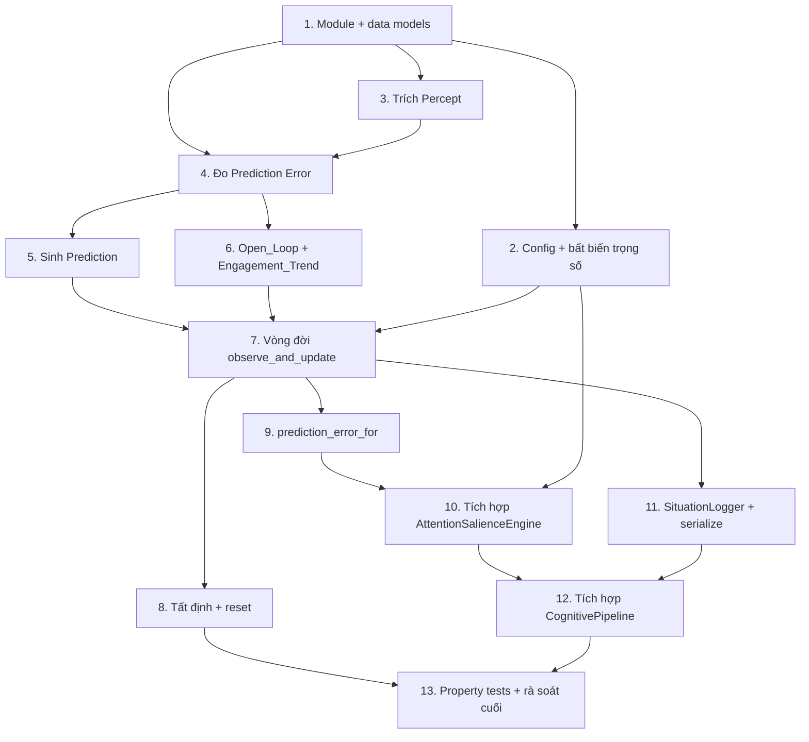

# Implementation Plan

## Overview

Kế hoạch triển khai Situation Model theo hướng tăng dần và test-driven. Thứ tự: dựng data models + config → trích percept → đo prediction error → sinh prediction → cập nhật trạng thái → ghép vòng đời → tích hợp Attention → tích hợp Pipeline → observability → property tests. Mỗi bước đều có test bám vào acceptance criteria. Tính năng mặc định BẬT; có cờ tắt để fallback về `_novelty_score` cũ khi cần.

## Task Dependency Graph



```json
{
  "waves": [
    { "wave": 1, "tasks": ["1"] },
    { "wave": 2, "tasks": ["2", "3"] },
    { "wave": 3, "tasks": ["4"] },
    { "wave": 4, "tasks": ["5", "6"] },
    { "wave": 5, "tasks": ["7"] },
    { "wave": 6, "tasks": ["8", "9", "11"] },
    { "wave": 7, "tasks": ["10"] },
    { "wave": 8, "tasks": ["12"] },
    { "wave": 9, "tasks": ["13"] }
  ]
}
```

## Tasks

- [x] 1. Tạo module nền và data models của Situation Model
  - Tạo `src/cortex/situation_model.py` với các import mềm tái dùng (`clamp01`, `safe_float`, `tokenize` từ `attention_salience`; `_cosine_similarity`, `_normalize_vector`, `EventEmbeddingCache` từ `event_semantics`).
  - Định nghĩa các dataclass: `Prediction`, `OpenLoop`, `PredictionErrorResult`, `ExpectationViolation`, `SituationModelState`, và `EngagementTrend` literal.
  - Áp ràng buộc cơ bản trong constructor/field: mô tả Prediction 1–280 ký tự, confidence ∈ [0,1].
  - _Requirements: 1.1, 2.2, 3.3_

- [x] 2. Cấu hình và bất biến trọng số
  - [x] 2.1 Viết `SituationModelConfig` với toàn bộ cờ/ngưỡng mặc định
    - Các field: `enabled=False`, `expectation_violation_threshold=0.5`, `cold_start_min_percepts=5`, `engagement_window=3`, `high_prediction_error_threshold=0.65`, `salience_floor=0.30`, `max_open_loops=100`, `prediction_error_weight=1.00`, `habituation_weight=0.35`.
    - _Requirements: 6.4, 3.5, 4.6, 5.4, 4.8_
  - [x] 2.2 Cài `normalized()` và bất biến `habituation_weight < prediction_error_weight`
    - Clamp các ngưỡng về [0,1]; ép `habituation_weight` nhỏ hơn nghiêm ngặt `prediction_error_weight`.
    - Viết test khẳng định bất biến trọng số (Property 4).
    - _Requirements: 4.5_

- [x] 3. Trích Percept từ frame
  - Cài `_percept_from_frame(frame) -> PerceptView` gom văn bản tổng hợp (dominant claim + claim salient), `tokens`, và `embedding` (qua `EventEmbeddingCache`/provider nếu có).
  - Xử lý trường hợp frame không có evidence ⇒ percept rỗng.
  - Viết test cho percept đầy đủ và percept rỗng.
  - _Requirements: 8.4_

- [x] 4. Đo Prediction Error
  - [x] 4.1 Cài đường embedding/cosine
    - `compute_prediction_error(prediction, percept)` dùng `_cosine_similarity` + `_normalize_vector`; `value = clamp01((1 - sim)/2)`.
    - Coi `_cosine_similarity == -1.0` (vector rỗng/lệch chiều) là tín hiệu thiếu embedding, không phải "trái hoàn toàn".
    - _Requirements: 3.1, 3.2, 3.3_
  - [x] 4.2 Cài fallback token-overlap
    - Khi thiếu embedding hợp lệ: `error = clamp01(1 - overlap)` qua `tokenize`, đặt `degraded=True` và `reason` thuộc `{missing_prediction_embedding, missing_percept_embedding}`.
    - _Requirements: 3.4_
  - [x] 4.3 Xử lý không có prediction trước
    - Chu kỳ đầu / chưa có prediction ⇒ trả `defined=False`, `reason=cold_start`, không tính error.
    - Viết test cho cosine, fallback degraded, và bỏ qua khi chưa có prediction trước.
    - _Requirements: 3.6, 2.5_

- [x] 5. Sinh Prediction cho chu kỳ kế
  - Cài `_make_prediction(state, percept) -> Prediction` thuần heuristic (tất định), mô tả dạng "Ngài tiếp tục <activity>/<content_thread>".
  - Gán embedding nếu lấy được + cờ `embedding_available`; nếu không, vẫn lưu Prediction và đánh dấu không khả dụng.
  - Khi Cold_Start: gán `confidence=0.0`.
  - Viết test: đúng 1 prediction, độ dài/độ tin hợp lệ, Cold_Start confidence=0.0, lưu cả khi thiếu embedding.
  - _Requirements: 2.1, 2.2, 2.3, 2.4, 2.7_

- [x] 6. Cập nhật Open_Loop và Engagement_Trend
  - [x] 6.1 Cập nhật Open_Loop theo kết quả so khớp
    - So `prediction_error` với ngưỡng: `< threshold` = khớp, `>= threshold` = trái; cập nhật `updated_ts`.
    - Loop kỳ vọng khép nhưng vẫn mở ⇒ giữ mở + `expectation_violated=True`.
    - Giới hạn danh sách ≤ `max_open_loops`.
    - _Requirements: 5.2, 5.3, 1.1_
  - [x] 6.2 Cập nhật Engagement_Trend theo cửa sổ N
    - Đẩy điểm engagement vào `recent_engagement`, cắt còn `engagement_window`; phân loại `tang`/`giam`/`on_dinh`.
    - Cold_Start / error chưa xác định ⇒ giữ `on_dinh`.
    - Viết test cửa sổ trend và nhánh Cold_Start.
    - _Requirements: 5.4, 5.5_

- [x] 7. Vòng đời `observe_and_update` (commit-or-rollback)
  - Ghép tuần tự: observe percept → đo error → cập nhật state → sinh prediction; đúng thứ tự, không đảo/bỏ bước.
  - Tính toàn bộ trên bản nháp (`replace(state, ...)`), chỉ gán `self.state` ở cuối; lỗi giữa chừng ⇒ giữ nguyên state cũ.
  - Percept rỗng ⇒ giữ state, giữ `last_prediction`, `error.defined=False`; tăng `cycle_count` đúng 1.
  - Ghi `ExpectationViolation` khi `error >= threshold`.
  - Trả `SituationUpdate` (error tổng hợp + `per_candidate_error` theo fingerprint + violation + snapshot).
  - Viết test: thứ tự + cập nhật 1 lần, rollback khi lỗi, percept rỗng giữ state.
  - _Requirements: 8.1, 8.2, 8.4, 8.5, 3.5_

- [x] 8. Tính tất định và reset
  - Bảo đảm lõi cập nhật nhận `now` từ ngoài, không gọi `time.time()`; dùng cấu trúc có thứ tự ổn định.
  - Cài `reset()` đưa toàn bộ state về mặc định trung tính (Content_Thread rỗng, activity rỗng, trend `on_dinh`, open_loops rỗng, prediction rỗng).
  - Viết test replay xác nhận `serialize()` bằng nhau theo từng trường, và test reset.
  - _Requirements: 8.3, 1.5, 1.6_

- [x] 9. `prediction_error_for(candidate)` cho Attention
  - Tra `per_candidate_error` theo `candidate.fingerprint`; nếu không có ⇒ trả `PredictionErrorResult(defined=False)`.
  - Trả `defined=False` khi đang Cold_Start (`observed_percept_count < cold_start_min_percepts`).
  - Viết test cold-start trả undefined và tra cứu theo fingerprint.
  - _Requirements: 4.1, 4.6, 4.7_

- [x] 10. Tích hợp vào `AttentionSalienceEngine`
  - [x] 10.1 Thêm tham chiếu situation_model không phá chữ ký
    - Thêm tham số keyword-only `situation_model=None` vào `__init__` và `set_situation_model()`; `evaluate()` giữ nguyên chữ ký.
    - _Requirements: 6.2_
  - [x] 10.2 Thay novelty term bằng prediction error có fallback
    - Cài `_novelty_term(candidate, *, repeat_count, age_seconds)`: dùng prediction error khi `enabled` và `pe.defined`, ngược lại gọi `_novelty_score` cũ.
    - Gọi `_novelty_term` trong `_score_candidate` thay cho `_novelty_score`.
    - _Requirements: 4.1, 4.5, 4.6, 4.7, 6.1_
  - [x] 10.3 Sàn salience cho va chạm family
    - Sau bước cap, nếu `enabled` và `pe.defined` và `pe.value >= high_prediction_error_threshold` thì `capped = max(capped, salience_floor)`.
    - Xử lý đầu vào PE/Stake ngoài [0,1]/NaN: clamp về biên, phát chỉ báo, giữ percept gốc.
    - _Requirements: 4.8, 4.9_
  - [x] 10.4 Test tích hợp Attention
    - Test: đơn điệu theo PE và theo Stake; family-collision không bị đè dưới sàn; parity khi `enabled=False` so baseline `_novelty_score`; chữ ký công khai không đổi.
    - _Requirements: 4.3, 4.4, 4.8, 6.1, 6.2_

- [x] 11. `SituationLogger` và serialize
  - Cài `serialize()` trả dict gồm `content_thread`, `engagement_trend`, `open_loops`, `last_prediction`, `last_error`.
  - Cài logger ghi prediction(prev)/percept(now)/prediction_error mỗi chu kỳ; Cold_Start ghi rõ trạng thái thay vì giá trị giả; Expectation_Violation ghi expected/observed/error đã vượt ngưỡng; degraded/undefined ghi `reason` thuộc tập phân loại.
  - Bọc mọi thao tác log/serialize trong try/except để lỗi không gián đoạn chu kỳ.
  - Viết test: nội dung log đủ 3 thành phần, trường serialize đúng, lỗi logger được cô lập.
  - _Requirements: 7.1, 7.2, 7.3, 7.4, 7.5, 7.6_

- [x] 12. Tích hợp vào `CognitivePipeline`
  - [x] 12.1 Sở hữu và nối Situation_Model
    - Thêm tham số `situation_model=None` vào `CognitivePipeline.__init__`; tạo mặc định và nối vào attention qua `set_situation_model`.
    - Đọc cờ `enabled`; vắng/không hợp lệ ⇒ mặc định bật + cảnh báo.
    - _Requirements: 6.4, 6.5_
  - [x] 12.2 Gọi observe_and_update trong run() với cô lập lỗi
    - Trước bước attention: gọi `observe_and_update`, set slot `situation` qua `_set_slot`; bọc try/except để lỗi ⇒ cảnh báo + attention fallback `_novelty_score`, WM/WS giữ nguyên.
    - _Requirements: 6.3_
  - [x] 12.3 Test tích hợp pipeline
    - Test: chu kỳ chạy bình thường khi bật cờ; lỗi Situation_Model ⇒ pipeline vẫn hoàn tất + có cảnh báo; cờ không hợp lệ ⇒ tắt + cảnh báo.
    - _Requirements: 6.3, 6.5_

- [x] 13. Property-based tests và rà soát cuối
  - Viết property test cho: chuẩn hóa giá trị (P1), đơn điệu PE/Stake (P2, P3), tất định replay (P5), an toàn fallback (P7), toàn vẹn khi lỗi (P8), giới hạn cấu trúc (P9), sàn family-collision (P10).
  - Chạy toàn bộ test suite, sửa lỗi phát sinh, dọn file tạm.
  - _Requirements: 1.1, 3.3, 4.3, 4.4, 4.5, 4.8, 4.9, 5.4, 6.1, 8.2, 8.3, 8.5_

## Notes

- Mỗi task là một bước code rời, có test đi kèm, không để lại trạng thái hỏng giữa chừng.
- Task 10 và 12 là điểm tích hợp nhạy cảm: phải giữ nguyên chữ ký công khai và đảm bảo parity khi cờ tắt trước khi bật mặc định.
- Ba quyết định mở trong `design.md` (nguồn sinh Prediction, embedding provider dùng chung, khóa per-candidate) nên được chốt trước khi bắt đầu Task 5 và Task 9; mặc định hiện tại: heuristic tất định, dùng chung `EventEmbeddingCache`, khóa theo `fingerprint`.
- Property-based test ở Task 13 có thể chạy lâu; cân nhắc giới hạn số mẫu khi chạy CI.

