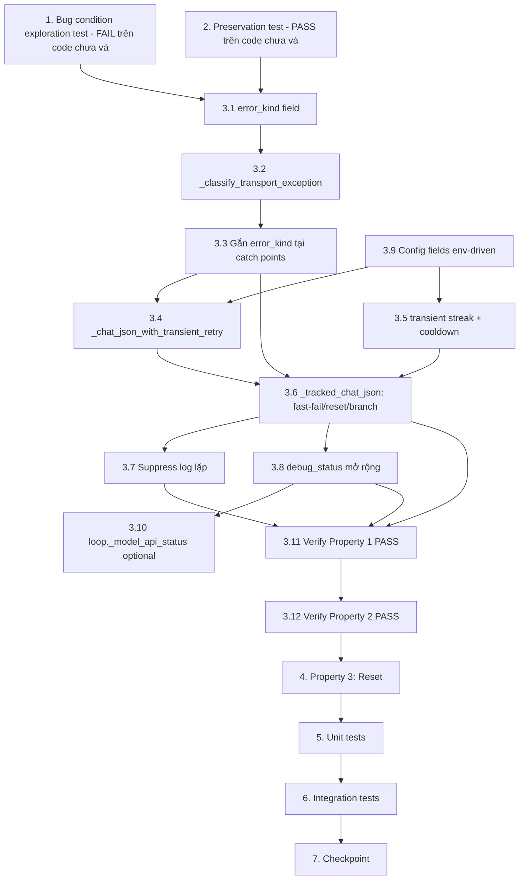

# Implementation Plan

## Overview

Mọi thay đổi mã nguồn nằm trong `src/runtime/private_mind_model_adapter.py` (và mở rộng nhẹ
`src/runtime/private_mind_loop.py`). KHÔNG sửa `src/llm/client.py`. Test đặt trong
`tests/` (mở rộng `tests/test_private_mind_model_adapter.py` hoặc thêm file mới), dùng fake
provider client để mô phỏng HTTP 5xx/429/timeout — không gọi mạng thật. Test thuộc tính
(property-based) dùng `hypothesis`; nếu chưa có trong môi trường thì cài `hypothesis` trước
khi chạy.

## Tasks

- [x] 1. Viết property test làm lộ bug condition (Exploratory Bug Condition Checking)
  - **Property 1: Bug Condition** - Transient transport error không được retry/circuit-breaker
  - **QUAN TRỌNG**: Viết property-based test này TRƯỚC khi triển khai bản vá
  - **CRITICAL**: Test này PHẢI FAIL trên code CHƯA vá — thất bại xác nhận bug tồn tại
  - **KHÔNG sửa test hay sửa code khi nó fail** — đây là kết quả mong đợi ở bước này
  - **GHI CHÚ**: Test này mã hoá hành vi mong đợi; nó sẽ validate bản vá khi PASS sau khi triển khai
  - **GOAL**: Surface counterexamples chứng minh bug tồn tại (thiếu retry + thiếu phân loại transient)
  - **Scoped PBT Approach**: Với bug mang tính tất định, scope property vào các ca lỗi cụ thể: inject fake provider client (qua `llm_service` hoặc `_provider_client`) sao cho `create_chat_completion` ném `requests.HTTPError(response.status_code ∈ {500,502,503,504,429})` hoặc `requests.exceptions.ReadTimeout`/`ConnectTimeout`/`ConnectionError`
  - Đếm số lần fake client được gọi cho một lần `evaluate_fragment`/`synthesize_judgment`
  - Khẳng định (sẽ FAIL trên code chưa vá):
    - HTTP 500 → client phải được gọi >1 lần (retry + backoff) — chưa vá chỉ gọi 1 lần
    - ReadTimeout → phải có retry — chưa vá không retry
    - Gọi liên tiếp đều 503 vượt ngưỡng → `_transient_cooldown_active()` phải bật — chưa vá không bao giờ bật, `debug_status()` không có `transient_streak`/`transient_cooldown_until`
  - Chạy test trên code CHƯA vá
  - **EXPECTED OUTCOME**: Test FAILS (đúng — chứng minh bug tồn tại)
  - Ghi lại counterexample: "client chỉ gọi đúng 1 lần khi gặp 500/timeout; không có transient streak/cooldown; mỗi tick chịu đầy đủ độ trễ ~28s"
  - Đánh dấu task hoàn thành khi test đã viết, đã chạy, và đã ghi nhận thất bại
  - _Requirements: 1.1, 1.2, 1.3_

- [x] 2. Viết property test bảo toàn hành vi (Preservation Checking) — TRƯỚC khi vá
  - **Property 2: Preservation** - Input không-transient giữ nguyên hành vi
  - **QUAN TRỌNG**: Theo phương pháp observation-first — quan sát hành vi trên code CHƯA vá rồi chốt lại bằng property test
  - Quan sát & chốt hành vi trên code CHƯA vá cho các input KHÔNG thỏa bug condition:
    - JSON hợp lệ → trả đúng mapping fragment/judgment; `_invalid_json_streak` reset; calls/latency/token đếm đúng
    - `invalid_json` → chạy hot-retry (nhiệt độ cao hơn + repair prompt) + salvage JSON + cooldown 120s sau streak 3
    - Fixed-config (HTTP 4xx ngoài 429: 400/401/403) → trả `None` ngay, KHÔNG retry
    - Đường đi `llama_server` / `llm_service` injected với input không-transient → kết quả & số liệu như cũ
  - Viết property-based test sinh ngẫu nhiên các kịch bản trên (JSON hợp lệ ngẫu nhiên, output invalid_json ngẫu nhiên, mã 4xx ngẫu nhiên) để bảo đảm "for all input không-transient" hành vi không đổi
  - Chạy test trên code CHƯA vá
  - **EXPECTED OUTCOME**: Tests PASS (xác nhận baseline cần bảo toàn)
  - Đánh dấu task hoàn thành khi test đã viết, đã chạy, và PASS trên code chưa vá
  - _Requirements: 3.1, 3.2, 3.3, 3.4, 3.5, 3.6_

- [x] 3. Vá lỗi transient transport cho PrivateMind API adapter

  - [x] 3.1 Thêm trường phân loại `error_kind` vào `PrivateMindModelResult`
    - Thêm `error_kind: str = ""` với giá trị thuộc `{"", "invalid_json", "transient", "fixed_config"}`
    - Mục đích: phân loại đáng tin cậy theo kiểu exception/HTTP status, không so khớp chuỗi `error`
    - _Bug_Condition: isBugCondition(input) — transient transport error_
    - _Expected_Behavior: phân loại error_kind="transient" cho 5xx/429/timeout (từ design)_
    - _Requirements: 1.5, 2.6_

  - [x] 3.2 Thêm hàm `_classify_transport_exception(exc) -> str`
    - Nhập exception, trả `"transient"` hoặc `"fixed_config"` theo *kiểu* và *status* (không theo message)
    - `requests.HTTPError`/exception có `.response`: status ∈ `{500,502,503,504,429}` → `"transient"`; 4xx khác → `"fixed_config"`; 5xx khác → `"transient"`
    - `requests.exceptions.Timeout`/`ReadTimeout`/`ConnectTimeout`/`ConnectionError` → `"transient"`
    - `urllib.error.HTTPError` (llama_server): dùng `.code` cùng quy tắc status
    - `urllib.error.URLError`/`socket.timeout`/`TimeoutError` → `"transient"`
    - Mặc định (không nhận diện được) → `"fixed_config"` (an toàn: không retry vô cớ)
    - Thêm import `socket`, `urllib.error`, `requests` ở đầu file
    - _Bug_Condition: isTransientTransportError(input.raisedException) từ design_
    - _Expected_Behavior: nhãn phân loại đúng cho mọi loại exception_
    - _Requirements: 2.1, 2.2, 3.3_

  - [x] 3.3 Gắn `error_kind` tại các điểm bắt exception
    - Trong `_provider_chat_json()`, `_llama_server_chat_json()`, và nhánh `llm_service` của `_chat_json_once()`: khi `except Exception as exc`, đặt `error_kind=_classify_transport_exception(exc)` (giữ nguyên `error=f"{type(exc).__name__}:{exc}"`)
    - `missing_provider_client` / `unsupported_provider` → `error_kind="fixed_config"`
    - `invalid_json` → `error_kind="invalid_json"` (cooldown có thể giữ `""`)
    - _Bug_Condition: isBugCondition(input) gắn nhãn tại catch point_
    - _Expected_Behavior: error_kind phản ánh đúng nguyên nhân; không đổi nội dung log_
    - _Requirements: 2.6, 3.2, 3.3, 3.4_

  - [x] 3.4 Thêm retry transient (innermost) bằng `_chat_json_with_transient_retry()`
    - Hàm mới bọc `_chat_json_once(...)`: gọi một lần; nếu `result.error_kind == "transient"` thì lặp tối đa `config.transient_max_retries` lần, mỗi lần `time.sleep(backoff)` với backoff tăng dần `transient_backoff_base * (2 ** attempt)` (chặn cận trên hợp lý)
    - Trả kết quả thành công đầu tiên, hoặc kết quả transient cuối cùng nếu hết lượt
    - Đổi `_chat_json()` để gọi `_chat_json_with_transient_retry()` thay `_chat_json_once()` tại cả lần gọi đầu và lần hot-retry `invalid_json` → retry transport (innermost) tách bạch với hot-retry invalid_json (outer)
    - Backoff/retry phải nhỏ để không kéo dài tick quá so với `timeout_seconds=28`; cân nhắc timeout rút gọn cho các lần retry
    - _Bug_Condition: isBugCondition(input) — transient được retry_
    - _Expected_Behavior: retried_with_backoff(result), số lần gọi ≤ 1 + transient_max_retries_
    - _Requirements: 2.1, 2.2_

  - [x] 3.5 Thêm transient streak + cooldown (song song invalid_json)
    - Trong `__init__`: thêm `self._transient_streak = 0`, `self._transient_cooldown_until = 0.0`, và `self._last_error_kind = ""`
    - Thêm `_transient_cooldown_active()` (mirror `_json_cooldown_active()`)
    - Thêm `_maybe_enter_transient_cooldown()` (mirror `_maybe_enter_json_cooldown()`): nếu `_transient_streak >= config.transient_cooldown_threshold` và chưa cooldown thì đặt `_transient_cooldown_until = time.time() + config.transient_cooldown_seconds` và log **một lần** mức warning
    - _Bug_Condition: streak transient chạm ngưỡng_
    - _Expected_Behavior: after_threshold_streak ⇒ transient_cooldown_active_
    - _Requirements: 2.3_

  - [x] 3.6 Cập nhật `_tracked_chat_json()` (fast-fail, reset, phân nhánh)
    - Early-return song song: ngoài `_json_cooldown_active()`, thêm `if self._transient_cooldown_active(): self._last_error = "transient_cooldown"; return PrivateMindModelResult(ok=False, error="transient_cooldown", error_kind="transient")` (fast-fail, không gọi network)
    - Nhánh xử lý kết quả:
      - `result.ok`: reset `_invalid_json_streak=0`, `_transient_streak=0`, `_transient_cooldown_until=0.0`, `_last_error=""` (và `_last_error_kind=""`)
      - `result.error_kind == "transient"`: `_transient_streak += 1`; gọi `_maybe_enter_transient_cooldown()`; reset `_invalid_json_streak=0`
      - `result.error == "invalid_json"`: giữ nguyên nhánh cũ (`_invalid_json_streak += 1`, `_maybe_enter_json_cooldown()`); reset `_transient_streak=0`
      - `error == "invalid_json_cooldown"` / `"transient_cooldown"`: không đụng streak
      - Còn lại (fixed-config): reset `_invalid_json_streak=0` và `_transient_streak=0`
    - Lưu `_last_error_kind` theo `result.error_kind` gần nhất để phân loại chính xác
    - _Bug_Condition: isBugCondition(input) — transient streak/cooldown/fast-fail_
    - _Expected_Behavior: transient_cooldown_active fast-fail trả None sạch; success reset trạng thái_
    - _Requirements: 1.3, 2.4, 2.5, 3.1, 3.2, 3.3_

  - [x] 3.7 Suppress log lặp trong `evaluate_fragment`/`synthesize_judgment`
    - Đổi điều kiện log từ `if result.error != "invalid_json_cooldown"` sang `if result.error not in {"invalid_json_cooldown", "transient_cooldown"}`
    - _Bug_Condition: transient cooldown active_
    - _Expected_Behavior: không log cảnh báo lặp gây nhiễu khi đang cooldown_
    - _Requirements: 2.4_

  - [x] 3.8 Mở rộng `debug_status()` (phân loại nguyên nhân degraded)
    - Thêm `degraded_cause`: `"transient"` nếu `_transient_cooldown_active()` hoặc `_last_error == "transient_cooldown"` hoặc `_last_error_kind == "transient"`; `"invalid_json"` nếu `_json_cooldown_active()` hoặc lỗi gần nhất liên quan invalid_json; ngược lại `""`
    - Thêm `transient_streak = self._transient_streak`
    - Thêm `transient_cooldown_until = round(float(self._transient_cooldown_until or 0.0), 3)`
    - Cập nhật `api_degraded = bool(self._last_error or self._json_cooldown_active() or self._transient_cooldown_active())`
    - Giữ nguyên toàn bộ field cũ (`calls`, `ok_calls`, `usage`, ...) — chỉ bổ sung
    - _Bug_Condition: nhận thức degraded do transient_
    - _Expected_Behavior: debug_status().degraded_cause = "transient" cùng streak/cooldown_until_
    - _Requirements: 1.5, 2.6, 3.6_

  - [x] 3.9 Thêm field cấu hình env-driven vào `PrivateMindModelAdapterConfig`
    - `transient_max_retries` ← `ERIS_PRIVATE_MIND_TRANSIENT_RETRIES` (mặc định `2`)
    - `transient_backoff_base` ← `ERIS_PRIVATE_MIND_TRANSIENT_BACKOFF` (giây, mặc định `0.5`)
    - `transient_cooldown_threshold` ← `ERIS_PRIVATE_MIND_TRANSIENT_THRESHOLD` (mặc định `3`)
    - `transient_cooldown_seconds` ← `ERIS_PRIVATE_MIND_TRANSIENT_COOLDOWN` (giây, mặc định `60`)
    - Dùng `_as_float`/`int` với cận dưới hợp lý như các field hiện có
    - _Bug_Condition: ngưỡng/giới hạn retry & cooldown_
    - _Expected_Behavior: tham số resilience cấu hình được qua env_
    - _Requirements: 2.1, 2.3_

  - [x] 3.10 (Tùy chọn) Mở rộng `private_mind_loop._model_api_status()`
    - Đọc thêm `status.get("degraded_cause")` để phơi bày `api_degraded_cause` lên metadata dossier
    - KHÔNG đổi logic fallback của `tick()`
    - _Bug_Condition: quan sát phân loại degraded ở tầng loop_
    - _Expected_Behavior: loop phơi bày api_degraded_cause; fallback không đổi_
    - _Requirements: 1.4, 2.6, 3.5_

  - [x] 3.11 Xác nhận property test bug condition (task 1) nay PASS
    - **Property 1: Expected Behavior** - Transient transport error được retry/backoff/circuit-breaker
    - **QUAN TRỌNG**: Chạy lại CHÍNH test ở task 1 — KHÔNG viết test mới
    - Test ở task 1 mã hoá hành vi mong đợi; khi nó PASS, xác nhận expected behavior được thoả mãn
    - **EXPECTED OUTCOME**: Test PASSES (xác nhận bug đã được vá)
    - _Requirements: 2.1, 2.2, 2.3, 2.4, 2.6_

  - [x] 3.12 Xác nhận property test bảo toàn (task 2) vẫn PASS
    - **Property 2: Preservation** - Input không-transient giữ nguyên hành vi
    - **QUAN TRỌNG**: Chạy lại CHÍNH các test ở task 2 — KHÔNG viết test mới
    - **EXPECTED OUTCOME**: Tests PASS (xác nhận không có hồi quy)
    - _Requirements: 3.1, 3.2, 3.3, 3.4, 3.5, 3.6_

- [x] 4. Property test Reset — thành công xoá trạng thái transient degraded
  - **Property 3: Reset** - Thành công sau chuỗi transient xoá streak/cooldown
  - Sinh chuỗi (vài transient error) rồi một call thành công
  - Assert `_transient_streak == 0`, `_transient_cooldown_until == 0`, và `debug_status().degraded_cause != "transient"`
  - **EXPECTED OUTCOME**: Test PASS sau khi vá
  - _Requirements: 2.5_

- [x] 5. Unit tests cho các thành phần resilience
  - `_classify_transport_exception`: bảng tham số HTTPError {400,401,403,429,500,502,503,504}, ReadTimeout/ConnectTimeout/ConnectionError/Timeout, URLError/socket.timeout → đúng nhãn `"transient"`/`"fixed_config"`
  - `_transient_cooldown_active()` / `_maybe_enter_transient_cooldown()`: bật đúng ngưỡng, hết hạn đúng thời gian
  - `_tracked_chat_json()` fast-fail khi transient cooldown active: trả `None`/result transient ngay, KHÔNG gọi client, không log lặp
  - `debug_status()` chứa `degraded_cause`, `transient_streak`, `transient_cooldown_until` và giữ nguyên field cũ
  - _Requirements: 2.3, 2.4, 2.6, 3.6_

- [x] 6. Integration tests cho `private_mind_loop.tick()`
  - Inject fake provider 503 lặp lại: assert loop vẫn tạo fragments/concerns/judgment qua rule fallback, không crash, và sau ngưỡng thì các tick fast-fail (không tốn ~28s mỗi tick)
  - Phục hồi: sau khi cooldown hết hạn và một call thành công, tick tiếp theo dùng lại model bình thường
  - `debug_status()` xuyên suốt loop phơi bày `degraded_cause="transient"`, phân biệt rõ với `invalid_json`
  - _Requirements: 1.4, 2.4, 2.5, 3.5_

- [x] 7. Checkpoint - Đảm bảo toàn bộ test PASS
  - Chạy `pytest tests/test_private_mind_model_adapter.py` (và file integration liên quan) ở chế độ chạy một lần
  - Đảm bảo Property 1 (Bug Condition→Expected), Property 2 (Preservation), Property 3 (Reset), unit & integration tests đều PASS
  - Đảm bảo không có hồi quy ở các test hiện có; nếu phát sinh thắc mắc, hỏi người dùng

## Task Dependency Graph

```json
{
  "waves": [
    { "wave": 1, "tasks": ["1", "2"], "dependsOn": [] },
    { "wave": 2, "tasks": ["3.1"], "dependsOn": ["1", "2"] },
    { "wave": 3, "tasks": ["3.2", "3.9"], "dependsOn": ["3.1"] },
    { "wave": 4, "tasks": ["3.3", "3.4", "3.5"], "dependsOn": ["3.2", "3.9"] },
    { "wave": 5, "tasks": ["3.6"], "dependsOn": ["3.3", "3.4", "3.5"] },
    { "wave": 6, "tasks": ["3.7", "3.8"], "dependsOn": ["3.6"] },
    { "wave": 7, "tasks": ["3.10"], "dependsOn": ["3.8"] },
    { "wave": 8, "tasks": ["3.11"], "dependsOn": ["3.6", "3.7", "3.8"] },
    { "wave": 9, "tasks": ["3.12"], "dependsOn": ["3.11"] },
    { "wave": 10, "tasks": ["4"], "dependsOn": ["3.12"] },
    { "wave": 11, "tasks": ["5"], "dependsOn": ["4"] },
    { "wave": 12, "tasks": ["6"], "dependsOn": ["5"] },
    { "wave": 13, "tasks": ["7"], "dependsOn": ["6"] }
  ]
}
```



## Notes

- Thứ tự bugfix: viết test bug-condition (Property 1) làm lộ counterexample TRƯỚC khi vá; nó
  PHẢI fail trên code chưa vá. Sau khi vá, chính test đó phải PASS (task 3.11).
- Test bảo toàn (Property 2) theo phương pháp observation-first: chốt hành vi quan sát được
  trên code chưa vá rồi chạy lại nguyên vẹn sau khi vá (task 3.12).
- Tất cả test dùng fake/mock provider client, không gọi mạng thật. Chạy pytest ở chế độ chạy
  một lần (không watch mode).
- Property-based test dùng `hypothesis`; cài đặt nếu môi trường chưa có.
- Phạm vi vá là tối thiểu và phẫu thuật: không sửa `src/llm/client.py`; không đổi ngữ nghĩa
  fallback của `private_mind_loop.tick()`.
