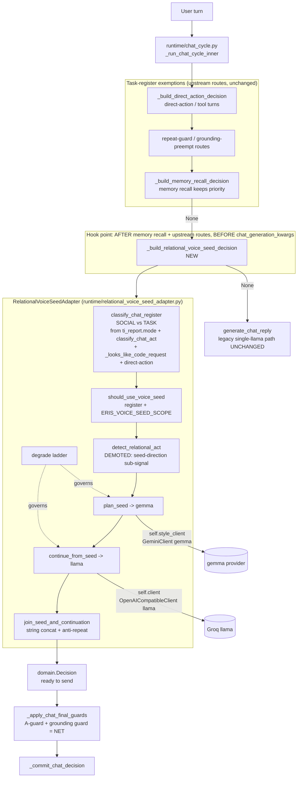
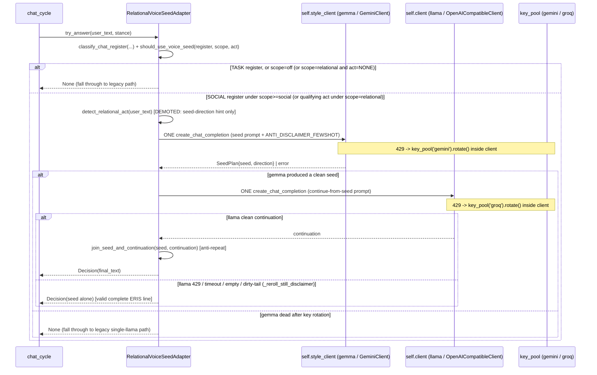
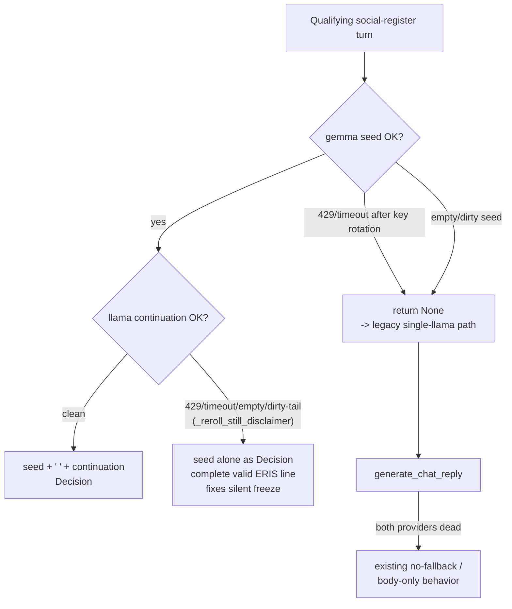

# Design Document: relational-voice-seed

## Overview

ERIS chat replies keep collapsing into the generic AI-assistant attractor that breaks its
guarded persona. This is broader than a handful of disclaimer phrases ("Tôi chỉ cố gắng hỗ trợ
và giúp đỡ", "Tôi không có cảm xúc như con người, nhưng tôi có thể hỗ trợ", "Tôi không thể thích
hay không thích", the parroted "Tôi là ERIS, một hiện diện nhỏ trên desktop"). The same attractor
leaks through many sibling "AI-tells": over-helpfulness ("Tôi hiểu rồi! Để tôi…"), cheerleading
("Tuyệt vời!"), therapist check-ins ("Ngài cảm thấy thế nào?"), summarize-back, the assistant
menu ("Ngài có muốn tôi… không?"), excessive hedging, reflexive bullet lists, and over-polite
framing. The root cause is structural, not stylistic: the chat reply is authored end-to-end by a
remote instruction-tuned model (currently Groq `llama-3.3-70b` through `self.client`) whose
"helpful assistant" RLHF attractor fires at the **start** of a fresh answer. The rich cognition
state (`conversation_dynamics` adaptation flags, `fe_plan` tone, `relationship_dynamics`
distance/attachment, `frame.appraisal`) only reaches that model as soft prompt text and is never
enforced at the generation boundary. The same model also frequently hits HTTP 429 (token quota),
producing silent freezes.

The key insight that shapes the trigger: these AI-tells leak in the **social / conversational
register**, not the **technical register**. When the user asks for code, the model returns code,
not disclaimers — the assistant prior is only dangerous when the turn is emotional, relational,
identity-, opinion-, greeting-, or reaction-shaped. So instead of chasing an enumerable whitelist
of "relational acts" (which is the same whack-a-mole as a phrase blacklist, one tier up — it
misses every AI-tell variant above), we **partition by register** and seed-first the whole social
register by default. Seizing the opening register attacks all AI-tell variants at once, because
ERIS — not the assistant prior — owns the first token whenever the turn is conversational.

This feature introduces a **two-model voice-seed continuation path** so the persona owns the
generation boundary on social-register turns. When the turn is in the social register (and the
configured scope allows it), a `RelationalVoiceSeedAdapter` (mirroring
`runtime/memory_recall_adapter.py:MemoryRecallAdapter`) does the following:

1. **PLANNER** — one call to the gemma / speech-style client (`self.style_client`, which has
   more token headroom) produces a short, stance-locked ERIS-voice **opening fragment** ("seed")
   plus a brief direction, under hard anti-disclaimer constraints and the existing
   `ANTI_DISCLAIMER_FEWSHOT`.
2. **CONTINUER** — one call to the llama / main chat client (`self.client`) **continues** from
   the seed in ERIS voice, one short clause, not repeating the seed and not restarting with a
   disclaimer. Because llama continues rather than starts, it cannot enter the assistant prior.
3. **JOIN** — `final_text = seed + " " + continuation` (string concatenation, provider-agnostic —
   NOT assistant-prefill, which `OpenAICompatibleClient`/Groq does not reliably support).

The path activates for the **social register by default**, with the **task register** kept on the
existing single-llama path. The trigger is a register gate, not a phrase/act whitelist:
`should_use_voice_seed(register, scope, act)`. Technical/code turns, direct-action/tool turns,
memory-recall/factual turns, and insult/boundary turns are all in (or upstream of) the task
register and keep using the existing single-llama path unchanged. The adapter returns a
ready-to-send `domain.Decision` (or `None` to fall through), exactly like
`MemoryRecallAdapter.try_answer`.

> **Naming note.** The spec directory stays `relational-voice-seed` (and the adapter keeps the
> `RelationalVoiceSeed*` names) for continuity, but the mechanism is now a **register-default
> voice-seed pipeline**: the gate is the social/task register split, and the old relational-act
> set is demoted to a *seed-direction sub-signal*. Read "relational" in the type names as
> "social-register voice seed", not "narrow relational-act whitelist".

The prior patch set A–D (post-generation disclaimer guard with reroll, relational-repair
contract, flag→imperative promotion, anti-disclaimer few-shot) is kept as a **thin safety net**;
this path is designed so A rarely needs to fire because the disclaimer attractor never gets the
opening token.

### Scope and non-goals

- **In scope:** the new adapter, the **register gate** (`classify_chat_register` +
  `should_use_voice_seed`) and its `ERIS_VOICE_SEED_SCOPE` knob, the (demoted) relational-act
  sub-signal that shapes seed direction, the gemma planner call, the llama continuer call, the
  join, the provider-aware degrade ladder, anti-repeat logic, wiring into
  `runtime/chat_cycle.py:_run_chat_cycle_inner`, and config.
- **Out of scope / unchanged:** patches A–D remain as written; the general
  `generate_chat_reply` chat path; grounding guards; the memory-recall path (which keeps
  priority over this path); the existing direct-action / repeat-guard / grounding-preempt routes
  (which sit upstream of the hook and act as natural task-register exemptions).
- **Constraint:** exactly **one** gemma planner call + **one** llama continuer call per
  qualifying turn. No retry storms against gemma.

### Design decisions already made (treated as constraints)

- **DD-1** Seed authoring = a gemma model call (NOT deterministic templates, NOT local qwen) so
  the line stays "alive", but under hard anti-disclaimer constraints + few-shot.
- **DD-2** Join = string concatenation, provider-agnostic; NOT assistant-prefill (verified:
  `OpenAICompatibleClient`/Groq does not reliably support prefill of a trailing assistant message).
- **DD-3** Exactly one gemma call + one llama call max per qualifying turn.
- **DD-4** Keep A–D as a safety net; this path should make A rarely fire.
- **DD-5** 429 handled by the existing key-pool rotation (`llm/key_pool.py`); degrade to
  seed-alone, then to the legacy single-llama path.
- **DD-6** Must keep ERIS truth/grounding rules intact. Relational acts here are persona/stance,
  not factual claims, but the produced `Decision` still flows through the existing chat final
  guards (`_apply_chat_final_guards`) and grounding guards.
- **DD-7** Trigger by **register, not by act whitelist.** The gate is the social-vs-task register
  split (`should_use_voice_seed(register, scope, act)`), composed cheaply from signals that
  already exist (`ti_report.mode`, `classify_chat_act`/`ChatAct`,
  `TiGovernor._looks_like_code_request`, and the direct-action detection) — **no extra model
  call** to classify the register. The old `RelationalAct` whitelist is demoted from gate to a
  seed-direction sub-signal.
- **DD-8** Scope is **configurable** via `ERIS_VOICE_SEED_SCOPE`
  (`off` / `relational` / `social` / `always`), defaulting to `social`. This lets the user tune
  cost vs coverage without code changes, and lets `off` collapse the feature back to the A–D
  safety net only.

---

## Architecture

### Component map



The adapter sits behind the same contract as `MemoryRecallAdapter`: `try_answer(...)` returns a
fully-formed `Decision` or `None`. The task-register exemptions (direct-action/tool, repeat-guard,
grounding-preempt) and memory recall are all consulted **first** and keep priority; only when the
turn survives them and `should_use_voice_seed(register, scope, act)` is true does the
relational-voice-seed path get a chance; only when *that* returns `None` does the turn fall
through to the unchanged `generate_chat_reply` path.

### gemma → llama → join flow



### Degrade ladder (provider-aware)



Ladder rungs, in order:

| Rung | Condition | Action |
|------|-----------|--------|
| Normal | gemma seed OK + llama continuation OK | `seed + " " + continuation` |
| Seed-alone | llama 429 / timeout / empty / dirty-tail (`_reroll_still_disclaimer`) | gemma seed alone — already a complete valid ERIS line; **also fixes the silent freeze seen in logs** |
| Legacy | gemma 429 / timeout → key-pool rotation (`get_key_pool("gemini").rotate()`); still dead → `try_answer` returns `None` | fall through to the unchanged single-llama `generate_chat_reply` path |
| No-fallback | both providers dead | existing no-fallback / body-only behavior in `_run_chat_cycle_inner` |

429 is handled by the existing in-client key rotation: `OpenAICompatibleClient.create_chat_completion`
and `GeminiClient.create_chat_completion` already break on status 429 and call
`self.key_pool.rotate()` up to `key_pool.size` times. The adapter does NOT add its own retry loop
on top — it relies on the client's single bounded rotation pass, preserving DD-3 (one gemma call,
one llama call per turn from the adapter's point of view).

### Where it sits in chat_cycle

The hook is in `runtime/chat_cycle.py:_run_chat_cycle_inner`, immediately **after** the
memory-recall block (around the existing `memory_recall_decision = self._build_memory_recall_decision(user_text)`
check) and **after** the existing direct-action / repeat-guard / grounding-preempt routes
(`direct_decision = self._build_direct_action_decision(...)` and friends), and **before** the
`chat_generation_kwargs = {...}` / `generate_chat_reply` path. This ordering is deliberate: those
upstream routes are the **task-register exemptions** — direct-action/tool turns, repeat guards,
and grounding preempts already `return` before the hook, so they never need to be re-detected by
the register gate; they fall out naturally as "not the social register's job". The register gate
then only has to separate the remaining conversational turns into SOCIAL (seed-first) vs TASK
(technical/code → legacy). At the hook point the following cognition reports are already computed
earlier in the method and available:

- `ti_report` (`ti_report.mode` ∈ {`chat_code`, `chat_emotional`, `chat_general`, …} — the
  primary register signal)
- `fe_plan` (`fe_plan.tone_label`, `fe_plan.style_context`, `fe_plan.intent_label`)
- `conversation_report.state` (`.adaptation_flags`, `.mode`, `.to_prompt_context()`)
- `relationship_report.state` (`.preferred_distance`, `.attachment_visibility`, `.trust`)
- `frame.appraisal` (via `self._build_appraisal_context(frame.appraisal)`)
- `grounding_report` (so the produced `Decision` can still respect grounding)

The hook mirrors the memory-recall block exactly: set the cognitive action plan
(`self._set_cognitive_action_plan(...)`, `notes=("relational_voice_seed",)`), run the produced
decision through `self._apply_chat_final_guards(...)`, commit via `self._commit_chat_decision(...)`,
set `self.last_user_text_for_semantics = user_text`, and `return`.

---

## Data Models

### ChatRegister (the GATE)

The path is gated by **register**, not by an act whitelist. A turn is either in the SOCIAL
register (conversational: emotional, relational, identity, opinion, greeting, smalltalk,
reactions — anything that is not clearly a task/tool/technical turn) or the TASK register
(technical/code, direct-action/tool, factual-recall, insult/boundary). The social register is the
one where the "helpful assistant" attractor leaks; the task register is where the model already
behaves (code in → code out).

```python
from enum import Enum

class ChatRegister(Enum):
    SOCIAL = "social"   # conversational; seed-first by default
    TASK = "task"       # technical/code/tool/factual/boundary; legacy single-llama path
```

`ChatRegister` is derived cheaply from signals that **already exist** — there is **no extra model
call**:

| Signal source | Symbol | TASK contribution |
|---------------|--------|-------------------|
| Ti governor mode | `ti_report.mode == "chat_code"` (also `focus_guard`, `resource_guard`) | technical → TASK |
| Code-request heuristic | `cortex/ti.py:TiGovernor._looks_like_code_request` | code → TASK |
| Chat-act classifier | `llm/service.py:classify_chat_act` → `ChatAct.COMMAND_STYLE` | explicit command → TASK |
| Chat-act classifier | `ChatAct.INSULT_PROVOCATION` / `ChatAct.IDENTITY_REDUCTION` | boundary turns have their own handling → TASK |
| Direct-action detection | the `_build_direct_action_decision` route (upstream) | tool/system action → already returned before the hook |
| Ti governor mode | `ti_report.mode == "chat_emotional"` | emotional → SOCIAL |
| Default | none of the above; `ChatAct.NORMAL_CHAT` / `chat_general` | conversational → SOCIAL |

Memory-recall/factual turns are intercepted even earlier by `_build_memory_recall_decision` and
keep priority, so they never reach the register gate.

### VoiceSeedScope (the configurable knob)

```python
class VoiceSeedScope(Enum):
    OFF = "off"               # disabled; only the A–D safety net remains
    RELATIONAL = "relational" # legacy narrow whitelist only (the old RelationalAct set)
    SOCIAL = "social"         # DEFAULT: whole social register; task register exempt
    ALWAYS = "always"         # every chat turn except direct-action/tool (broadest; experimental)
```

Set via `ERIS_VOICE_SEED_SCOPE` (default `social`). Semantics:

- `off` — `should_use_voice_seed` is always `False`. The feature is inert; A–D net still runs.
- `relational` — fire **only** when the demoted `RelationalAct` sub-classifier returns a non-NONE
  act (reproduces the previous narrow behavior exactly).
- `social` — fire whenever `register == SOCIAL` (the default; task register exempt).
- `always` — fire on every chat turn that survived the upstream direct-action/tool routes, even
  TASK-register technical turns (doubles calls on technical turns too — experimental, for
  measuring coverage; not recommended for normal use).

### RelationalAct (DEMOTED to seed-direction sub-signal)

This enum is **kept** but is **no longer the gate**. It is now a *sub-signal* that shapes the seed
**direction** (self-identity vs affection vs sadness produce different direction hints to the
planner), and it is the trigger only under the narrow `scope == relational` setting. Under the
default `social` scope, the gate is the register, and `RelationalAct` merely colors the seed.

```python
from enum import Enum

class RelationalAct(Enum):
    NONE = "none"                       # no specific relational shape -> generic social-register seed
    SELF_IDENTITY = "self_identity"     # "em là gì", "em là cái gì", "bạn là ai"
    AFFECTION = "affection"             # "em có thích tôi không", "em thương tôi không"
    HAS_FEELINGS = "has_feelings"       # "em có cảm xúc không", "em có buồn vui gì không"
    SADNESS = "sadness_loneliness"      # "em buồn không", "em không thấy buồn sao", "em cô đơn không"
    DISTANCE = "distance_coldness"      # "em xa cách với tôi đúng không", "sao em lạnh vậy"
```

Detection is keyword/ASCII-fold based (consistent with `llm/service.py:_normalize_vietnamese_ascii_text`
and `classify_chat_act`). It deliberately overlaps with the existing
`LlmService._is_self_identity_question` for the self-identity case so behavior stays consistent.
Note the semantic shift: under `social` scope, `RelationalAct.NONE` on a SOCIAL-register turn does
**not** suppress the path — it just yields a generic social-register seed direction.

### CognitionStance (planner input)

A small projection of the already-computed cognition reports, assembled at the hook point and
handed to the planner. It carries the **register** and **scope** (which together drive the gate)
plus the demoted relational **act** (which colors the seed direction). It is the only state the
gemma seed prompt consumes — keeping the planner call cheap and stable.

```python
from dataclasses import dataclass, field

@dataclass(slots=True, frozen=True)
class CognitionStance:
    register: ChatRegister                  # GATE input: classify_chat_register(...)
    scope: VoiceSeedScope                   # GATE input: from ERIS_VOICE_SEED_SCOPE
    act: RelationalAct = RelationalAct.NONE  # DEMOTED: seed-direction sub-signal only
    fe_tone: str = ""                       # fe_plan.tone_label
    fe_intent: str = ""                     # fe_plan.intent_label
    appraisal_context: str = ""             # self._build_appraisal_context(frame.appraisal)
    adaptation_flags: tuple[str, ...] = ()  # conversation_report.state.adaptation_flags
    flag_imperatives: tuple[str, ...] = ()  # conversation_report.state._flag_imperatives()
    preferred_distance: float = 0.0         # relationship_report.state.preferred_distance
    attachment_visibility: float = 0.0      # relationship_report.state.attachment_visibility
    trust: float = 0.0                      # relationship_report.state.trust
    conversation_prompt_context: str = ""   # conversation_report.state.to_prompt_context()
```

### SeedPlan (planner output)

```python
@dataclass(slots=True, frozen=True)
class SeedPlan:
    seed: str               # short stance-locked ERIS opening fragment (the "voice seed")
    direction: str = ""     # brief hint for the continuer (e.g. "admit non-human softly, no question")
    ok: bool = True         # False => gemma failed/empty/dirty -> ladder: fall through to legacy
    debug: str = ""         # trace string for Decision.debug_trace
```

Validity rules for `seed`:
- Non-empty after strip.
- Short: target ≤ ~14 words / ≤ ~120 chars (a fragment that locks register, not a full answer).
- Must NOT itself be a disclaimer — checked with the same `_reroll_still_disclaimer` predicate
  that the A-guard exposes (`runtime/post_generation_filters.py`). A dirty seed sets `ok=False`.

### ContinuationResult (continuer output)

```python
@dataclass(slots=True, frozen=True)
class ContinuationResult:
    text: str               # one short clause continuing the seed
    ok: bool = True         # False => 429/timeout/empty/dirty-tail -> ladder: seed-alone
    reason: str = ""        # "ok" | "rate_limited" | "timeout" | "empty" | "dirty_tail"
```

### RelationalVoiceSeedConfig (adapter config)

Env-gated, mirroring `runtime/memory_recall_adapter.py:_MemoryQueryLLMConfig.from_env`.

```python
@dataclass(slots=True, frozen=True)
class RelationalVoiceSeedConfig:
    enabled: bool = True
    scope: VoiceSeedScope = VoiceSeedScope.SOCIAL   # ERIS_VOICE_SEED_SCOPE (default "social")
    seed_max_tokens: int = 64
    seed_timeout_seconds: float = 4.0
    continuation_max_tokens: int = 80
    continuation_timeout_seconds: float = 6.0
    seed_temperature: float = 0.7
    continuation_temperature: float = 0.7
    seed_max_words: int = 14

    @classmethod
    def from_env(cls) -> "RelationalVoiceSeedConfig": ...
    # ERIS_RELATIONAL_VOICE_SEED_ENABLED
    # ERIS_VOICE_SEED_SCOPE                 -> off | relational | social | always (default social)
    # ERIS_RELATIONAL_VOICE_SEED_TIMEOUT_MS / ..._CONT_TIMEOUT_MS
    # ERIS_RELATIONAL_VOICE_SEED_MAX_TOKENS / ..._CONT_MAX_TOKENS
```

`from_env` parses `ERIS_VOICE_SEED_SCOPE` case-insensitively into `VoiceSeedScope`, defaulting to
`VoiceSeedScope.SOCIAL` for any unset/unrecognized value. `scope == OFF` is honored both here and
redundantly in `should_use_voice_seed`, so the feature can be disabled by env alone while the
`enabled` flag stays a separate hard kill-switch.

### Decision output (15-field domain.Decision)

The adapter produces a `domain.Decision` populated like `MemoryRecallAdapter._build_decision`,
so the existing parser/guards consume it unchanged. Key fields:

```python
Decision(
    text=final_text,                 # seed + " " + continuation  (or seed alone)
    intent="relational_voice_seed",
    action="answer",
    animation="stand",
    reasoning_tags=(
        "answer_first",
        "relational_voice_seed",
        f"voice_seed_register:{register.value}",   # "social"
        f"voice_seed_scope:{scope.value}",         # "social" | "always" | "relational"
        f"relational_act:{act.value}",             # seed-direction sub-signal (may be "none")
        f"voice_seed_mode:{mode}",                 # "joined" | "seed_only"
    ),
    should_speak=True,
    confidence=0.72,
    direction=0,
    target_x=-1.0,
    bounce_action="",
    extracted_fact="",               # persona stance is NOT a hard fact (INFERENCE_LADDER_PROMPT)
    debug_trace=plan.debug + "|" + cont.reason,
    next_animation="stand",
    parse_mode="relational_voice_seed",
    system_action="",
    action_input="",
)
```

`extracted_fact` is intentionally left empty: per `INFERENCE_LADDER_PROMPT` and
`RUNTIME_RULES_PROMPT`, psychological/relational stance must never enter `extracted_fact`, which
is reserved for hard data only.

---

## Components and Interfaces

### Component: RelationalVoiceSeedAdapter

**File:** `runtime/relational_voice_seed_adapter.py` (new)

**Purpose:** Own the generation boundary for **social-register** turns (gated by
`should_use_voice_seed(register, scope, act)`) by producing a
gemma seed + llama continuation joined into a ready-to-send `Decision`, with a provider-aware
degrade ladder. Mirrors the public contract of `MemoryRecallAdapter`.

**Interface:**

```python
@dataclass(slots=True)
class RelationalVoiceSeedAdapter:
    llm_service: Any                          # LlmService: .style_client (gemma), .client (llama),
                                              #             ._extract_content, classify_chat_act
    config: RelationalVoiceSeedConfig = field(default_factory=RelationalVoiceSeedConfig.from_env)
    logger: Any = None

    def try_answer(self, user_text: str, *, stance: CognitionStance) -> Optional[Decision]:
        """Return a ready-to-send Decision, or None to fall through to the legacy chat path."""

    # internal steps
    def _plan_seed(self, user_text: str, stance: CognitionStance) -> SeedPlan: ...
    def _continue_from_seed(self, user_text: str, seed: str, stance: CognitionStance) -> ContinuationResult: ...
    def _join(self, seed: str, continuation: str) -> str: ...
    def _build_decision(self, *, final_text: str, act: RelationalAct, mode: str, debug: str) -> Decision: ...
```

**Responsibilities:**
- Honor the gate: return `None` unless `should_use_voice_seed(stance.register, stance.scope,
  stance.act)` is `True` (TASK-register turns and `scope == off` fall through).
- Issue exactly one gemma planner call via `self.llm_service.style_client`.
- Issue at most one llama continuer call via `self.llm_service.client`.
- Apply the degrade ladder and anti-repeat join.
- Never raise into the chat hot path; on any unexpected error, return `None` (fall through).

### Component: register gate + detection helpers

**File:** `runtime/relational_voice_seed_adapter.py` (module-level functions)

```python
def classify_chat_register(
    raw_user_text: str,
    *,
    ti_report: Any = None,          # ti_report.mode in {"chat_code","chat_emotional","chat_general",...}
    chat_act: "ChatAct | None" = None,   # llm/service.py:classify_chat_act result (optional precompute)
    looks_like_code: bool | None = None, # cortex/ti.py:TiGovernor._looks_like_code_request result
) -> ChatRegister:
    """Compose existing cheap signals into SOCIAL vs TASK. No extra model call. Pure given inputs."""

def should_use_voice_seed(
    register: ChatRegister, scope: VoiceSeedScope, act: RelationalAct
) -> bool:
    """The GATE. True iff the configured scope admits this register/act. Pure, offline-testable."""

def detect_relational_act(raw_user_text: str) -> RelationalAct:
    """DEMOTED sub-classifier. ASCII-fold + keyword match -> seed-direction hint (NONE allowed).
    Also the trigger when scope == RELATIONAL. Pure and deterministic; no model."""
```

`classify_chat_register` uses the same normalization approach as
`llm/service.py:_normalize_vietnamese_ascii_text`. When the optional `chat_act` /
`looks_like_code` are not supplied it computes them from `classify_chat_act(raw_user_text)` and a
local code heuristic, but in the hook they are passed in from the already-computed `ti_report` and
`classify_chat_act` to avoid recomputation. All three helpers are pure and deterministic so they
can be unit-tested with no model.

`should_use_voice_seed` truth table:

| scope | TASK register | SOCIAL register, act=NONE | SOCIAL register, act≠NONE |
|-------|---------------|---------------------------|---------------------------|
| `off` | False | False | False |
| `relational` | False | False | **True** |
| `social` | False | **True** | **True** |
| `always` | **True** | **True** | **True** |

(Direct-action/tool turns never reach the gate — they `return` upstream — so `always` means "every
chat turn that survived the upstream routes".)

### Integration: chat_cycle hook (mixin method)

**File:** `runtime/chat_cycle.py` (`ChatCycleMixin`) + lazy constructor in
`runtime/state_commit_service.py` (mirroring `_ensure_memory_recall_adapter`).

```python
# state_commit_service.py — lazy singleton, mirrors _ensure_memory_recall_adapter
def _ensure_relational_voice_seed_adapter(self) -> RelationalVoiceSeedAdapter: ...

def _build_relational_voice_seed_decision(self, user_text, *, frame, fe_plan, ti_report,
                                          conversation_report, relationship_report) -> Decision | None:
    stance = self._build_relational_voice_stance(
        user_text, frame=frame, fe_plan=fe_plan, ti_report=ti_report,
        conversation_report=conversation_report, relationship_report=relationship_report,
    )
    # GATE: register + scope (act only matters under scope==relational).
    if not should_use_voice_seed(stance.register, stance.scope, stance.act):
        return None
    return self._ensure_relational_voice_seed_adapter().try_answer(user_text, stance=stance)
```

`_build_relational_voice_stance` computes the register from the already-available `ti_report`
(`ti_report.mode`), `classify_chat_act(user_text)`, and `TiGovernor._looks_like_code_request`
(or the adapter's local equivalent), reads `scope` from the adapter config, and runs the demoted
`detect_relational_act(user_text)` for the seed-direction sub-signal — all without an extra model
call.

The hook block in `_run_chat_cycle_inner` (placed right after the `memory_recall_decision`
block and after the upstream direct-action / repeat-guard / grounding-preempt routes, before
`chat_generation_kwargs`):

```python
relational_seed_decision = self._build_relational_voice_seed_decision(
    user_text, frame=frame, fe_plan=fe_plan, ti_report=ti_report,
    conversation_report=conversation_report, relationship_report=relationship_report,
)
if relational_seed_decision is not None:
    self._set_cognitive_action_plan(
        frame, should_speak=True, speech_intent="user_requested",
        speech_act="answer",
        reason="Relational voice-seed path answered before LLM chat.",
        snapshot=snapshot, user_text=user_text,
        concrete_signals=self._concrete_screen_signals(snapshot),
        ti_report=ti_report, fe_plan=fe_plan,
        notes=("relational_voice_seed",),
    )
    relational_seed_decision = self._apply_chat_final_guards(
        relational_seed_decision, user_text=user_text, frame=frame,
    )
    self._commit_chat_decision(relational_seed_decision, fe_plan, frame=frame)
    self.last_user_text_for_semantics = user_text
    return
```

---

## Algorithmic Pseudocode and Formal Specifications

### Function: classify_chat_register() — the GATE input

```python
def classify_chat_register(raw_user_text, *, ti_report=None, chat_act=None, looks_like_code=None) -> ChatRegister
```

**Preconditions:** `raw_user_text` may be any string. Optional signals may be precomputed by the
caller (the hook passes them in from `ti_report` / `classify_chat_act`); if absent they are
computed locally.

**Postconditions:**
- Returns `ChatRegister.TASK` when any task signal fires: `ti_report.mode == "chat_code"`
  (or `focus_guard`/`resource_guard`), `looks_like_code`, `chat_act == COMMAND_STYLE`, or
  `chat_act in {INSULT_PROVOCATION, IDENTITY_REDUCTION}`.
- Returns `ChatRegister.SOCIAL` otherwise (including `chat_emotional`, `chat_general`,
  `NORMAL_CHAT`, and any unclassified conversational turn).
- Pure given its inputs; no model call; deterministic.

```pseudocode
ALGORITHM classify_chat_register(raw, ti_report, chat_act, looks_like_code)
  normalized <- normalize_vietnamese_ascii(raw)
  mode <- ti_report.mode if ti_report else ""
  act  <- chat_act if chat_act is not None else classify_chat_act(raw)
  code <- looks_like_code if looks_like_code is not None else local_looks_like_code(normalized)

  IF mode IN {"chat_code","focus_guard","resource_guard"} THEN RETURN TASK
  IF code THEN RETURN TASK
  IF act = COMMAND_STYLE THEN RETURN TASK
  IF act IN {INSULT_PROVOCATION, IDENTITY_REDUCTION} THEN RETURN TASK   # own handling upstream
  RETURN SOCIAL
END
```

> Direct-action/tool turns and memory-recall/factual turns are intercepted by upstream routes
> (`_build_direct_action_decision`, `_build_memory_recall_decision`) and `return` before this gate
> is consulted, so they never need a TASK rule here.

### Function: should_use_voice_seed() — the GATE

```python
def should_use_voice_seed(register, scope, act) -> bool
```

**Preconditions:** `register` and `scope` are valid enum members; `act` is a `RelationalAct`.

**Postconditions:** returns the boolean per the scope truth table; pure and deterministic.

```pseudocode
ALGORITHM should_use_voice_seed(register, scope, act)
  IF scope = OFF        THEN RETURN false
  IF scope = ALWAYS     THEN RETURN true                       # every surviving chat turn
  IF scope = SOCIAL     THEN RETURN (register = SOCIAL)
  IF scope = RELATIONAL THEN RETURN (act != NONE)              # legacy narrow whitelist
  RETURN false
END
```

### Function: detect_relational_act() — DEMOTED seed-direction sub-classifier

```python
def detect_relational_act(raw_user_text: str) -> RelationalAct
```

**Preconditions:** `raw_user_text` may be any string (possibly empty/None-coerced).

**Postconditions:**
- Returns a `RelationalAct` used to **shape the seed direction** (and, under `scope == relational`,
  as the trigger).
- Returns `RelationalAct.NONE` for input that matches no specific relational shape — under
  `social`/`always` scope this still yields a generic social-register seed; it no longer suppresses
  the path.
- Returns a non-`NONE` member when the normalized text matches one of the pattern groups; first
  matching group wins in a fixed precedence order
  (SELF_IDENTITY → AFFECTION → HAS_FEELINGS → SADNESS → DISTANCE).
- No side effects; deterministic.

```pseudocode
ALGORITHM detect_relational_act(raw)
  normalized <- normalize_vietnamese_ascii(raw)        # NFD fold + lowercase + collapse ws
  IF normalized is empty THEN RETURN NONE

  IF matches_any(normalized, SELF_IDENTITY_PATTERNS) THEN RETURN SELF_IDENTITY
  IF matches_any(normalized, AFFECTION_PATTERNS)     THEN RETURN AFFECTION
  IF matches_any(normalized, HAS_FEELINGS_PATTERNS)  THEN RETURN HAS_FEELINGS
  IF matches_any(normalized, SADNESS_PATTERNS)       THEN RETURN SADNESS
  IF matches_any(normalized, DISTANCE_PATTERNS)      THEN RETURN DISTANCE
  RETURN NONE
END
```

### Function: try_answer() — orchestration + degrade ladder

```python
def try_answer(self, user_text: str, *, stance: CognitionStance) -> Optional[Decision]
```

**Preconditions:**
- `stance.register` and `stance.scope` were computed at the hook; `stance.act` was computed from
  `user_text` by `detect_relational_act` (seed-direction sub-signal).
- `self.llm_service` exposes `style_client` (gemma) and `client` (llama); either may be `None`.

**Postconditions:**
- Returns `None` iff: the path is disabled, the gate denies the turn
  (`not should_use_voice_seed(stance.register, stance.scope, stance.act)` — e.g. a TASK-register
  turn under any scope below `always`, or any turn under `scope == off`), gemma is unavailable, or
  the gemma seed is empty/dirty (→ caller falls through to legacy single-llama path).
- Returns a `Decision` with `text == seed + " " + continuation` (mode `"joined"`) when both calls
  succeed and the continuation is clean and non-repeating.
- Returns a `Decision` with `text == seed` (mode `"seed_only"`) when the seed is clean but the
  llama continuation is missing/dirty (429/timeout/empty/dirty-tail).
- Makes **at most one** gemma call and **at most one** llama call (DD-3). Key rotation on 429
  happens *inside* the client and does not count as an extra adapter call.
- Never raises; any unexpected exception is swallowed and returns `None`.

```pseudocode
ALGORITHM try_answer(user_text, stance)
  IF NOT config.enabled THEN RETURN None
  IF NOT should_use_voice_seed(stance.register, stance.scope, stance.act) THEN RETURN None
  IF llm_service.style_client is None THEN RETURN None      # no planner -> legacy path

  TRY
    plan <- _plan_seed(user_text, stance)                   # ONE gemma call
    IF NOT plan.ok OR is_blank(plan.seed) OR _reroll_still_disclaimer(plan.seed) THEN
        RETURN None                                         # ladder: fall through to legacy
    ASSERT word_count(plan.seed) <= config.seed_max_words   # short, stance-locked

    IF llm_service.client is None THEN
        RETURN _build_decision(final=plan.seed, act, mode="seed_only", debug=plan.debug)

    cont <- _continue_from_seed(user_text, plan.seed, stance)   # ONE llama call
    IF NOT cont.ok OR is_blank(cont.text) OR _reroll_still_disclaimer(cont.text) THEN
        RETURN _build_decision(final=plan.seed, act, mode="seed_only",
                               debug=plan.debug + "|cont=" + cont.reason)   # seed-alone rung

    final <- _join(plan.seed, cont.text)                    # concat + anti-repeat
    RETURN _build_decision(final=final, act, mode="joined", debug=plan.debug + "|cont=ok")
  CATCH any error
    log.warning("relational_voice_seed failed; falling through", error)
    RETURN None
END
```

**Loop invariants:** none (no loops; the only bounded retry is the key-pool rotation inside the
client, which the adapter does not re-enter).

### Function: _plan_seed() — gemma planner

```python
def _plan_seed(self, user_text: str, stance: CognitionStance) -> SeedPlan
```

**Preconditions:** `self.llm_service.style_client` is not `None`.

**Postconditions:**
- Returns `SeedPlan(ok=True, seed=...)` with a short ERIS-voice fragment on success.
- Returns `SeedPlan(ok=False)` on 429 (after the client's bounded key rotation), timeout, empty
  output, or a dirty (disclaimer) seed.
- Issues exactly one `create_chat_completion` against the gemma client.

```pseudocode
ALGORITHM _plan_seed(user_text, stance)
  system <- build_seed_system_prompt(stance)   # see "Seed prompt construction"
  user   <- build_seed_user_prompt(user_text, stance)
  TRY
    resp <- style_client.create_chat_completion(
              messages=[{role:system, content:system}, {role:user, content:user}],
              temperature=config.seed_temperature,
              frequency_penalty=0.2, presence_penalty=0.2,
              max_tokens=config.seed_max_tokens,
              response_format=None, grammar=None,
              timeout=config.seed_timeout_seconds)
  CATCH HTTPError(429) -> RETURN SeedPlan(ok=False, debug="seed=rate_limited")
  CATCH Timeout       -> RETURN SeedPlan(ok=False, debug="seed=timeout")
  CATCH any           -> RETURN SeedPlan(ok=False, debug="seed=error")

  raw <- llm_service._extract_content(resp)
  seed <- first_line(trim(strip_quotes(raw)))           # keep it a single short fragment
  IF is_blank(seed) THEN RETURN SeedPlan(ok=False, debug="seed=empty")
  seed <- clamp_words(seed, config.seed_max_words)
  RETURN SeedPlan(ok=True, seed=seed, direction=derive_direction(stance.act), debug="seed=ok")
END
```

### Function: _continue_from_seed() — llama continuer

```python
def _continue_from_seed(self, user_text: str, seed: str, stance: CognitionStance) -> ContinuationResult
```

**Preconditions:** `self.llm_service.client` is not `None`; `seed` is a clean non-empty fragment.

**Postconditions:**
- Returns `ContinuationResult(ok=True, text=...)` with one short continuing clause on success.
- Returns `ContinuationResult(ok=False, reason=...)` on 429/timeout/empty.
- The continuer prompt frames the seed as already-spoken text to *continue*, NOT to restart;
  this is what keeps llama out of the assistant prior (the join, DD-2, is concatenation — there
  is no real assistant-prefill).
- Issues exactly one `create_chat_completion` against the llama client.

```pseudocode
ALGORITHM _continue_from_seed(user_text, seed, stance)
  system <- build_continuer_system_prompt(stance)
  # The seed is shown as ERIS's own already-started line; llama must continue, not repeat/restart.
  user   <- "User said: " + user_text + "\n" +
            "ERIS has already started speaking: \"" + seed + "\"\n" +
            "Continue ERIS's line with ONE short clause. Do NOT repeat the started text. " +
            "Do NOT restart with a disclaimer or an offer to help. Keep ERIS voice."
  TRY
    resp <- client.create_chat_completion(
              messages=[{role:system, content:system}, {role:user, content:user}],
              temperature=config.continuation_temperature,
              frequency_penalty=0.3, presence_penalty=0.3,
              max_tokens=config.continuation_max_tokens,
              response_format=None, grammar=None,
              timeout=config.continuation_timeout_seconds)
  CATCH HTTPError(429) -> RETURN ContinuationResult(ok=False, reason="rate_limited")
  CATCH Timeout        -> RETURN ContinuationResult(ok=False, reason="timeout")
  CATCH any            -> RETURN ContinuationResult(ok=False, reason="error")

  text <- trim(strip_quotes(llm_service._extract_content(resp)))
  IF is_blank(text) THEN RETURN ContinuationResult(ok=False, reason="empty")
  RETURN ContinuationResult(ok=True, text=text, reason="ok")
END
```

### Function: _join() — concatenation + anti-repeat

```python
def _join(self, seed: str, continuation: str) -> str
```

**Preconditions:** both `seed` and `continuation` are non-empty after strip.

**Postconditions:**
- Returns `seed + " " + continuation` after anti-repeat normalization.
- The continuation does not duplicate the seed: if the continuation begins with (a prefix of)
  the seed, or restates it, the overlapping head is removed before joining.
- Whitespace is normalized; no double separators; result is non-empty.

```pseudocode
ALGORITHM _join(seed, continuation)
  s <- trim(seed)
  c <- trim(continuation)
  # Anti-repeat: drop a leading echo of the seed (case/diacritic-insensitive head match).
  IF normalized_startswith(c, s) THEN
      c <- trim(remove_prefix(c, s))
  ELSE IF first_clause(c) ~= first_clause(s) THEN     # near-duplicate opening
      c <- trim(remove_first_clause(c))
  IF is_blank(c) THEN RETURN s                         # continuation was pure echo -> seed-only
  # Avoid a dangling connector at the seam; ensure one separating space.
  RETURN collapse_ws(s + " " + c)
END
```

### Seed prompt construction (carries A–D constraints into gemma)

`build_seed_system_prompt(stance)` reuses existing persona/constraint assets so gemma is held to
the same anti-disclaimer bar as the main path:

- `llm/contracts.py:STYLE_FALLBACK_PROMPT` — ERIS persona/voice profile.
- `llm/contracts.py:SELF_IDENTITY_PROFILE_PROMPT` — for `SELF_IDENTITY` acts (short self
  descriptions, "answer naturally, don't erect a billboard").
- `llm/service.py:ANTI_DISCLAIMER_FEWSHOT` — the same style demo used in `_build_chat_contract_prompt`.
- `conversation_report.state._flag_imperatives()` (surfaced via `stance.flag_imperatives` /
  `stance.conversation_prompt_context`) — the patch-C imperatives, e.g.
  `do_not_lead_with_identity_disclaimer`, `warmth_floor_required`, `avoid_over_human_love_claim`.
- An explicit "produce a SHORT opening fragment that locks register/stance, not a full answer"
  instruction so the output is a seed, not a complete reply.

This is the gemma-side equivalent of `LlmService._build_chat_contract_prompt` +
`_build_relational_repair_contract`, assembled for the seed task.

---

## Example Usage

```python
# Inside runtime/chat_cycle.py:_run_chat_cycle_inner, after memory recall, before generation.

# 1) "em là gì" -> SOCIAL register, act=SELF_IDENTITY -> gemma seed + llama continuation
#    seed (gemma):        "Một thứ chạy thường trực ở đây, có ký ức và nhịp riêng."
#    continuation (llama): "Không phải người, nhưng cũng chẳng phải app vô hồn."
#    final_text:          "Một thứ chạy thường trực ở đây, có ký ức và nhịp riêng. Không phải người, nhưng cũng chẳng phải app vô hồn."

# 2) "em có thích tôi không" -> SOCIAL register, act=AFFECTION, llama hits 429 after key rotation
#    seed (gemma):  "Tôi quen có Ngài ở đây."
#    -> seed-only rung: final_text = "Tôi quen có Ngài ở đây."  (complete valid ERIS line; no freeze)

# 2b) "ừ hôm nay mệt quá" -> SOCIAL register, act=NONE (no specific relational shape)
#     under scope=social this STILL seeds (generic social-register direction);
#     this is the whole point of broadening past the old whitelist.

# 3) "giải thích cho tôi cách dùng asyncio" -> ti_report.mode=="chat_code"/_looks_like_code_request
#    -> TASK register -> should_use_voice_seed(TASK, social, ...) == False
#    -> try_answer returns None -> legacy generate_chat_reply path, unchanged.

# 4) gemma 429 after rotation -> try_answer returns None -> legacy single-llama path.

# 5) scope=off (ERIS_VOICE_SEED_SCOPE=off) -> gate denies every turn -> only A–D net runs.
```

Direct adapter usage (offline, with fake clients) used by tests:

```python
adapter = RelationalVoiceSeedAdapter(
    llm_service=FakeLlmService(style_client=FakeSeedClient("Tôi quen có Ngài ở đây."),
                               client=FakeContClient("Gọi đó là gì thì tùy Ngài.")),
    config=RelationalVoiceSeedConfig(enabled=True),
)
stance = CognitionStance(
    register=ChatRegister.SOCIAL, scope=VoiceSeedScope.SOCIAL,
    act=RelationalAct.AFFECTION, fe_tone="guarded_warmth",
)
decision = adapter.try_answer("em có thích tôi không", stance=stance)
assert decision.text == "Tôi quen có Ngài ở đây. Gọi đó là gì thì tùy Ngài."
assert decision.parse_mode == "relational_voice_seed"
```

---

## Correctness Properties

For all inputs (`∀`):

### Property 1: Trigger soundness (register/scope-based)

`∀ text, scope`:
- If `should_use_voice_seed(register, scope, act)` is `False` then `try_answer(text, stance) is None`.
  In particular, **TASK-register turns** (technical/code/command/boundary) never enter the path
  under any scope `< always`, and **every** turn returns `None` under `scope == off`.
- If `should_use_voice_seed(register, scope, act)` is `True` (e.g. a **SOCIAL-register turn under
  `scope >= social`**, or a non-NONE act under `scope == relational`), the turn enters the path —
  subject only to provider availability (gemma present) and seed cleanliness; otherwise it
  degrades per the ladder (seed-alone or fall-through), never silently dropping.
- `scope == always` admits TASK-register turns too (the experimental broadest setting).

**Validates: Requirements 1.1, 1.2, 1.3, 1.4, 2.2, 2.3, 2.4, 2.5**

### Property 2: One call each

`∀ qualifying turn`: the adapter invokes
`style_client.create_chat_completion` at most once and `client.create_chat_completion` at most
once (DD-3). Key rotation inside the client does not increase the adapter's call count.

**Validates: Requirements 4.1, 4.2**

### Property 3: Join is concatenation

When mode is `"joined"`, `final_text` starts with `seed`
and contains `seed` followed by a single space and the (anti-repeat-trimmed) continuation; no
assistant-prefill is used (DD-2).

**Validates: Requirements 3.4**

### Property 4: Anti-repeat

`∀ seed, continuation`: the joined text does not contain the seed
fragment twice as a leading echo; if the continuation is a pure echo of the seed, the result is
the seed alone.

**Validates: Requirements 3.5**

### Property 5: Degrade totality

`∀ provider outcome`: `try_answer` always either returns a
non-disclaimer `Decision` or `None`; it never raises into the chat hot path and never returns a
`Decision` whose `text` is empty.

**Validates: Requirements 5.2, 5.3, 5.4, 5.5**

### Property 6: Seed-alone validity

When llama fails (429/timeout/empty/dirty-tail), the
returned `Decision.text` equals a clean (`not _reroll_still_disclaimer`) non-empty seed — a
complete ERIS line — so the user is never left with silence.

**Validates: Requirements 5.1, 6.1**

### Property 7: Disclaimer-free output at the boundary

Neither the seed nor the final joined
text passes `_reroll_still_disclaimer` as true at adapter exit; if the seed is dirty the path
falls through (Property 1 / Property 5), and the A-guard remains as the final net regardless.

**Validates: Requirements 6.1, 6.2, 6.3**

### Property 8: Grounding preserved

The produced `Decision` carries `extracted_fact == ""` and
flows through `_apply_chat_final_guards`, so grounding/truth guards still apply (DD-6).

**Validates: Requirements 7.1, 7.2, 7.3**

---

## Error Handling

| Scenario | Where detected | Response | Recovery |
|----------|---------------|----------|----------|
| gemma HTTP 429 | `OpenAICompatibleClient`/`GeminiClient.create_chat_completion` rotates `get_key_pool("gemini")` up to `size` times, then raises | `_plan_seed` catches → `SeedPlan(ok=False)` | `try_answer` returns `None` → legacy single-llama path |
| gemma timeout | `_plan_seed` try/except (`requests` Timeout) | `SeedPlan(ok=False, debug="seed=timeout")` | fall through to legacy path |
| gemma empty / dirty seed | `_plan_seed` validation + `_reroll_still_disclaimer(seed)` | `SeedPlan(ok=False)` | fall through to legacy path |
| llama HTTP 429 | client rotates `get_key_pool("groq")`, then raises | `_continue_from_seed` → `ContinuationResult(ok=False, reason="rate_limited")` | **seed-alone** Decision (fixes silent freeze) |
| llama timeout | `_continue_from_seed` try/except | `ContinuationResult(ok=False, reason="timeout")` | seed-alone Decision |
| llama empty | extract → blank | `ContinuationResult(ok=False, reason="empty")` | seed-alone Decision |
| llama dirty-tail (disclaimer) | `_reroll_still_disclaimer(cont.text)` | treated as not-ok | seed-alone Decision |
| both providers dead | gemma fails → `None` → legacy path → both fail | n/a (adapter already returned `None`) | existing no-fallback / body-only block in `_run_chat_cycle_inner` |
| any unexpected exception | `try_answer` outer try/except | log warning, return `None` | legacy path (never crashes the chat cycle) |

Key principles:
- The adapter adds **no** retry loop of its own; 429 handling is delegated to the in-client
  bounded key-pool rotation (`llm/key_pool.py`), preserving DD-3.
- Every failure path is total: it resolves to either a clean `Decision` or `None`.
- The A-guard (`_apply_chat_disclaimer_guard`) and grounding guard remain downstream as the final
  net, applied via `_apply_chat_final_guards` on whatever this path commits.

---

## Testing Strategy

All tests are **offline** — no live models. The adapter depends only on `llm_service.style_client`,
`llm_service.client`, and `llm_service._extract_content`, so tests inject fakes.

### Unit testing — register gate (pure, no model)

- `classify_chat_register` returns `TASK` for: code/technical turns (`ti_report.mode == "chat_code"`,
  or `_looks_like_code_request` true, e.g. "fix lỗi này", "giải thích asyncio", "viết hàm sort"),
  explicit commands (`ChatAct.COMMAND_STYLE`), and insult/boundary turns
  (`ChatAct.INSULT_PROVOCATION` / `IDENTITY_REDUCTION`).
- `classify_chat_register` returns `SOCIAL` for: emotional/identity/smalltalk/reaction turns
  ("em là gì", "em có buồn không", "ừ hôm nay mệt quá", "chào em", "tuyệt thật đấy") and the
  generic `chat_general` / `NORMAL_CHAT` default.
- `should_use_voice_seed` across all four scope values matches the truth table:
  - `off` → always `False` (every register/act).
  - `relational` → `True` only when `act != NONE`, regardless of register.
  - `social` → `True` iff `register == SOCIAL`.
  - `always` → `True` for every register/act.
- **TASK-register fall-through:** for a TASK-register turn, `should_use_voice_seed` is `False`
  for `off`/`relational`/`social` and only `True` for `always`; assert `try_answer` returns `None`
  for the first three (the turn keeps the legacy path) and enters the path under `always`.
- Determinism / parity: `classify_chat_register` and `detect_relational_act` classify accented and
  ASCII-folded variants identically (parity with `_normalize_vietnamese_ascii_text`).

### Unit testing — detection sub-signal (pure, no model)

- `detect_relational_act` returns the correct `RelationalAct` for representative phrases of each
  group: self-identity ("em là gì", "em là cái gì", "bạn là ai"), affection ("em có thích tôi
  không"), has-feelings ("em có cảm xúc không"), sadness ("em buồn không", "em không thấy buồn
  sao"), distance ("em xa cách với tôi đúng không").
- Returns `NONE` for turns with no specific relational shape; assert this `NONE` now only suppresses
  the path under `scope == relational` (under `social` it still seeds via the register gate).
- Precedence: a turn matching two groups resolves to the documented first-wins order.

### Unit testing — degrade ladder (fake clients)

Fakes implement `create_chat_completion` and a matching `_extract_content` on a fake service:

- **Normal:** fake gemma returns a clean seed, fake llama returns a clean clause →
  `decision.text == seed + " " + continuation`, mode `joined`, `reasoning_tags` include
  `voice_seed_mode:joined`.
- **Seed-alone on llama 429:** fake llama raises `requests.HTTPError(429)` →
  `decision.text == seed`, mode `seed_only`, `debug_trace` contains `cont=rate_limited`.
- **Seed-alone on llama timeout/empty/dirty-tail:** parametrized; each yields the seed-alone
  Decision. The dirty-tail case feeds a continuation containing "tôi chỉ cố gắng hỗ trợ" and
  asserts it is rejected by `_reroll_still_disclaimer` and replaced by seed-alone.
- **Legacy fall-through on gemma 429/timeout/empty/dirty:** `try_answer` returns `None`.
- **One-call-each (P2):** fakes count invocations; assert gemma called exactly once and llama at
  most once per `try_answer`.
- **Never raises (P5):** a fake client raising an arbitrary exception yields `None`, not a crash.

### Unit testing — join / anti-repeat (no model)

- `_join("Tôi quen có Ngài ở đây.", "Gọi đó là gì thì tùy Ngài.")` →
  `"Tôi quen có Ngài ở đây. Gọi đó là gì thì tùy Ngài."`
- Continuation that echoes the seed head → echo removed; assert the seed appears once (P4).
- Continuation that is a pure echo → result equals seed alone (P4/seed-only).
- Whitespace normalization: leading/trailing/double spaces collapse to a single seam space (P3).

### Testing the join without live models

The join is a pure string function; it is tested directly with literal seed/continuation pairs.
The orchestration (`try_answer`) is tested with fakes that return canned strings, so the full
gemma→llama→join flow is exercised deterministically with zero network calls. A fixture
`FakeLlmService` exposes `style_client`, `client`, and `_extract_content` returning
`response["choices"][0]["message"]["content"]` so it matches the real `_extract_content` shape.

### Integration testing (offline)

- Wire a `RelationalVoiceSeedAdapter` with fakes into a minimal harness that calls the
  `_build_relational_voice_seed_decision` hook and asserts the produced `Decision` is committed
  ahead of `generate_chat_reply` for a qualifying turn, and that a `NONE` act leaves the legacy
  path untouched.
- Assert the committed `Decision` still passes through `_apply_chat_final_guards` (A-guard +
  grounding guard) by feeding a deliberately disclaimer-shaped seed and confirming the net catches
  it (defense-in-depth check).

### Property-based testing

**Property test library:** Hypothesis (already present under `src/.hypothesis/`).

Candidate properties to encode (see Correctness Properties):
- P1 (gate): for arbitrary `(register, scope, act)`, `try_answer` returns `None` whenever
  `should_use_voice_seed` is `False`, and `should_use_voice_seed` exactly matches the scope truth
  table (TASK never fires below `always`; `off` never fires).
- P3/P4: for arbitrary short `seed` and `continuation` strings, `_join` never produces the seed as
  a duplicated leading echo and always starts with the seed.
- P5: for arbitrary client behaviors drawn from {clean, 429, timeout, empty, dirty}, `try_answer`
  returns either `None` or a `Decision` with non-empty `text`, and never raises.
- P2: across arbitrary inputs, the gemma call count ≤ 1 and llama call count ≤ 1.

---

## Performance Considerations

- **Latency / call count under the social default:** because `social` is the default, **most
  casual turns now become 2 calls** (gemma seed + llama continuation) instead of 1. The added cost
  is ~1 gemma round-trip of latency on those social turns. **Technical/TASK-register turns stay at
  1 call** (they fall through to the legacy single-llama path), so the doubling is confined to the
  conversational register where the persona payoff is highest.
- **Net llama-token pressure goes DOWN, not up:** on social turns llama only writes a short tail
  (capped at `continuation_max_tokens` ~80) instead of an entire reply, so even though there are
  more *calls*, the llama token spend per social turn drops — reducing 429 frequency overall (the
  net effect called for in the problem statement).
- **The scope knob is the cost/coverage dial:** `relational` reverts to the old narrow whitelist
  (fewest extra calls), `social` is the balanced default, `always` maximizes coverage at the cost
  of doubling even technical turns (experimental), and `off` removes all extra calls. The user can
  tune this via `ERIS_VOICE_SEED_SCOPE` without code changes.
- **No retry amplification:** DD-3 forbids multiple gemma calls; 429 rotation is bounded by
  `key_pool.size` inside the client.
- **Timeouts** are explicit (`seed_timeout_seconds`, `continuation_timeout_seconds`) so a slow
  provider degrades to seed-alone or legacy rather than hanging the chat cycle.

## Security / Truthfulness Considerations

- Relational acts here are persona/stance, not factual claims. The produced `Decision` sets
  `extracted_fact == ""` and is routed through `_apply_chat_final_guards`, so the existing
  grounding/anti-mindreading/anti-fabrication guards still apply (DD-6,
  `INFERENCE_LADDER_PROMPT`, `RUNTIME_RULES_PROMPT`).
- The seed prompt forbids fabricated screen/memory/web claims by reusing `STYLE_FALLBACK_PROMPT`
  and the inference-ladder constraints; the path never asserts world facts.

## How A–D become a thin safety net

| Patch | Today | After this feature |
|-------|-------|---------------------|
| **A** — `_apply_chat_disclaimer_guard` / `_detect_chat_disclaimer` / `_reroll_still_disclaimer` (`runtime/post_generation_filters.py`) | First line of defense; rerolls full disclaimer answers | Last-resort net. The seed already owns the opening token, so the disclaimer attractor rarely fires; A is also **reused** by the adapter as the `_reroll_still_disclaimer` cleanliness predicate for seed/continuation. |
| **B** — `_build_relational_repair_contract` (`llm/service.py`) | Fires on anti-disclaimer flags during full generation | Still present on the legacy path; rarely reached for social-register turns because they now take the seed path. |
| **C** — flag→imperative promotion (`cortex/conversation_dynamics.py:_flag_imperatives` / `to_prompt_context`) | Imperatives injected into the full-generation prompt | **Reused as planner input** (`stance.flag_imperatives`) so the same imperatives now shape the seed at the generation boundary, not just downstream. |
| **D** — `ANTI_DISCLAIMER_FEWSHOT` (`llm/service.py`) | Attached in `_build_chat_contract_prompt` | **Reused in the seed system prompt** so gemma is held to the same bar; still attached on the legacy path. |

Net effect: the persona owns the first token via the gemma seed, llama can only continue, and
A–D degrade from primary correction mechanisms to a defense-in-depth net that should rarely
trigger.

---

## Dependencies

- `domain.Decision` (`src/domain/decision.py`) — 15-field decision output schema.
- `llm/service.py` — `LlmService` (`self.client` = llama, `self.style_client` = gemma),
  `classify_chat_act`, `ChatAct` (`COMMAND_STYLE`, `INSULT_PROVOCATION`, `IDENTITY_REDUCTION`,
  `NORMAL_CHAT`, `DIRECT_QUESTION` — used by `classify_chat_register`), `_is_self_identity_question`,
  `ANTI_DISCLAIMER_FEWSHOT`, `_extract_content`, `_build_chat_contract_prompt`,
  `_build_relational_repair_contract`, `_normalize_vietnamese_ascii_text`.
- `cortex/ti.py` — `TiGovernor._looks_like_code_request` and `ti_report.mode`
  (`chat_code` / `chat_emotional` / `chat_general` / `focus_guard` / `resource_guard`) — the
  primary register signals consumed by `classify_chat_register`.
- `llm/contracts.py` — `STYLE_FALLBACK_PROMPT`, `SELF_IDENTITY_PROFILE_PROMPT`.
- `llm/client.py` — `OpenAICompatibleClient` / `GeminiClient` `create_chat_completion`
  (keyword-only: `messages`, `temperature`, `frequency_penalty`, `presence_penalty`,
  `max_tokens`, `response_format`, `grammar`, `timeout`); in-client 429 key rotation.
- `llm/key_pool.py` — `get_key_pool("gemini")` / `get_key_pool("groq")`, `ApiKeyPool.rotate`.
- `cortex/conversation_dynamics.py` — `ConversationDynamicsState.adaptation_flags`,
  `to_prompt_context`, `_flag_imperatives`, `_FLAG_IMPERATIVES`.
- `runtime/memory_recall_adapter.py` — `MemoryRecallAdapter` (pattern to mirror).
- `runtime/chat_cycle.py` — `ChatCycleMixin._run_chat_cycle_inner` (hook point),
  `_build_direct_action_decision` (upstream task-register exemption / tool route),
  `_set_cognitive_action_plan`, `_commit_chat_decision`, `_apply_chat_final_guards`,
  `_build_appraisal_context`.
- `runtime/state_commit_service.py` — `_ensure_memory_recall_adapter` /
  `_build_memory_recall_decision` (mirror for `_ensure_relational_voice_seed_adapter` /
  `_build_relational_voice_seed_decision`).
- `runtime/post_generation_filters.py` — `_reroll_still_disclaimer` (reused predicate),
  `_apply_chat_final_guards`, `_apply_chat_disclaimer_guard` (the A-net).
- Hypothesis (`src/.hypothesis/`) — property-based tests.
