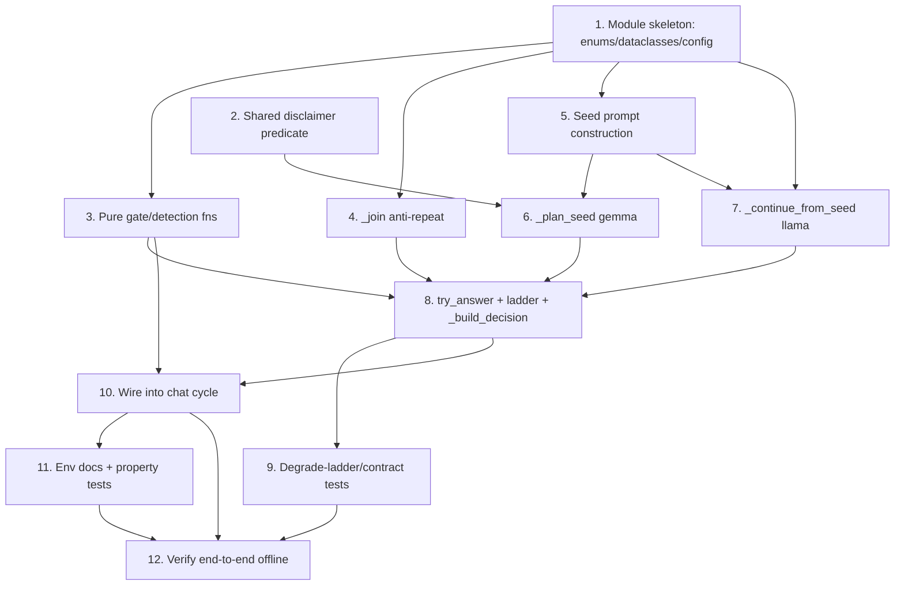

# Implementation Plan

## Overview

Build the `RelationalVoiceSeedAdapter` (gemma seed → llama continuation → join) and wire it into
`_run_chat_cycle_inner` behind a register-based gate with a configurable scope, keeping the A–D
patches as the downstream safety net. Work is ordered bottom-up: pure functions first (offline
testable), then the model-calling steps with fakes, then the chat-cycle wiring, then property
tests and verification.

## Task Dependency Graph



```json
{
  "waves": [
    { "wave": 1, "tasks": ["1", "2"], "parallel": true },
    { "wave": 2, "tasks": ["3", "4", "5"], "parallel": true },
    { "wave": 3, "tasks": ["6", "7"], "parallel": true },
    { "wave": 4, "tasks": ["8"], "parallel": false },
    { "wave": 5, "tasks": ["9", "10"], "parallel": true },
    { "wave": 6, "tasks": ["11"], "parallel": false },
    { "wave": 7, "tasks": ["12"], "parallel": false }
  ]
}
```

## Tasks

- [x] 1. Create the adapter module skeleton with enums, data models, and config
  - Created `src/runtime/relational_voice_seed_adapter.py` with `ChatRegister`, `VoiceSeedScope`,
    `RelationalAct`, `CognitionStance`, `SeedPlan`, `ContinuationResult`, and
    `RelationalVoiceSeedConfig.from_env` (scope default `social`).
  - _Requirements: 2.1, 8.1_

- [x] 2. Factor the disclaimer predicate into a shared, importable helper
  - Created `src/runtime/disclaimer_markers.py` (marker tuples + `normalize_guard_ascii` +
    `is_disclaimer_text`); `PostGenerationFiltersMixin._reroll_still_disclaimer` now delegates to it.
  - _Requirements: 6.1, 6.2_

- [x] 3. Implement the pure gate/detection functions with unit tests
  - [x] 3.1 `detect_relational_act` (ASCII-fold + precedence groups). _Requirements: 2.3, 10.1_
  - [x] 3.2 `classify_chat_register` (ti_mode + chat_act + code heuristic + perception → TASK). _Requirements: 1.1, 1.2, 1.4, 10.1_
  - [x] 3.3 `should_use_voice_seed` per the scope truth table. _Requirements: 2.2, 2.3, 2.4, 2.5, 10.1_
  - [x] 3.4 Unit tests for register/detection/gate + diacritic parity. _Requirements: 1.1, 1.2, 2.2, 2.3, 2.4, 2.5, 10.1_

- [x] 4. Implement `_join` (concatenation + anti-repeat) with unit tests
  - _Requirements: 3.4, 3.5, 10.1_

- [x] 5. Implement seed prompt construction
  - `_build_seed_system_prompt`/`_build_seed_user_prompt`/`_build_continuer_system_prompt` reuse
    `STYLE_FALLBACK_PROMPT`, `SELF_IDENTITY_PROFILE_PROMPT`, `ANTI_DISCLAIMER_FEWSHOT`, flag imperatives;
    `derive_direction` per act.
  - _Requirements: 3.1, 3.2, 7.3_

- [x] 6. Implement `_plan_seed` (gemma planner) with error handling
  - _Requirements: 3.1, 3.2, 4.1, 5.2, 6.2_

- [x] 7. Implement `_continue_from_seed` (llama continuer) with error handling
  - _Requirements: 3.3, 4.1, 4.3, 5.1_

- [x] 8. Implement `try_answer` orchestration + degrade ladder + `_build_decision`
  - _Requirements: 1.1, 4.1, 4.2, 5.1, 5.2, 5.4, 5.5, 7.1, 8.1_

- [x] 9. Write degrade-ladder + contract tests with fake clients
  - `tests/test_relational_voice_seed.py`: normal join, seed-alone (429/timeout/empty/dirty-tail),
    legacy fall-through, one-call-each, never-raises, never-empty.
  - _Requirements: 4.1, 5.1, 5.2, 5.4, 5.5, 10.2_

- [x] 10. Wire the adapter into the chat cycle
  - [x] 10.1 `_ensure_relational_voice_seed_adapter` in `state_commit_service.py`. _Requirements: 8.4_
  - [x] 10.2 `_build_relational_voice_stance` in `chat_cycle.py` (no extra model call). _Requirements: 1.4, 3.1_
  - [x] 10.3 `_build_relational_voice_seed_decision` (gate + try_answer, defensively wrapped). _Requirements: 1.1, 1.2, 2.x_
  - [x] 10.4 Hook in `_run_chat_cycle_inner` after memory-recall/upstream routes, before generation. _Requirements: 1.3, 6.3, 7.2, 8.2, 8.3_

- [x] 11. Add env documentation and property-based tests
  - [x] 11.1 Documented `ERIS_VOICE_SEED_SCOPE` + token/timeout knobs in `.env.example`. _Requirements: 2.1, 9.3_
  - [x] 11.2 Hypothesis property tests: gate truth-table parity + try_answer totality/one-call. _Requirements: 10.3_

- [x] 12. Verify end-to-end offline
  - 51 new tests pass; changed modules diagnostics-clean and import without cycles.
  - Confirmed perception/screen queries route to TASK (legacy path), social turns route to adapter.
  - Pre-existing unrelated failure (`test_live_observation_query_bypasses_repeat_guard...`) confirmed
    failing on clean `main` via git stash — not caused by this work.
  - _Requirements: 1.1, 1.2, 9.1, 10.2_

## Notes

- The spec dir name stays `relational-voice-seed`; the mechanism is the register-default voice-seed
  pipeline (see design.md naming note). The `RelationalVoiceSeed*` symbol names are kept.
- A–D (`runtime/post_generation_filters.py`, `llm/service.py`, `cortex/conversation_dynamics.py`)
  stay in place as the safety net; task 2 only factors the disclaimer predicate so the adapter can
  reuse it without depending on the coordinator instance.
- All model calls are bounded to one gemma + one llama per turn (DD-3); 429 handling is delegated
  to the existing in-client `key_pool.rotate()` — do NOT add adapter-level retry loops.
- Default scope is `social`; `off` collapses the feature back to the A–D net only.
- Screen/vision/perception questions are routed to TASK (legacy grounded path) so the adapter never
  fabricates a persona answer to "what is on my screen".
- Running build lives at `Documents\eris\src` while edits are in `Documents\GitHub\eris\src` —
  sync/build the running copy before live testing.
