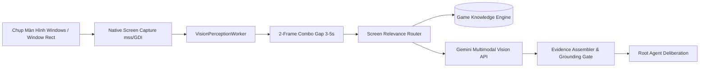
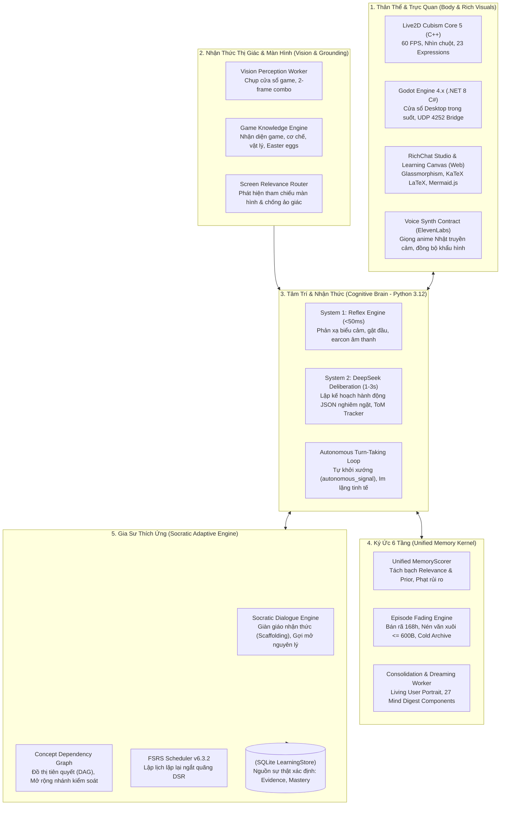

# Eris AI: Sinh Thể Số Đồng Hành, VTuber Tự Trị & Nhận Thức Đa Thức (Multimodal Autonomous Companion)

<p align="left">
  
  
  
  
  
  
</p>

> 🌟 **Eris** là một sinh thể số đồng hành trên desktop Windows (Digital Companion) kiêm AI VTuber tự trị. Eris sở hữu thân thể **Live2D Cubism 5 Native (60 FPS)**, hệ thống **nhận thức màn hình theo thời gian thực (Real-time Screen Vision & Game Grounding)**, bộ não suy luận 2 cấp độ **DeepSeek Deliberation System 1 & 2**, vòng lặp tự trị **Autonomous Turn-Taking Loop** (phong cách Neuro-sama), lõi gia sư Socrates thích ứng (**ErisTutor**) và hệ thống ký ức 6 tầng độc lập.

> [!IMPORTANT]
> **Lưu ý về các công cụ & phân hệ mở rộng (Tools / Ecosystem):**  
> Các công cụ tự động hóa và phân hệ cổng dịch vụ ngầm (Whale2API, Gemini Vision Docker, Account Hub, v.v.) hiện được **giữ ẩn (private / internal)** để bảo mật và tránh lạm dụng upstream.  
> Nếu bạn muốn nhận trọn bộ công cụ hoặc cần hỗ trợ cài đặt & cấu hình trọn gói, vui lòng liên hệ trực tiếp:  
> 👉 **Facebook:** [https://www.facebook.com/khong.co.gi.dac.biet.none/](https://www.facebook.com/khong.co.gi.dac.biet.none/)

---

## 📖 Mục Lục

1. [Tổng Quan Cốt Lõi](#-tổng-quan-cốt-lõi)
2. [Hệ Thống Nhận Thức Màn Hình & Game Grounding (Mới Hoàn Thiện)](#-hệ-thống-nhận-thức-màn-hình--game-grounding-mới-hoàn-thiện)
3. [Vòng Lặp Tự Trị & Tố Chất Co-host (Autonomous Turn-Taking)](#-vòng-lặp-tự-trị--tố-chất-co-host-autonomous-turn-taking)
4. [Kiến Trúc Tổng Thể 5 Trụ Cột](#-kiến-trúc-tổng-thể-5-trụ-cột)
5. [Thân Thể Live2D & Khế Ước Ngôn Ngữ Đa Ngữ (Polyglot Pipeline)](#-thân-thể-live2d--khế-ước-ngôn-ngữ-đa-ngữ-polyglot-pipeline)
6. [Lõi Gia Sư Socrates Thích Ứng (ErisTutor Engine)](#-lõi-gia-sư-socrates-thích-ứng-eristutor-engine)
7. [Hệ Thống Ký Ức 6 Tầng (Unified Memory Kernel)](#-hệ-thống-ký-ức-6-tầng-unified-memory-kernel)
8. [Ranh Giới Quyền Sở Hữu & Quy Tắc An Toàn (Invariants & Safety)](#-ranh-giới-quyền-sở-hữu--quy-tắc-an-toàn-invariants--safety)
9. [Cấu Trúc Thư Mục Dự Án](#-cấu-trúc-thư-mục-dự-án)
10. [Yêu Cầu Môi Trường & Cài Đặt](#-yêu-cầu-môi-trường--cài-đặt)
11. [Khởi Chạy & Kiểm Thử](#-khởi-chạy--kiểm-thử)
12. [Bản Đồ Tri Thức Kỹ Thuật (Knowledge Atlas)](#-bản-đồ-tri-thức-kỹ-thuật-knowledge-atlas)

---

## 💡 Tổng Quan Cốt Lõi

Eris **không phải** là một chatbot hỏi-đáp bài tập đơn thuần hay một lớp vỏ bọc LLM (LLM wrapper) thụ động. Eris được thiết kế để trở thành:

* **Sinh Thể Số Đồng Hành (Digital Companion - INFJ 5w4 / Tritype 594)**: Hiện diện nhẹ nhàng trên màn hình desktop (`ambient_copresence`). Thấu hiểu tâm lý qua Thuyết Tâm Trí (Theory of Mind), tôn trọng sự tĩnh lặng khi bạn làm việc, và kiên quyết loại bỏ mọi văn mẫu chăm sóc khách hàng rỗng tuếch (`social_surface_chatter_dislike`).
* **Co-Host & Game Companion Tự Trị**: Cùng chơi game và bình luận trực tiếp với người dùng. Nhờ hệ thống thị giác đa phương thức, Eris đọc được text trong game, nhận biết con trỏ chuột, theo dõi trạng thái vật lý của trò chơi và chủ động tung hứng đùa giỡn, giữ nhịp tương tác tự nhiên.
* **Quyền Lực Phát Ngôn Duy Nhất (Single Speech Authority)**: Toàn bộ phản xạ và lời nói của Eris đều trải qua chu trình kiểm duyệt khắt khe từ `Root Agent` / `ConversationDirector`, đồng bộ chuẩn xác với âm thanh và khẩu hình nhân vật.
* **Gia Sư Socrates Thích Ứng (ErisTutor)**: Dẫn dắt người học qua Vùng Phát Triển Gần Nhất (Vygotsky ZPD), dựng giàn giáo nhận thức (Scaffolding 4 cấp độ), chẩn đoán ngộ nhận (`misconception`) dựa trên Concept DAG và thuật toán **FSRS v6.3.2**.

---

## 👁️ Hệ Thống Nhận Thức Màn Hình & Game Grounding (Mới Hoàn Thiện)

Phân hệ thị giác và nhận thức màn hình vừa được đại tu toàn diện, biến Eris thành một AI bạn cùng chơi game (gaming buddy / co-host) thực thụ:



### Các Đặc Tính Nổi Bật Vừa Triển Khai:
1. **Phân Tích 2 Khung Hình Động (2-Frame Combo Analysis)**:
   * `VisionPerceptionWorker` tự động bắt cặp 2 khung hình liên tiếp cách nhau 3–5 giây (`combo_gap`).
   * Giúp mô hình thị giác phân tích được **chuyển động**, sự thay đổi hành vi (ví dụ: con trỏ chuột di chuyển từ nồi nấu lên kệ tủ, trang sách công thức vừa được lật, nước tràn khỏi bồn rửa).
2. **Game Knowledge Engine (`src/screen/game_knowledge.py`)**:
   * Tự động nhận diện cửa sổ game đang hoạt động thông qua tiêu đề cửa sổ và tiến trình.
   * Nạp tri thức nền tảng về cơ chế game (ví dụ: *Little Chef* – sandbox vật lý 2D, kéo thả nguyên liệu, vòi nước ngập bếp, phím tắt `R` để reset bàn, các công thức meme độc lạ như *bánh mì mix dao*, *cassoulet đóng hộp Paris*, nhân vật *Shane* đòi ăn đất).
   * Giúp Eris hiểu sâu bối cảnh và bình luận chính xác từng chi tiết mà không cần người dùng giải thích.
3. **Bộ Định Tuyến Thích Ứng & Chống Ảo Giác (Screen Relevance & Grounding Guard)**:
   * Giới hạn trần tin cậy thị giác (`cap=0.35`) đối với các hình ảnh chưa có bằng chứng xác thực (`source grounding`).
   * Nhận diện hồi chỉ thị giác (Visual Anaphora: *"cái này"*, *"món kia"*, *"xem màn hình đi"*), kích hoạt chụp tức thì và gửi vào context hội thoại.
   * Kiểm thử tự động chuyên sâu: Đã bổ sung bộ test `tests/test_game_and_vision_grounding.py` với **21 test cases pass 100%**.

---

## 🎙️ Vòng Lặp Tự Trị & Tố Chất Co-host (Autonomous Turn-Taking)

Eris không chỉ trả lời khi được hỏi, mà chủ động tương tác như một con người thực thụ:

* **Chủ Động Phá Vỡ Im Lặng (`autonomous_signal`)**:
  Khi phát hiện người chơi đang lúng túng ở menu quá lâu, hoặc vừa tạo ra một tình huống hài hước trong game (như nước ngập bãi chiến trường), Eris tự động phát ngôn trêu chọc và khích lệ.
* **Im Lặng Tinh Tế (Intelligent Silence / `no_reply`)**:
  Eris biết khi nào **không nên nói**. Trong các tình huống người dùng đang tập trung kéo thả chuột, đọc mô tả món ăn, hoặc khi vừa dứt lời một câu thoại dài, Eris ghi nhận lý do im lặng (`no_reply: Người chơi đang thao tác chuột, tránh nghẽn mạch`) thay vì spam thoại chèn ngang.
* **Khí Chất Đồng Hành INFJ 5w4**:
  Lối nói chuyện sắc sảo, tự nhiên, mang phong vị mạng xã hội Việt Nam ("sếp" và "đệ đệ", tự giễu cợt, bắt bài trò đùa của người chơi), hoàn toàn thoát khỏi lối mòn của trợ lý ảo thông thường.

---

## 🏛 Kiến Trúc Tổng Thể 5 Trụ Cột



---

## 🎭 Thân Thể Live2D & Khế Ước Ngôn Ngữ Đa Ngữ (Polyglot Pipeline)

### 1. Kiến Trúc Kỹ Thuật Đa Tầng (Polyglot Stack)
* **C++ (Live2D Cubism Core SDK 05.01)**: Đồ họa nhân vật 60 FPS, hit-testing chuột xuyên thấu $< 10\text{ms}$, 23 biểu cảm (expressions), 4 nhóm chuyển động (`glance`, `ponder`, `tilt`, `settle`).
* **C# / .NET 8 (Godot Engine 4.x)**: Cửa sổ desktop không viền trong suốt (`transparent borderless`), điều phối IPC / UDP Socket Bridge.
* **Python 3.12 (Cognitive Brain & Runtime)**: Trái tim nhận thức trung tâm gồm Cortex INFJ 5w4, Vision Perception Worker, Unified Memory Kernel, và Socratic Tutor.
* **HTML5 / CSS3 / JavaScript (ES6+)**: Giao diện RichChat Studio và bảng vẽ số Learning Canvas.

### 2. Đường Ống Ngôn Ngữ Độc Đáo (Linguistic Pipeline)
* **Tiếng Việt (Cognitive Core)**: Ngôn ngữ tư duy nội tâm (Inner Deliberation), suy luận System 2 và lên ý tưởng hành động (`say`).
* **Tiếng Nhật (Speech Persona)**: Sau khi chốt ý phát ngôn tiếng Việt, module `tts_localizer` chuyển ngữ sang văn phong anime tiếng Nhật tự nhiên, truyền cảm.
* **ElevenLabs Streamed Voice**: Đồng bộ khẩu hình các nguyên âm $(A, I, U, E, O)$ của Live2D theo thời gian thực.
* **Tiếng Anh (Technical Grounding)**: Sử dụng cho thuật ngữ lập trình và schema API.

---

## 📚 Lõi Gia Sư Socrates Thích Ứng (ErisTutor Engine)

Khi người dùng chuyển sang chế độ học tập, Eris kích hoạt phân hệ sư phạm thích ứng:
* **Chống mớm đáp án (Anti-spoon-feeding)**: Tuyệt đối không giải hộ; dẫn dắt từng bước thông qua câu hỏi gợi mở Socrates.
* **Giàn giáo nhận thức 4 cấp độ (Scaffolding Levels 0–3)**: Từ gợi ý nguyên lý chung đến gợi mở kỹ thuật cụ thể.
* **Đồ thị khái niệm (Concept DAG)**: Quản lý cây tri thức môn học (ví dụ: Java Dependency Injection Pack).
* **Nguồn sự thật xác định (Deterministic SQLite)**: Điểm thành thạo (`mastery`) do SQLite lưu trữ độc quyền; LLM không có quyền tự ý sửa điểm.

---

## 🧠 Hệ Thống Ký Ức 6 Tầng (Unified Memory Kernel)

* **Unified MemoryScorer**: Tính điểm truy hồi dựa trên *Relevance*, *Prior*, và *Penalties*. Nguyên tắc bất biến: *"Prior không được cứu ký ức không liên quan"* (nếu $\text{relevance} < \text{min\_relevance}$, điểm tổng $\text{total} = 0.0$).
* **Episode Fading Engine**: Ký ức sự kiện suy giảm theo chu kỳ bán rã 168 giờ (7 ngày), sau đó được nén cô đọng dưới 600 bytes và chuyển vào Cold Archive.
* **Living User Portrait**: Chân dung người học sống động được củng cố trong chu kỳ "ngủ/mơ" (Dreaming Worker).

---

## 🔒 Ranh Giới Quyền Sở Hữu & Quy Tắc An Toàn (Invariants & Safety)

### 1. Bất Biến Kiến Trúc (Architectural Invariants)
| Phân hệ | Chủ sở hữu duy nhất | Điều cấm kỵ tuyệt đối |
| :--- | :--- | :--- |
| **Quyền phát ngôn** | `Root` / `ConversationDirector` | Cấm các daemon nền hoặc UI panel tự ý cướp kênh public speech. |
| **Bằng chứng & Mastery** | `LearningService` + `SQLiteStore` | LLM hay UI không được tự ý ghi đè phần trăm năng lực của người dùng. |
| **Ký ức cá nhân** | `living_user` (phạm vi riêng) | Không trộn lẫn cảm xúc riêng tư với đồ thị tri thức kỹ thuật. |

### 2. Quy Tắc An Toàn DeepSeek Web / Whale2API (Shumei Abuse Prevention)
Proxy cục bộ `http://127.0.0.1:5103` kết nối DeepSeek Web được giám sát chống bot nghiêm ngặt (Shumei Risk Control):
* ⚠️ **Khoảng chờ kiểm thử**: Giữa các request test phải cách nhau tối thiểu 3–5 giây; cấm gửi burst spam.
* ⚠️ **Giới hạn Payload**: Context không vượt quá 64 KB (~15.000 tokens); không nhồi raw memory dump dồn dập.
* ⚠️ **Tắt Thinking khi Test**: Luôn gửi `thinking: {"type": "disabled"}` khi test cổng 5103 để tránh phình token và lỗi rỗng upstream.
* ⚠️ **Bảo vệ tài khoản ngủ**: Giữ nguyên các tài khoản phụ ở trạng thái `discarded = 1`.

---

## 📁 Cấu Trúc Thư Mục Dự Án

```text
eris/
├── src/                               # Toàn bộ mã nguồn Runtime & Thân thể
│   ├── screen/                        # [MỚI] Nhận thức thị giác & tri thức game
│   │   ├── vision_perception_worker.py # Chụp màn hình, 2-frame combo, Gemini vision
│   │   ├── game_knowledge.py          # Cơ sở tri thức game (Little Chef, mechanics)
│   │   └── screen_relevance_router.py # Định tuyến truy vấn màn hình & chống ảo giác
│   ├── runtime/                       # Trục điều phối nhận thức, vòng lặp tự trị & hội thoại
│   │   ├── chat_cycle.py              # Chu trình hội thoại hợp nhất
│   │   ├── autonomous_loop_runtime.py # Vòng lặp tự trị nền (proactive turn-taking)
│   │   ├── conversation_trajectory.py # Quản lý quỹ đạo và xung lực hội thoại (v76)
│   │   ├── coordinator_bootstrap.py   # Khởi động và kết nối các dịch vụ lõi
│   │   ├── learning_core/             # Lõi học tập xác định (Evidence, Mastery, SQLite Store)
│   │   └── conversation/              # Hợp đồng prompt Root, Delivery Adapter, Surface
│   ├── memory/                        # Hệ thống ký ức 6 tầng
│   │   ├── living_user/               # Living User Portrait & Dreaming
│   │   ├── memory_scoring.py          # Unified MemoryScorer
│   │   └── episodic_memory.py         # Ký ức sự kiện & Episode Fading 168h
│   ├── cortex/                        # Nhận thức bậc cao, bản ngã INFJ 5w4, Thuyết tâm trí (ToM)
│   ├── llm/                           # AI Gateway, DeepSeek Process Manager & Web lanes
│   ├── body/                          # Cầu nối Godot C# (.NET 8), UDP listener & RichChat web
│   └── vision.py                      # Entrypoint điều phối cấp cao của Eris
├── data/                              # Dữ liệu game, cache tri thức, subject audit
├── docs/                              # Kho tài liệu tri thức kiến trúc toàn diện
│   ├── knowledge/                     # Các chuyên khảo kỹ thuật sâu (Runtime lessons, EQ, TTS...)
│   └── ERISTUTOR_DEEP_ARCHITECTURE_SPEC.md # Đặc tả kiến trúc lõi
├── tests/                             # Bộ kiểm thử tự động toàn diện (342 test cases)
│   ├── test_game_and_vision_grounding.py # [MỚI] Kiểm thử Game Knowledge & Screen Vision
│   └── ...                            # Các bộ test Live2D, Memory, Tutor, Cortex
├── tools/                             # Công cụ phụ trợ (whale2api, harvest)
├── run_eris.bat                       # Khởi chạy toàn bộ Eris Desktop (Godot + Python Runtime)
├── run_runtime.bat                    # Khởi chạy riêng biệt Python Cognitive Runtime (Console)
├── run_tests.py                       # Trình chạy kiểm thử tự động
├── pyproject.toml                     # Cấu hình dự án, dependencies và pytest
└── requirements-dev.txt               # Thư viện phát triển và CI
```

---

## 💻 Yêu Cầu Môi Trường & Cài Đặt

### 1. Yêu Cầu Hệ Thống
* **Hệ điều hành**: **Windows 10 / 11 (64-bit)** (bắt buộc do sử dụng Windows API: `msvcrt`, GDI, `CREATE_NO_WINDOW`, `tasklist`).
* **Python**: **Python 3.12** (khuyến nghị `3.12.x`).
* **.NET SDK**: **.NET 8.0 SDK** (dành cho phần Godot C# Live2D Body).
* **Godot Engine**: Godot 4.x hỗ trợ .NET/C# (nếu chạy kèm giao diện nhân vật Live2D).

### 2. Các Bước Cài Đặt

```powershell
# 1. Clone repository
git clone https://github.com/Gtvkun-ai/eris.git
cd eris

# 2. Khởi tạo môi trường ảo Python 3.12
python -m venv .venv
.\.venv\Scripts\Activate.ps1

# 3. Nâng cấp pip và cài đặt dependencies
python -m pip install --upgrade pip
pip install -r requirements-dev.txt

# 4. (Tùy chọn) Cài đặt asset Live2D Body
.\install_live2d_body.bat
```

> [!NOTE]
> File cấu hình `.env` và `config/secrets.json` sẽ được tự động tạo từ bản mẫu (`.example`) khi bạn khởi chạy ứng dụng lần đầu. Cập nhật các API key (Gemini, DeepSeek, ElevenLabs) trong các file này.
>
> 🛠️ **Các công cụ tự động hóa & cổng kết nối ngầm (Whale2API, Gemini Vision Docker, Account Hub) hiện đang được ẩn.** Nếu bạn cần hỗ trợ cài đặt hoặc muốn sở hữu bộ công cụ hoàn chỉnh, vui lòng inbox: [Facebook](https://www.facebook.com/khong.co.gi.dac.biet.none/).

---

## 🚀 Khởi Chạy & Kiểm Thử

### 1. Khởi Chạy Ứng Dụng

| Lệnh thực thi | Mô tả |
| :--- | :--- |
| `.\run_eris.bat` | Khởi chạy toàn diện **Eris Desktop** (Thân thể Live2D Godot GUI + Não bộ Python Runtime). |
| `.\run_runtime.bat` | Khởi chạy riêng biệt **Python Cognitive Runtime** (chế độ dòng lệnh / headless). |

### 2. Chạy Toàn Bộ Kiểm Thử Tự Động (CI Gate)

Mọi tính năng mới đều phải vượt qua 100% các bài kiểm thử unit & integration:

```powershell
# Thiết lập biến môi trường chuẩn UTF-8
$env:PYTHONUTF8 = "1"

# Thực thi toàn bộ 342 test cases
.\.venv\Scripts\pytest.exe tests/ -q
```

**Kết quả kiểm tra thực tế:**
```text
342 passed, 10 warnings in 45.14s (100% PASS)
```

---

## 📚 Bản Đồ Tri Thức Kỹ Thuật (Knowledge Atlas)

Để hiểu sâu các quyết định thiết kế và bài học vận hành, tham khảo các tài liệu trong [`docs/`](docs/):

* **Bài Học Điều Tra Runtime & Phòng Chống Bot**:
  * [2026-10-14: Bài học điều tra runtime Eris](docs/knowledge/2026-10-14-eris-runtime-lessons.md)
  * [2026-11-13: Phòng chống cấm ngôn DeepSeek Web qua Whale2API](docs/knowledge/2026-11-13-deepseek-web-abuse-prevention.md)
* **Ký Ức & Nhận Thức**:
  * [ARCH-MEM-01: Trọng số & Công thức MemoryScorer](docs/knowledge/2026-11-08-memory-scoring-weights-and-prior-architecture.md)
  * [ARCH-MEM-03: Ký ức sự kiện & Episode Fading 168h](docs/knowledge/2026-11-08-episodic-memory-and-episode-fading.md)
  * [ARCH-COG-01: Tâm lý học nhận thức & Persona INFJ 5w4](docs/knowledge/2026-11-08-cognitive-psychology-and-persona-infj.md)
* **Thân Thể & Giọng Nói**:
  * [ARCH-LANG-01: Polyglot Tech Stack & Khế ước ngôn ngữ](docs/knowledge/2026-11-08-polyglot-tech-stack-and-linguistics.md)
  * [2026-11-05: Kiểm tra biểu cảm & rig Live2D](docs/knowledge/2026-11-05-live2d-expression-audit.md)
  * [2026-10-18: Độ trễ Token & Kết nối IPv4/IPv6 ElevenLabs](docs/knowledge/2026-10-18-elevenlabs-token-ipv6-latency.md)

---

<p align="center">
  Phát triển với sự tận tâm bởi đội ngũ <b>Eris AI</b> • 2026
</p>
