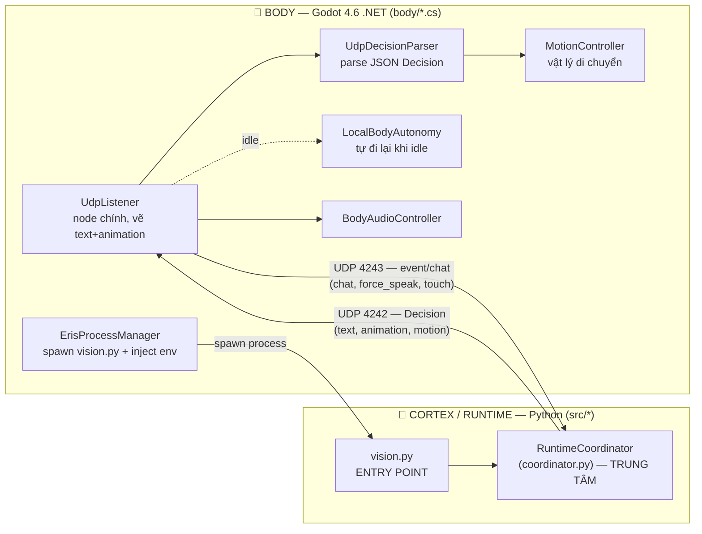
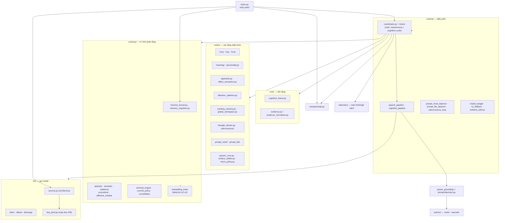
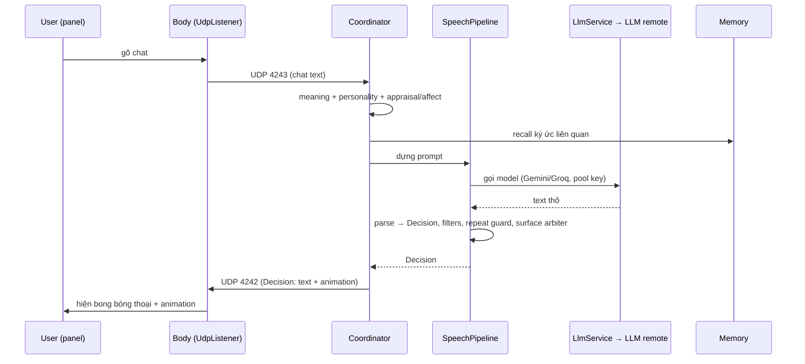
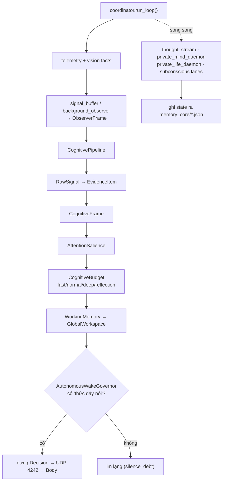
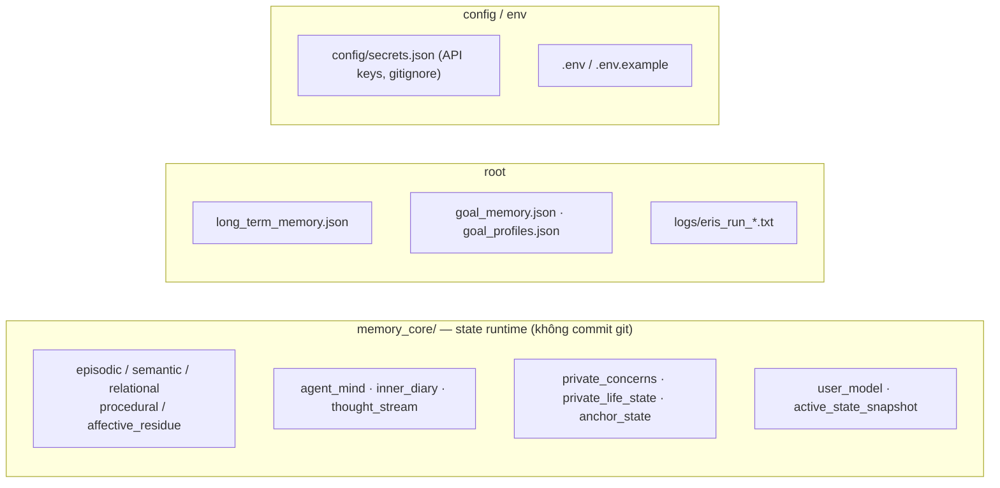

# ERIS — Sơ đồ kiến trúc (graph)

Tài liệu này tóm tắt repo bằng sơ đồ Mermaid cho dễ nhìn. Đọc kèm `tongquat.txt`
(bản đồ file-to-file chi tiết) và `README.md` (cài đặt/cấu hình).

> Mẹo: mở file này trong Kiro hoặc GitHub để xem Mermaid render thành hình.

---

## 1. Hai nửa hệ thống (Body ↔ Cortex qua UDP)

---

## 2. Bản đồ thư mục `src/` (vai trò từng nhóm)

---

## 3. Luồng dữ liệu — lượt chat của user

---

## 4. Vòng tự chủ (autonomous — khi không chat)

---

## 5. State trên đĩa (đọc khi debug "nhớ/quên gì")

---

### Kênh UDP (nhắc nhanh)
- `127.0.0.1:4242` — CORTEX → BODY (Decision: text, animation, motion, debug)
- `127.0.0.1:4243` — BODY → CORTEX (event: chat_start/end, chat text, force_speak, touch)
